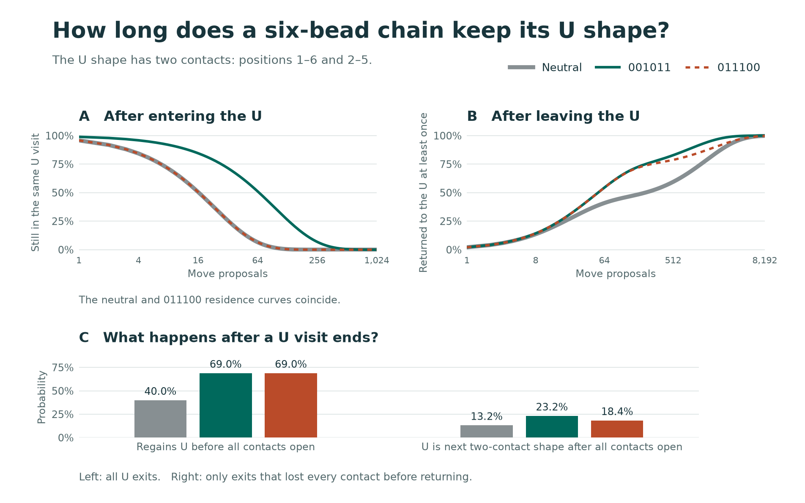

# How long does the six-bead chain keep or recover its U shape?

The supplied order changes the lifetime of a U-shaped bend. With attraction enabled, an average U visit lasts **96 move proposals** for `001011` and **24** for `011100`. Both orders often regain the U while another contact is still in place. Once every contact has opened, the next two-contact shape is the U in only **23.25%** and **18.37%** of those excursions. The evidence supports a bend with a sequence-dependent lifetime. Several competing shapes remain accessible after opening. [Frozen protocol](protocol.md) · [Earlier equilibrium study and drawing of the U](../chain-structure-01/README.md)



## Residence and return

The U holds both the 1–6 and 2–5 contacts. The eight oriented conformations with exactly those contacts form a single shape up to rotation and reflection. We start the residence clock at entry and the return clock at exit, weighting each actual crossing by its equilibrium frequency. The time units below are individual proposals under the original single-bead move rule. [All eight maps and the individual 2–5 contact](results/targets.tsv) · [First-passage distributions](results/curves.tsv)

| U-shape measurement | Neutral, either order | 001011, attraction | 011100, attraction |
| --- | ---: | ---: | ---: |
| Equilibrium occupancy | 2.82% | 24.43% | 4.32% |
| Mean residence, proposals | 24 | 96 | 24 |
| Median residence, proposals | 17 | 67 | 17 |
| Mean return time from exit, proposals | 828 | 297 | 531 |
| Median return time from exit, proposals | 221 | 53 | 53 |
| Return within 128 proposals | 46.28% | 68.16% | 67.84% |

**Why the U lasts longer.** In every orientation of the U, two of the 48 possible bead/displacement proposals can change the shape. Both open the 1–6 contact and preserve 2–5. For `001011`, the ends are unlike and such a move is accepted one time in four. For `011100`, the ends are alike and the move is always accepted, as in the neutral control. The per-proposal probability of leaving is therefore 1/96 or 1/24. The first accepted shape change leaves the U in every arm. The longer residence comes entirely from waiting longer for that move. The individual 2–5 contact can survive changes elsewhere along the chain. Its mean residence is 336 proposals for `001011`, 192 for `011100`, and 48 under neutrality. [Target definitions and movement clocks](results/targets.tsv)

## What returns after the chain opens?

For either attractive sequence, **68.97%** of U exits regain the U before the chain reaches zero contacts. The neutral rate is 40.00%. Among excursions that do reach zero first, the table gives the first subsequent shape with two simultaneous contacts. The calculation retains the particular shape at first opening. A zero-contact chain can still be bent. [Return before opening](results/u.tsv) · [All competing shapes after opening](results/after_open.tsv)

| First two-contact shape after opening | Neutral | 001011 | 011100 |
| --- | ---: | ---: | ---: |
| 1–4 and 1–6 | 31.46% | 27.78% | 26.16% |
| **1–6 and 2–5 (original U)** | **13.17%** | **23.25%** | **18.37%** |
| 1–4 and 3–6 | 23.90% | 21.20% | 29.31% |
| 1–6 and 3–6 | 31.46% | 27.78% | 26.16% |

The U has its longest mean residence in `001011`, yet two other contact maps each occur more often than the U on first forming two contacts after opening. These measurements apply to the specified two-dimensional, six-bead dynamics. There is no conversion from proposals to physical time.

## Calculation and checks

We reconstructed the full 284-state transition matrix using the previous study's proposal slots and acceptance thresholds. Integer stationary flows balance on every edge. For each target, dividing its stationary mass by its outward crossing rate gives the mean residence. Using the outside mass gives the mean return interval, including arbitrarily long excursions. To count accepted shape changes, the numerator uses stationary non-self transition rates on the corresponding side. All clocks include the transition that ends the interval.

The plotted tails use transitions restricted to the starting side of the boundary. An independent first-passage solve reproduces the two U means, and the analytic geometric residence distribution reproduces its entire curve. For the opening calculation we first solved for the identity of the next two-contact map from every zero-contact shape. We then propagated those boundary values back to the actual U exit states, allowing direct return to end the excursion. Probability sums and equation residuals are checked by the numerical program.

All 192 fresh trajectories started in the stationary ensemble and ran for 32,768 proposals. Both seed blocks included every run. Across the 12 prespecified block comparisons the largest absolute discrepancy was 2.77 percentage points, within the four-point tolerance. These checks measure residence beyond 128 proposals and return within 128 proposals. Interval starts near the end of a run have a separate eligibility count. [Run ledger](results/runs.tsv) · [Block checks](results/blocks.tsv)

## Replay

Run from this directory with Python, NumPy, SciPy and Matplotlib. The reported calculation used CPython 3.12.16, NumPy 2.5.5, SciPy 1.18.1 and Matplotlib 3.11.2. Numerical tables are printed to 12 significant digits. The manifest covers the protocol, scripts, imported model files and numerical tables.

```sh
python3 -B residence.py
python3 -B plot.py
shasum -a 256 -c revision.sha256
```

The primary calculation is deterministic and uses no seeds. The trajectory check uses seeds 29825–29888. An independent integer ticket, drawn with the seed offset by one million, selects a starting state in proportion to its stationary weight. All arms for a seed share the same subsequent proposal stream. The `initial_state` column indexes the lexicographically sorted original walks from zero. The `--out` option of the numerical program selects an alternative results directory. The plot accepts `--results DIR` and `--out FILE`.
