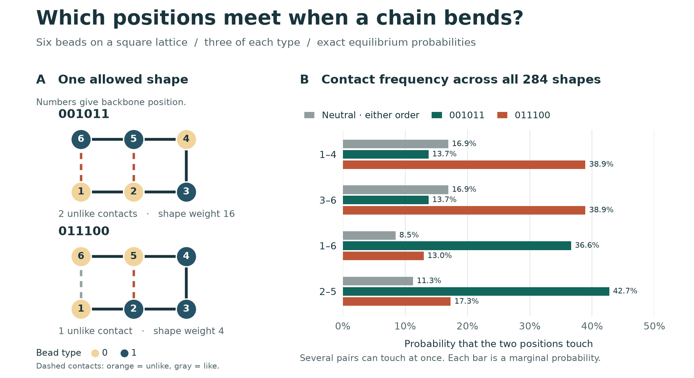

# Sequence order and intrachain contacts

The earlier pool experiment kept track of a chain's order and ancestry. This separate experiment gives each bead a position. Two chains with identical composition can now favor different arrangements in space. For the previously used orders `001011` and `011100`, positions 2 and 5 touch in **42.75%** and **17.30%** of their respective equilibrium ensembles. Both sequences have unlike beads at those positions. The rest of the chain changes how often that same favorable contact occurs. [Earlier pool experiment](../template-pool-01/README.md) · [Prespecified protocol](protocol.md)



## Exact result

Each chain consists of three beads of each type. Nonconsecutive beads can touch along an edge of a square lattice. Each unlike contact multiplies a conformation's weight by four. This numerical preference is a model input. The probability of any conformation follows by dividing its weight by the total for the sequence. Under the neutral control every conformation has weight one.

The 284 rooted, oriented walks yield eight geometric contact maps, including the empty map. Each of the four pairs in the figure can touch. All other nonconsecutive pairs have even sequence separation and occupy the same checkerboard color. Rows below give exact enumeration results rounded to two decimal places. [Exact integer masses by map](results/maps.tsv) · [All pair frequencies](results/pairs.tsv)

| Geometric observation | Neutral, either sequence | 001011, attraction | 011100, attraction |
| --- | ---: | ---: | ---: |
| No contacts | 57.75% | 31.30% | 22.16% |
| Exactly one contact | 30.99% | 30.53% | 47.57% |
| Exactly two contacts | 11.27% | 38.17% | 30.27% |
| Ends (1 and 6) touch | 8.45% | 36.64% | 12.97% |
| Positions 2 and 5 touch | 11.27% | 42.75% | 17.30% |

The total variation distance between the two indexed map distributions is **0.3815** under attraction and **zero** in the neutral control. Identifying a map with its chain reversal gives the same distances. Keeping only the number of contacts reduces the attraction distance to 0.1703. The positions of contacts therefore carry information beyond the amount of compaction. In the U shape in the figure, the 2–5 contact coexists with an unlike end contact in `001011` and a like end contact in `011100`. This is one geometrical contribution to the difference. [All prespecified contrasts](results/contrast.tsv)

Across all 20 equal-composition orders, the probability of any contact ranges from 61.68% to 84.05% under attraction. It is exactly 120/284 (42.25%) for every neutral sequence. Several different sequences share each value. Reversing an order reverses its indexed maps and exchanging all zeros and ones preserves its distribution exactly. [Census of all orders and contact counts](results/sequences.tsv)

## Local-motion check

Moving one bead at a time connects all 284 shapes. Every proposal has a reverse of the same multiplicity, every shape admits a stay, and the Metropolis acceptance probabilities satisfy detailed balance. Two independent enumeration methods agree on the shape set. Both checks run alongside the experiment. The clock counts simulation proposals.

For the neutral control and both attractive chains, 64 seeds each started once straight and once in the same compact U shape. All 384 trajectories gained and lost contacts during observation. Of 12 pooled comparisons against the exact equilibrium map law, **four exceeded the prespecified distance of 0.025**. All four were in the second seed block under attraction, from both starting shapes. Across the 12 comparisons, distances ranged from 0.0061 to 0.0329. Successive observations on a trajectory are correlated. [All seeds and map histograms](results/runs.tsv) · [Block diagnostics including flagged runs](results/sampler.tsv)

After inspecting these flags, we propagated the probability distribution through the original transition matrix for the original burn-in and sampling window. The largest distance from equilibrium for the expected window-average contact map was 0.00061 (rounded up). The specified initial shape accounts for little of the observed block deviations on this observable. The four original flags are retained. [Supplementary calculation](check_burn.py) · [Results for all six starts and arms](results/burn.tsv)

## Interpretation

A sequence-dependent local attraction and an excluded-volume backbone suffice here to bias the ensemble of contacts. Individual chains visit many maps. This result concerns a single intact chain on a two-dimensional lattice. A persistent fold would require a measure of residence and return at the same geometry. Interchain binding would require a second independently moving object, and catalysis would require a reaction with a measurable rate. The copying kernel and the earlier pool experiments have their own rules.

## Replay

From this directory, run the following commands. The two numerical programs use the Python standard library. The figure uses Matplotlib. The recorded run used CPython 3.12 and Matplotlib 3.11.2.

```sh
python3 -B run.py
python3 -B check_burn.py
python3 -B plot.py
shasum -a 256 -c revision.sha256
```

The manifest covers the numerical code, plotting code, protocol and numerical outputs. The PNG rendering can vary with fonts and library versions. The two numerical programs accept `--out DIR` for replay in a separate directory. In the tables, bit 0 of a contact mask denotes 1–4, bit 1 denotes 1–6, bit 2 denotes 2–5 and bit 3 denotes 3–6. Shape counts include rotations and reflections with bead 1 fixed at the origin. Each trajectory records 8,192 proposals after 1,024 burn-in proposals. Neutral runs are shared by both orders.
