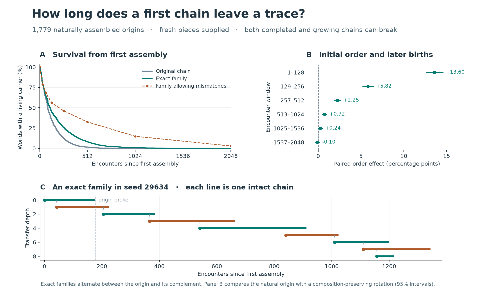

# How long does a naturally assembled sequence persist?

With fresh pieces arriving and chains breaking, 231 of 1,779 pools produced a new, exact copy of their first chain's order after that chain broke. The median time to irreversible loss of the exact family was 112 encounters from first assembly. Fifteen families were still present at encounter 1,024. The last disappeared at 1,360 and none reached 2,048. The pools themselves could keep building chains. [Primary protocol](protocol.md) · [Block and control totals](results/summary.tsv)



## Same first birth, four continuations

We replayed the 2,048 empty starts of template-pool-01. Exactly 1,779 produced a first unguided six-piece chain by encounter 160 (880 and 899 in the two historical blocks). The 269 nonstarters remain in the screening ledger. For each eligible seed we forked the entire chamber at that first birth, with its original free stock and partially assembled chains. Every arm started with the same sequence and placement, whatever order that seed happened to assemble. Age zero in the figure is that birth. The two factors were a supply of one piece of each type every fourth encounter and a 1/16 break probability at eight-encounter inspections. The origin's expected lifetime under breakage was 128 encounters and its observed median lifetime was 88. [Screening and original birth identities](results/screen.tsv) · [Original chamber rules](../template-pool-01/README.md)

An exact family includes its origin and every uninterrupted transfer from a member to its bitwise complement. Both alternating orders count. A new copy of the original order after origin death requires an even number of such transfers. Broader ancestry allows any sequence change but still requires an intact identified guide for every link from guide to completed product. Here a product is a new six-piece chain, and its guide retains its own six pieces. Unguided or interrupted completions cannot extend either lineage. A later occurrence of matching symbols has its own identity. [All chain identities, guide links, births and breaks](results/chains.tsv.gz)

| Outcomes among 1,779 matched pools | No feed, stable | Feed, stable | No feed, breakage | Feed and breakage |
| --- | ---: | ---: | ---: | ---: |
| Origin still intact at 2,048 | 1,779 | 1,779 | 0 | 0 |
| Exact family present at 2,048, including origin | 1,779 | 1,779 | 0 | 0 |
| Exact original-order birth strictly after origin broke | — | — | 183 | 231 |
| Median age at loss of exact family | Beyond window | Beyond window | 112 | 112 |
| Age by which 95% of exact families were lost | Beyond window | Beyond window | 552 | 608 |
| An intact chain present at close and a birth in the final 128 encounters | 0 | 1,779 | 0 | 1,770 |
| Intact chains at close with no birth in those final 128 encounters | 1,779 | 0 | 0 | 0 |
| No intact chains at close | 0 | 0 | 1,779 | 9 |

All eligible worlds made at least one further product in each arm. In the fed breakage arm, eight of the nine pools ending empty had also produced a chain during the final 128 encounters. Fresh pieces raised the number of worlds with a post-break original-order birth. Of the matched worlds, 181 succeeded in both breakage arms, 50 only with feed, two only without feed, and 1,546 in neither. Both fed blocks reached zero exact families at close. Their median loss ages were 104 and 120. Stable arms retain the actual origin throughout, so founder survival alone is sufficient to score presence there. [Every world and its endpoint](results/outcomes.tsv) · [Counts at fixed ages](results/survival.tsv)

## What continued after exact inheritance ended?

In 540 fed breakage pools an exact-family member outlived the origin. In 231 a descendant later produced the original order along that exact path. Seed 29634 illustrates the difference between surviving material and renewed assembly. Its origin 000001 broke at age 176. A living complement guided a new 000001 at age 205. The family eventually completed eight consecutive transfers and made another 000001 at age 1,157. Its last intact member broke at age 1,344. The latest loss across all seeds was at age 1,360 in seed 29499.

At the horizon, 51 pools still contained a descendant if mismatches were allowed along the guide path. In 166 pools a living chain carried the original order, and only two contained such a chain belonging to the broad founder family. Across the full window, 1,234 pools produced the original order again after their exact family had already disappeared. These returns can involve copying errors, interrupted prefixes and guides outside the exact family. The record supports loss of exact descent even in a pool where the same symbols later recur.

## How long did initial order affect the whole pool?

After seeing the primary loss results, we froze a supplementary comparison before running the new counterfactuals. Only the first chain's order was rotated by one position at its birth. Its piece composition, unfinished ends, surrounding stock and future random streams were matched. Rotations of 109 roots gave the same unordered sequence/complement pair, leaving 1,670 informative pairs. Every newly completed chain entered the analysis irrespective of ancestry. [Supplementary protocol](order-check.md)

| Encounters after first assembly | Advantage for the branch's own initial order and its complement, percentage points | Approximate 95% paired interval |
| --- | ---: | ---: |
| 1–128 | +13.60 | +12.63 to +14.56 |
| 129–256 | +5.82 | +5.23 to +6.41 |
| 257–512 | +2.25 | +1.89 to +2.61 |
| 513–1,024 | +0.72 | +0.49 to +0.95 |
| 1,025–1,536 | +0.24 | +0.02 to +0.46 |
| 1,537–2,048 | −0.10 | −0.33 to +0.12 |

For each world and window, take the share of new products matching the origin or its complement, subtract the share matching the competing rotation or its complement, and average this preference across the two branches, each favoring its own starting pair. An empty window contributes zero. The intervals use paired across-seed standard errors and are descriptive for individual windows. The final interval is compatible with zero and small residual effects. [Results and empty windows by block](results/order.tsv)

## Replay and scope

The primary protocol was committed as `a8f0a72` and the supplementary order comparison as `71425b9`. The original chamber, integer proposal streams and guide selection are reused verbatim from `47fab69`. Breakage and feed use time since first assembly. The attachment stream continues on the original absolute clock. Breakage exports the pieces of the affected chain as waste. Partial chains with two or more pieces can also break. If a guide breaks first, its unfinished product keeps any attached prefix but loses its guide. The ledger flags a resulting completion as interrupted. Offered feed above the free-piece cap of 64 per type is exported. All arms use the same underlying positional preference and the same single break rate where enabled. Other loss laws, fragment reuse, fidelity settings and longer observation windows remain untested. Encounters are simulator units.

The Python audit matched every historical empty-arm birth and all encounter-160 chamber ledgers. It independently reconstructed exact and broader ancestry, break times, resource balances for both piece types, and survival counts at all checkpoints. C++ controls cover a broken bound guide, breakage of an attached partial, release of an empty end, and a successful post-break return. Two optimization builds and reversed guide selection and break inspection produced byte-identical raw and derived tables. [Material ledgers](results/worlds.tsv.gz) · [Checksums](revision.sha256)

From the repository root with C++20, Make and Python 3.10 or newer, run the following. Matplotlib is needed for the PNG only.

```sh
study=experiments/template-persistence-01
make -C "$study" all test
"$study/build/persist" "$study/build/ordinary"
python3 -B "$study/analyze.py" "$study/build/ordinary" "$study/build/ordinary-results"
diff -qr "$study/results" "$study/build/ordinary-results"
make -C "$study" BUILD=build/replay CXXFLAGS='-O3 -Wall -Wextra -Werror' all test
"$study/build/replay/persist" "$study/build/reversed" --reverse
python3 -B "$study/analyze.py" "$study/build/reversed" "$study/build/reversed-results"
diff -qr "$study/results" "$study/build/reversed-results"
python3 -B "$study/plot.py" "$study/results" "$study/build/persistence.png"
shasum -a 256 -c "$study/revision.sha256"
```

Each chain ID is local to its world and arm. Sequence integers represent six bits including leading zeros. The first natural chain has ID 1. An absent guide, interrupted guide or break time is recorded as -1. A family loss time of -1 means right-censored at 2,048, including living original material where applicable. Birth and death ages are relative to the first assembly. The screening tick and the historical encounter-160 ledger use the original absolute clock.
