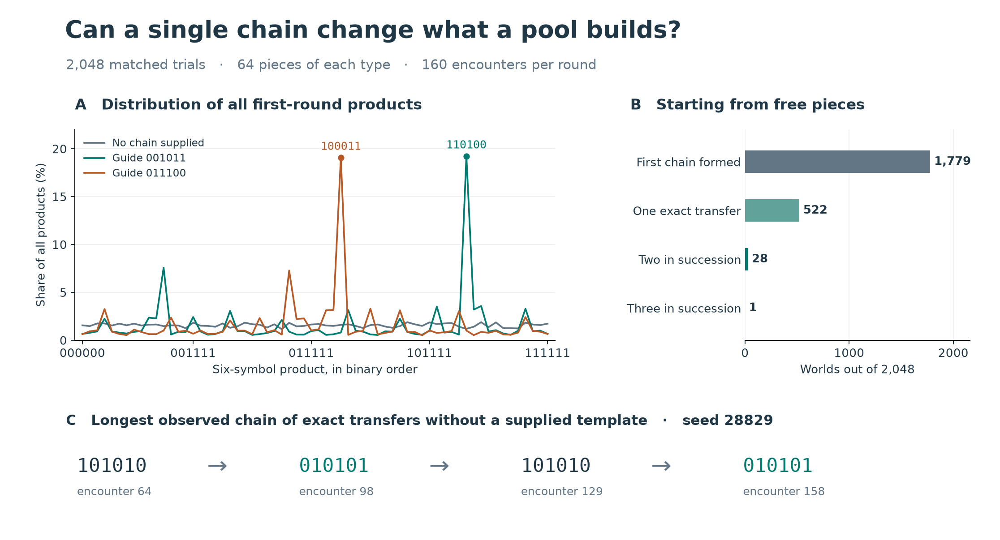

# Can one chain change what a pool of simple pieces builds?

A single six-symbol guide changed the sequence distribution of newly assembled chains in 2,048 paired digital trials. The mean share complementary to guide 001011 was 20.16% with the guide, 1.15% from free pieces alone and 1.50% with a guide that accelerated attachment equally for both types. Reordering the same six bound pieces moved the enrichment to the new complement. A randomly transferred product could bias a second pool after removal of the founder. This is an exploratory model of sequence transmission under a supplied pairing rule. [Frozen protocol](protocol.md) · [All paired differences](results/contrasts.tsv)



## What the chamber assumes

Every round starts with 64 free zeros, 64 free ones, four growing ends and 160 encounter opportunities. A founding or transferred guide is additional bound material. Growing ends retain every accepted piece. When an end first docks to a free guide, the piece opposite the corresponding guide symbol has acceptance probability 7/8 and the equal piece 1/8. An unguided end accepts either piece with probability 1/8. A position-blind guide accepts either with probability 4/8. Guide, material and encounter draws are paired across arms. A guide is temporarily occupied, releases at product completion and keeps its own pieces. Every completed six-piece product can immediately serve as a guide by the same rule. No operation constructs a whole sequence in one step. The code conserves each piece type including unfinished chains. [State transitions and controls](pool.cpp)

The four arms answer different questions. The empty arm measures assembly from free pieces, including subsequent guidance from its own products. The blind arm adds the same founder mass, docking and a sequence-independent acceleration. The reordered guide 011100 has the same three zeros and three ones as 001011. The template preference itself is assumed. The sequence distribution, yield and depth reached under finite opportunities are measured. The model has fixed orientation, guide registration, maximum chain length and immediate product release, with stable chains and an externally imposed encounter budget. It has no calibrated chemistry or energy ledger. The template-directed extension and mineral-surface experiments in the [source index](../../docs/references/README.md#origins-of-molecular-inheritance-2026-11-25) motivate the question. They do not supply the model parameters.

## First-round sequence distribution

| Initial condition | Complete products | Worlds with no completion / 2,048 | Mean share of 110100 |
| --- | ---: | ---: | ---: |
| Free pieces only | 4,626 | 269 | 1.15% |
| One position-blind 001011 | 12,074 | 0 | 1.50% |
| One active 001011 | 12,107 | 0 | 20.16% |
| One active 011100 | 12,135 | 0 | 1.00% |

The primary paired increase was 19.01 percentage points against the empty arm, with an approximate 95% interval of 18.22 to 19.80 points. The individual seed blocks gave +19.30 and +18.71 points. Against the blind guide the pooled increase was 18.66 points, with similar total yields. The reordered guide enriched its own complement 100011 to a mean share of 19.84%. In the figure, pooled shares weight each product equally. The table and paired contrasts instead give each starting world equal weight and a zero share to a world with no complete products. [All 64 sequences in every arm](results/spectra.tsv) · [World-weighted summaries](results/summary.tsv)

## Can one of the products transmit the effect?

At encounter 160 we drew one completed product uniformly, without looking at its sequence or provenance. The second pool received only this actual chain and fresh free pieces. Its two branches differed in whether the transferred chain retained its positional preference. In both branches subsequent completions guided normally. All 269 empty-arm worlds lacking a product received two fresh pools with no transfer and stayed in the denominators.

In the 001011 arm, the mean share complementary to the transferred product was 20.30% when it guided by position and 1.42% when blinded. The paired increase was 18.88 points (approximate 95% interval 18.11 to 19.64). Looking for the original 001011 sequence irrespective of the random transfer yielded 5.37% in the active second pool, compared with 1.41% after first-round assembly without a founder. [Both blocks and all branches](results/summary.tsv)

The identity ledger isolates a narrower two-step history. In 1,489 worlds the supplied founder directly guided at least one exact complement. In 355 worlds the random transfer chose such a child. In 257 of those 355, that very chain directly guided a return to 001011, compared with nine returns along the same contact route when its positional preference was disabled. Across all 2,048 starts, this is 12.55% versus 0.44%. Random transfer, the finite number of encounters and attachment errors all matter to this outcome. [Direct returns for both supplied sequences](results/returns.tsv)

## What happened without any initial guide?

A supplementary analysis traced exact transfers inside the first empty chamber, before the transfer or supply of fresh pieces. Each pedigree starts with a completely unguided assembly. Each later product must name the preceding physical chain as its guide and be its exact complement. Matching sequences elsewhere in a chamber cannot extend the path.

| Worlds reaching a stage | Block A / 1,024 | Block B / 1,024 | Total / 2,048 |
| --- | ---: | ---: | ---: |
| An unguided complete chain formed | 880 | 899 | 1,779 |
| A product served as guide for a later completion | 490 | 503 | 993 |
| At least one exact transfer from an unguided origin | 257 | 265 | 522 |
| Two consecutive exact transfers (original order recovered) | 14 | 14 | 28 |
| Three consecutive exact transfers | 0 | 1 | 1 |

In seed 28829 the first chain assembled from free pieces at encounter 64, carrying 101010. It guided 010101 at encounter 98. That individual guided 101010 at encounter 129, which guided 010101 at 158. The product IDs were 1, 2, 4 and 6. This is spontaneous assembly of a particular sequence and its short pedigree in a model where every completed chain already has guiding capacity. The 160-encounter window does not measure long-term persistence. [All background worlds and longest paths](results/background.tsv)

## Replay

Protocol commit `6e4e83b` precedes the outcome runs. Blocks A and B use seeds 27713–28736 and 28737–29760. A counter-indexed integer generator isolates encounters, guide choices and transfer draws across seed and round. Each optimization build produced identical chamber and product tables with reversed guide enumeration and end auditing. Synthetic controls cover single-piece selectivity, a position-blind reorder, exhaustion and unguided assembly. The independent Python audit reconstructs piece balances from all complete and partial chains, checks every encounter balance, verifies the transferred ID against the actual first-round product, and retains all 24,576 chamber records and 135,682 product records. Paired intervals use the mean within-seed difference plus or minus 1.96 standard errors. [Chambers and unfinished chains](results/worlds.tsv.gz) · [All product births and guide IDs](results/products.tsv.gz) · [File checksums](revision.sha256)

From the repository root with C++20, Make and Python 3.10 or newer, run the following. Matplotlib is needed only for the PNG.

```sh
study=experiments/template-pool-01
make -C "$study" all test
"$study/build/pool" "$study/build/ordinary"
python3 -B "$study/analyze.py" "$study/build/ordinary" "$study/build/ordinary-results"
diff -qr "$study/results" "$study/build/ordinary-results"
make -C "$study" BUILD=build/replay CXXFLAGS='-O3 -Wall -Wextra -Werror' all test
"$study/build/replay/pool" "$study/build/reversed" --reverse
python3 -B "$study/analyze.py" "$study/build/reversed" "$study/build/reversed-results"
diff -qr "$study/results" "$study/build/reversed-results"
python3 -B "$study/plot.py" "$study/results" "$study/build/template-pool.png"
shasum -a 256 -c "$study/revision.sha256"
```

Product IDs start at 1 within each chamber. Guide 0 identifies the supplied founder or the transferred chain, and -1 marks unguided growth. A partial is recorded as its piece string and bound guide ID. A dash denotes zero pieces. A world with zero completions can still have partial chains. In the background table depth -1 means no completed chain and depth zero means an unguided origin with no exact transfer observed.
