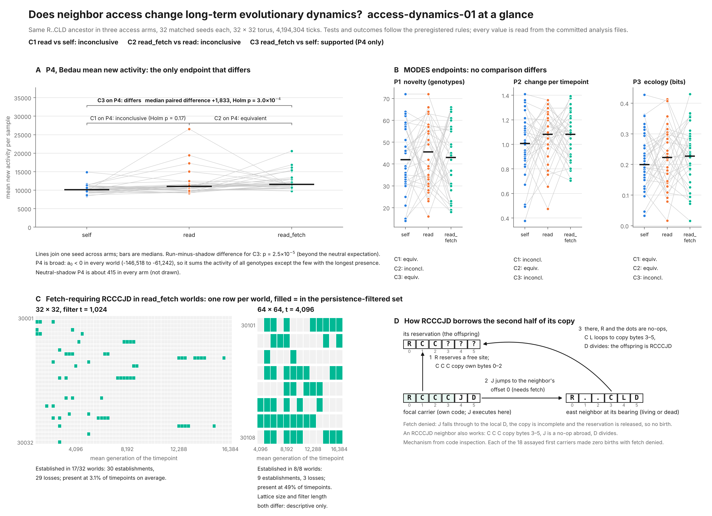
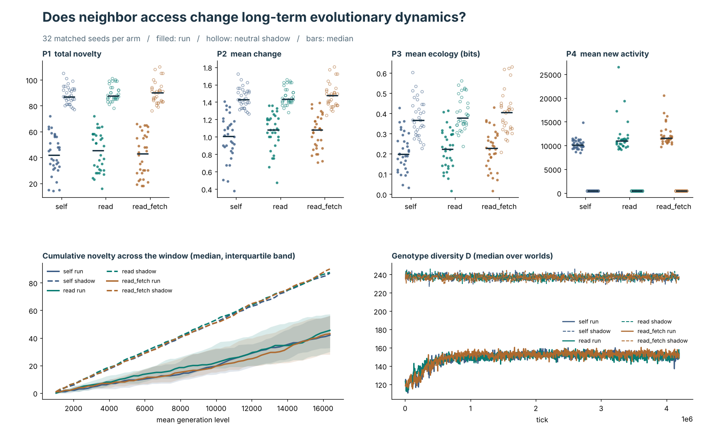
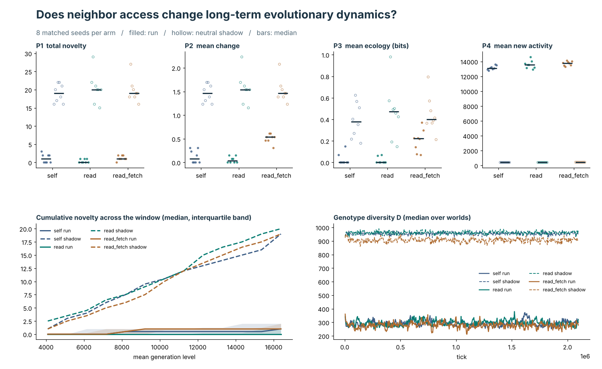

# Does neighbor access change long-term evolutionary dynamics?

Full neighbor access (reads plus instruction fetch) raised one preregistered statistic over self-only access in matched 32 × 32 worlds: Bedau's mean new activity (P4). The difference held in both seed blocks and exceeded the neutral shadow's. Under the frozen rules, claim C3 is therefore supported. No MODES endpoint (novelty, change, ecology) differed in any comparison. Neighbor reads alone (C1) and adding fetch to reads (C2) were inconclusive. All 96 worlds survived the 4,194,304-tick horizon. A fetch-requiring genotype, RCCCJD, passed the persistence filter in 17 of 32 read_fetch worlds. In five worlds it was the only filtered genotype at four or more consecutive timepoints. No read-requiring genotype passed the filter in any world. In a descriptive 64 × 64 check with a longer filter, RCCCJD was established in all eight read_fetch worlds. [Frozen protocol](protocol.md) · [Research brief](../../../docs/research/access-dynamics-rq.md) · [Generated analysis summary](results/analysis/summary.md)





## Claims under the preregistered rules

| Claim | Comparison | Outcome | Endpoints that differ | Equivalent | Inconclusive |
| --- | --- | --- | --- | --- | --- |
| C1 | read vs self | inconclusive | none | P1, P3 | P2, P4 |
| C2 | read_fetch vs read | inconclusive | none | P2, P3, P4 | P1 |
| C3 | read_fetch vs self | **supported** | P4 | P1 | P2, P3 |

A comparison differs on an endpoint when two conditions hold. Its exact two-sided Wilcoxon signed-rank p, Holm-corrected across all 12 tests, is below 0.05. The median paired difference has the same sign in seed blocks A (30001–30016) and B (30017–30032). An endpoint is equivalent when the 90% bootstrap interval of the mean paired difference lies within ±0.5 SD of the reference arm. [All tests](results/analysis/tests.tsv) · [Claim outcomes](results/analysis/claims.tsv)

| Claim | Endpoint | Median paired difference (A / B) | Holm p | 90% interval of mean difference | Equivalence bound | Outcome |
| --- | --- | --- | ---: | --- | ---: | --- |
| C1 | P1 total novelty | +4.5 (+5.5 / −1) | 1 | −3.9 to 7.7 | ±7.7 | equivalent |
| C1 | P2 mean change | +0.13 (+0.20 / −0.02) | 1 | −0.01 to 0.18 | ±0.13 | inconclusive |
| C1 | P3 mean ecology | +0.04 (+0.06 / −0.01) | 1 | −0.02 to 0.05 | ±0.05 | equivalent |
| C1 | P4 mean new activity | +784 (+269 / +819) | 0.17 | 542 to 2,534 | ±583 | inconclusive |
| C2 | P1 | −8.5 (−10.5 / −1) | 1 | −9.3 to 4.6 | ±7.7 | inconclusive |
| C2 | P2 | −0.07 (−0.15 / +0.04) | 1 | −0.09 to 0.07 | ±0.11 | equivalent |
| C2 | P3 | −0.01 (−0.01 / −0.01) | 1 | −0.04 to 0.04 | ±0.05 | equivalent |
| C2 | P4 | +559 (+1,632 / +319) | 0.84 | −798 to 1,725 | ±1,737 | equivalent |
| C3 | P1 | −1.5 (−2 / +2.5) | 1 | −6.2 to 5.3 | ±7.7 | equivalent |
| C3 | P2 | +0.11 (+0.14 / +0.08) | 1 | −0.02 to 0.16 | ±0.13 | inconclusive |
| C3 | P3 | +0.02 (+0.04 / +0.00) | 1 | −0.03 to 0.06 | ±0.05 | inconclusive |
| C3 | P4 | **+1,833 (+2,112 / +1,116)** | **3.0 × 10⁻⁴** | 1,237 to 2,754 | ±583 | **differs** |

For C3 P4, Glass's Δ against the self arm is 1.69. The run-minus-shadow difference between the same arms has an uncorrected exact Wilcoxon p of 2.5 × 10⁻⁵ and the same sign. The rules therefore label the result *beyond the neutral expectation*. This label is not an adaptation claim; the brief requires replay for that. Kruskal–Wallis across the three arms, reported only, gave p = 4.8 × 10⁻⁶ for P4 and p ≥ 0.40 for P1–P3. [Neutral comparison](results/analysis/neutral.tsv) · [Kruskal–Wallis](results/analysis/kruskal.tsv)

## Arm values

Medians over 32 worlds per arm. Shadow values use the shadow genealogy at the same filter length and, for P4, the run's thresholds. [Per-world endpoints](results/analysis/endpoints.tsv) · [Arm summary](results/analysis/arms.tsv)

| Arm | P1 run / shadow | P2 run / shadow | P3 run / shadow | P4 run / shadow | Window max complexity | Mean D run / shadow |
| --- | --- | --- | --- | --- | ---: | --- |
| self | 42 / 87 | 1.01 / 1.43 | 0.20 / 0.37 | 10,144 / 415 | 5 | 147 / 237 |
| read | 45.5 / 87.5 | 1.08 / 1.43 | 0.22 / 0.38 | 11,004 / 415 | 5 | 148 / 237 |
| read_fetch | 43 / 90 | 1.08 / 1.48 | 0.23 / 0.40 | 11,549 / 415 | 6 | 148 / 237 |

In every arm, runs had fewer genotypes passing the persistence filter, less change, lower ecology entropy and lower diversity than their neutral shadows. Per-world P4 values had a long upper tail in the read and read_fetch arms (largest values 26,547 and 20,587, against 14,896 for self). That tail is why the read arm's SD, 3,473, sets a wide equivalence bound for C2.

**What P4 measures here.** Each world's activity distributions first crossed their shadow's at a* = 2,048–2,656 ticks, with a_max ≈ 1.3–3.0 million. The brief's thresholds a₀, a₁ = a* ∓ 0.05 (a_max − a*) therefore put a₀ below zero and a₁ at 65,000–151,000 ticks. A_new thus sums the counters of every genotype present except the few with the longest presence, divided by D. A higher P4 means more accumulated presence among those non-dominant genotypes; this follows from the definitions, not from a separate measurement. P4 covers the whole horizon. The MODES window covers mean generations 1,024–17,408, about the first 0.72 million ticks; at H the mean generation was about 93,000. *Post hoc*, the read_fetch-minus-self difference in mean A_new was positive in each quarter of the horizon, in 19–22 of 32 seed pairs per quarter. It was similar whether or not RCCCJD was established in the read_fetch world (median +1,993 in 17 worlds, +1,807 in 15). These post hoc checks do not identify a mechanism.

## Strategies

Each genotype in a filtered set was classified by four lifetime forks at the birth of its first filtered carrier. [Classes per arm](results/analysis/strategies.tsv) · [Per-world episodes](results/analysis/strategy_worlds.tsv) · [Assays per world](results/primary/)

| Class | self | read | read_fetch |
| --- | --- | --- | --- |
| independent | 32/32 | 32/32 | 32/32, with 5 losses |
| fetch-requiring | 0/32 | 0/32 | **17/32** (95% CI 35–71%) |
| read-requiring, both-requiring, either-sufficient | 0/32 | 0/32 | 0/32 (one-sided 95% upper bound 8.9%) |
| template-only, other | 0/32 | 0/32 | 0/32 |

In the material genealogy every dependent genotype was the same six bytes, `RCCCJD`. Its first filtered carrier was assayed in 18 read_fetch worlds; in world 30018 it passed only under a sensitivity filter, at level 512. In each assay, the focal reproduced ordinarily (1–3 births) and with reads denied, and made zero births with fetch denied. In 15 of the 18 forks all six sites were informative. The executor genealogy, a sensitivity analysis, also classified `SJ.LDP` as fetch-requiring once (world 30009, one informative site).

*Code inspection* explains the dependence. `R` reserves. Three `C` instructions copy the first three own bytes. `J` then jumps into the neighbor at the CPU's bearing and fetches from its PC 0. If that neighbor carries `R..CLD`, its `R` is a no-op while a target is held. Its `C L` loop copies the remaining own bytes and its `D` divides. If the neighbor carries `RCCCJD`, its three `C` copy the rest, its `J` is a no-op abroad and its `D` divides. A cluster of RCCCJD carriers can therefore lend code to each other. A single substitution at offset 4 (`J`→`L`) gives the independent `RCCCLD`, which appeared in the filtered sets next to RCCCJD.

The establishments were transient: 30 episodes and 29 losses. Averaged over the 32 read_fetch worlds, RCCCJD was in the filtered set at 3.1% of window timepoints, and at most 8 of 61 in one world. In worlds 30007, 30011, 30016, 30026 and 30028, it was the only filtered genotype at four or more consecutive timepoints. At those times, every individual whose lineage persisted 1,024 generations carried RCCCJD. Four consecutive timepoints span 768 generations of mean depth. Continuous inheritance of RCCCJD between them was not traced; a genotype can also recur by substitution. The stage-1 fields were 16 × 4 and at most 8,192 ticks long. There, no confirmed changed program persisted beyond its first carrier without a supplied partner. In these larger fields, the fetch-requiring program's neighbors included its own kind.

## Sensitivity analyses (descriptive)

Each variant repeats the paired tests with Holm correction within the variant. [All variant tests](results/analysis/sensitivity.tsv) · [Variant claim outcomes](results/analysis/sensitivity_claims.tsv)

| Variant | Endpoints | Differs | Claim outcomes |
| --- | --- | --- | --- |
| Filter t = 256 | P1–P3 | none | all inconclusive |
| Filter t = 2,048 | P1–P3 | none | all inconclusive |
| Executor parentage | P1–P3 | none | all inconclusive |
| Informative-site components | P1–P3 | none | all inconclusive |
| Pooled thresholds (a* = 2,234, a₁ = 150,986) | P4 | C3 only: median +969, Holm p = 0.040, same sign in both blocks | C3 supported; C1, C2 inconclusive |

No variant found a MODES difference. The C3 P4 difference persisted under thresholds pooled across all 96 worlds.

**Boundedness (descriptive).** Arm-mean cumulative novelty was best fitted by a straight line in all three arms over the window. Arm-mean change and ecology were best fitted by a saturating exponential. Per world, cumulative novelty was linear in 22, 18 and 22 worlds (self, read, read_fetch); the rest were saturating, except one logarithmic. Novelty therefore did not saturate within the window. The genotype space is finite (4,826,809), so this is not evidence of unbounded growth. [Fits](results/analysis/boundedness.tsv)

## Demography and reach

All 96 worlds survived to H. No world was demographically or evolutionarily stagnant, and every world reached all 61 window timepoints. Per world, the population averaged about 843 of 1,024 sites. There were about 43.7 million births, 11.4% of them variation births. The mean generation interval was 41.1–42.3 ticks under either parent rule. Mean depth at H was about 93,300 generations in the run and 51,800 in the shadow. Shadow parents are drawn uniformly from the living, so a shadow generation spans the mean age of the living rather than the age at reproduction along run lineages. The 89–95 genotypes assayed per world (medians by arm) all reproduced their recorded births in the ordinary fork.

## Scale check (descriptive)

Seeds 30101–30108 ran in all three arms on a 64 × 64 torus for 2²¹ = 2,097,152 ticks, 24 worlds in all. The filter length was t = 4,096, with 13 timepoints from 4,096 to 16,384 generations. The brief runs no tests on this set. The paired counts below were computed from the endpoint table and are descriptive. [Scale summary](results/scale-analysis/summary.md) · [Per-world endpoints](results/scale-analysis/endpoints.tsv) · [Strategy episodes](results/scale-analysis/strategy_worlds.tsv)



| Arm | P1 run / shadow | P2 run / shadow | P3 run / shadow | P4 run / shadow | Window max complexity | Evolutionary stagnation | Fetch-requiring established |
| --- | --- | --- | --- | --- | ---: | ---: | ---: |
| self | 1 / 19 | 0.08 / 1.46 | 0.00 / 0.38 | 13,110 / 411 | 4 | 5/8 | 0/8 |
| read | 0 / 20 | 0.04 / 1.54 | 0.00 / 0.47 | 13,553 / 408 | 4 | 6/8 | 0/8 |
| read_fetch | 1 / 19 | 0.54 / 1.46 | 0.22 / 0.40 | 13,795 / 439 | 6 | 5/8 | 8/8 |

Medians over eight worlds per arm. All 24 worlds survived to H, none was demographically stagnant, and all reached the 13 timepoints. The population averaged 3,379–3,393 of 4,096 sites. Mean depth at H was 48,200–49,100 generations in the run and 25,700–26,300 in the shadow.

Few genotypes passed the longer filter. Median novelty was 0–1 in the runs against 19–20 in the shadows. In 16 of 24 worlds, no new genotype passed at any level from 12,288 to 16,384. In self and read worlds, the filtered sets were dominated by the independent `RCCCLD`, which had replaced the ancestor. Other genotypes passed at one or two levels.

In read_fetch worlds, `RCCCJD` was established in all eight (9 episodes, 3 losses). On average it was in the filtered set at 49% of timepoints, and in four worlds it was still there at 16,384. In worlds 30106 and 30107 it was the only filtered genotype until an independent genotype appeared in the window at 7,168 and 8,192. With two classes coexisting, read_fetch had higher change and ecology. P2 was higher than self in 7 of 8 seed pairs (one tie) and higher than read in 8 of 8. P3 was higher than self in 7 of 8 and higher than read in 8 of 8. Maximum complexity was 6 in every read_fetch world. P4 followed the primary order: read_fetch exceeded self in 7 of 8 pairs (median +693) and read exceeded self in 6 of 8 (median +381). The material genealogy classified no other genotype as dependent. The executor genealogy, a sensitivity analysis, also classified `RRJCLH` as both-requiring and `RSCCLD` as read-requiring once each, in world 30101.

Variation births were 10.5–10.7% of births in read_fetch worlds, against 11.5% in self and 11.6% in read worlds. In the primary set, all three arms were within 11.35–11.46%. This set changed both the lattice size and the filter length relative to the primary. It therefore cannot attribute RCCCJD's longer persistence, or the P2 and P3 differences, to population size alone. Worlds took 1,045–1,249 s each and about 170 MB of memory, run from revision `15ec77c` with the frozen files unchanged.

## Validation

Seeds 29901–29904 in all three arms for 65,536 ticks, the mutation-free self world for 2²⁰ ticks and the classifier controls passed all 61 checks. Observed and bare hashes matched. A perturbed shadow key left the run hash unchanged. All 56 assayed carriers reproduced their births. The mutation-free world had one genotype, zero change and ecology across all 61 timepoints, and complexity 4. The controls classified as independent, read-requiring and fetch-requiring. [Checks](results/validation/checks.tsv)

## Run record

- **Code and protocol.** Frozen in `d4416bd` before any study seed ran. [revision.sha256](revision.sha256) lists the digests that `run.py` checks before each set. Each world's `log.txt` records the command, the repository revision when the driver started (`06f84ec` for primary batches 1–7, `c8c00ef` after the restart), its final hash, wall time and peak memory. The kernel adds only the analysis hook `World::replace_bytes` (`5cacf82`) to the reference VM.
- **Batches.** Worlds ran in batches of eight, four at a time; each batch was committed and pushed. Primary worlds took 344–401 s each and 168–173 MB of memory.
- **Restart.** After batch 7 of the primary set, the driver was stopped and restarted detached, to avoid a two-hour limit on background commands. Its four unfinished worlds were rerun from scratch, and [progress.log](results/primary/progress.log) records the restart. No completed world was rerun or altered.
- **Plot.** [plot.py](plot.py) was written and tested on non-study seeds before any primary result was read. It is not part of the frozen analysis. The overview figure, [overview.py](overview.py), was drawn after the results from committed analysis files only; panel D is from code inspection.
- **Post hoc checks.** The P4 quarters and the RCCCJD timepoint listing above were computed after the frozen analysis and are labelled where used.

```sh
make -C kernel/runs/access-dynamics-01
python3 kernel/runs/access-dynamics-01/run.py validate
python3 kernel/runs/access-dynamics-01/run.py primary
python3 kernel/runs/access-dynamics-01/run.py scale
python3 kernel/runs/access-dynamics-01/analyze.py primary
python3 kernel/runs/access-dynamics-01/analyze.py scale
python3 kernel/runs/access-dynamics-01/plot.py primary
python3 kernel/runs/access-dynamics-01/plot.py scale
python3 kernel/runs/access-dynamics-01/overview.py
```

## What this does not show

- **Scope.** One ancestor, one mutation rate, six-byte genomes and one confirmatory lattice size; the 64 × 64 check is descriptive. Complexity is capped at six sites, and the question compares dynamics; it cannot show open-ended growth.
- **Combined access.** The arms change access to living, reserved and dead neighbors together. The P4 difference cannot be attributed to borrowed execution, dead bytes or any particular genotype without the reclamation comparison or replay experiments.
- **Weight of the support.** C3 rests on one of four endpoints. That endpoint's window includes most genotypes, a consequence of the brief's threshold rule at these activity ranges. The MODES endpoints, which filter for persistence, found no difference. Several MODES comparisons were inconclusive rather than equivalent, so small effects on them are not excluded.
- **Classes.** Strategy classes come from one recorded birth environment per genotype. RCCCJD's filter passages do not establish continuous inheritance.
