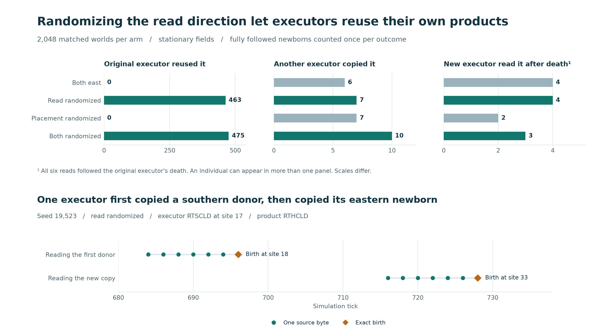

# Initial read direction accounts for repeated copying by the original executor

Across 2,048 matched stationary worlds, randomizing initial read direction alone produced 463 fully followed newborns that their original executor used to make a further exact copy. Randomizing initial placement direction alone produced zero. Both randomized produced 475 and both east produced zero. The increase in original-executor reuse occurred in both seed blocks. Handoff after the original executor died remained rare in all four arms. [Frozen protocol](protocol.md) · [Cohort and position counts](results/cohorts.tsv)



## What changed

A newborn normally starts facing east. In this experiment the initial direction used to select a template with S and the initial direction used to order the R search for a daughter site can differ. All four arms use stationary individuals, the same first-free search and ordinary competition. The placement setting changes the search order; the chosen neighbor must still be free and the executor must win the reservation. When both directions are randomized, they share one draw. A turn rotates both directions together. Division (including failed division) resets the executor to east for both functions. These experimental changes are applied to build-directory copies of the VM and observer. [Transition definitions](protocol.md) · [Reference transport study](../spatial-transport-01/README.md)

| Outcome | Both east | Read randomized | Placement randomized | Both randomized |
| --- | ---: | ---: | ---: | ---: |
| All births | 2,521,383 | 2,520,901 | 2,510,756 | 2,511,019 |
| Exact births from an unlike living template | 3,161 | 4,700 | 3,231 | 4,670 |
| Newborns with complete age follow-up | 3,031 | 4,529 | 3,102 | 4,467 |
| Newborns with incomplete age follow-up | 130 | 171 | 129 | 203 |
| Original executor used the newborn as an intact template | 0 | 463 | 0 | 475 |
| A different executor used the newborn as an intact template | 6 | 7 | 7 | 10 |
| A different executor began reading after the original executor died | 4 | 4 | 2 | 3 |
| Used by both original and different executors | 0 | 1 | 0 | 2 |
| Newborn also executed an exact self-copy | 1,908 | 2,938 | 1,923 | 2,901 |

Enrollment requires an executor that differs in sequence from the copied living individual. Each follow-up endpoint counts newborns once among those born by tick 1,967. An individual can both copy itself and supply its sequence to another executor. After-death use is a subset of different-executor use. For the second transfer, all executor sequences were eligible. In these data, restricting later handoffs to an executor whose genome differed from the product gave the same totals. Every arm had 2,048 reproducing populations at the cutoff, zero stagnant and zero extinct. [All world outcomes](results/fields.tsv) · [Per-world endpoints](results/endpoints.tsv)

### Where the large change arose

The read-only arm had 248 original-executor reuses in the pilot block and 215 in replication. The placement-only arm had zero in both. Expressed per 1,000 matched worlds, the read-only minus fixed difference was +226.1 newborns (approximate 95% interval +205.3 to +246.8). The additive interaction for original reuse was +5.9 (−23.6 to +35.3). For initial exact births, the corresponding read-only difference was +751.5 (+692.6 to +810.3) and the placement-only difference was +34.2 (−51.2 to +119.6). [Paired seed contrasts](results/contrasts.tsv)

Among completely followed newborns in the read-only arm, 1,997 landed east of their executor and 463 of those were reused by it (23.2%). None of the 2,532 newborns at other sites was reused by its original executor. For those 463, the initial donor was west in 159 cases, north in 153 and south in 151. The eastern site could therefore hold the new copy while the executor read the first donor. Following division, the executor again faced east. In the placement-only arm just 58 enrolled newborns landed east, with zero original reuses. This factorial result concerns the rule for choosing the initial read direction. The observed position of a newborn still mattered to the later copy.

In the plotted read-only example, the executor RTSCLD at site 17 read RTHCLD from site 1 to its south at ticks 684, 686, 688, 690, 692 and 694. An exact product appeared to its east at site 18 at tick 696. The same executor read those six bytes from that newborn at ticks 716, 718, 720, 722, 724 and 726. A second product was born at site 33 at tick 728. This is the first complete original-reuse case in seed and birth order in that arm. [Sources and first births](results/products.tsv) · [Each onward copy](results/links.tsv)

### When another individual took over

With read direction alone randomized, four after-death cases occurred in the pilot block and zero in replication. With both directions randomized the counts were one and two. Fixed controls gave three and one. The read-only minus fixed difference in total handoffs was +0.49 per 1,000 worlds (approximate 95% interval −2.38 to +3.36), and zero for after-death handoffs (−2.35 to +2.35). These few events establish that takeover is possible. They provide little precision on how strongly birth orientation changes its frequency.

Seed 19607 gives an example of why identity includes birth tick. At site 18 an RSRCLD executor born at tick 1309 copied RSHCLD into site 34 at tick 1358 and died at tick 1390. Another RSRCLD individual was born at the same site 18 at tick 1406. It read the site-34 individual at ticks 1427, 1429, 1431, 1433, 1435 and 1437 and produced RSHCLD at site 19 on tick 1439. The sequence and location of the two executors match, while their lifetimes are disjoint. [Transfer ledger](results/links.tsv)

## Measurement and replay

The reference revision is `50cd8cb`. Protocol commit `abce3bf` precedes new-arm runs. Both original seed blocks run to tick 2,048 on the 16 × 4 torus from one independent east-facing R..CLD at site 36. Neighbor reads, local instruction fetch, retained bytes, first-free placement, maximum age 80, 20,000 ppm copy substitution and deterministic synchronous updates follow the preceding study. The arm is part of replay configuration. The VM state hash includes any nonzero difference between a CPU's placement and read bearings. For the two historical arms the original hash format is reproduced exactly.

Each intact living-template birth records the donor and executor birth identities, product identity, six read ticks and six read sites. At each event the observer checks the source occupant against the opening state. The six reads must use offsets 0 through 5, match the output bytes and share the same living donor. In ledger order the six input and written bytes can thus be recovered from the product hex string. Link two births only when the earlier product individual is the later donor and the full genome agrees. The first onward read must be strictly later than the original executor's committed death for after-death credit. Reading on the death tick still sees the opening occupant. The world cutoff also bounds observable onward divisions, including divisions after their source died. Measurements here follow one onward transfer from the enrolled individual.

The fixed-program controls check all 16 read/placement combinations, rotation, successful and failed division resets, and hashing of split bearings. All fields, including both historical controls, were rerun; all 4,096 historical field rows and 7,831 enrolled birth rows match their archived values, including source read ticks and sites. Two optimized builds with opposite traversal orders reproduced all six tables byte for byte. Intervals are unadjusted paired normal approximations on world counts. A zero-width interval for two all-zero samples only describes the observed seed differences. [Source and result checksums](revision.sha256)

Run from the repository root with a C++20 compiler, Make, patch and Python 3.10 or newer. The figure uses Matplotlib.

```sh
study=kernel/runs/bearing-handoff-01
out=kernel/build/bearing-handoff
replay=kernel/build/bearing-handoff-replay
make -C kernel all test
make -C "$study" all test
mkdir -p "$out/example"
"$out/field" 19607 read "$out/example"
python3 -B "$study/run.py" "$out/field" "$out/results"
python3 -B "$study/analyze.py" "$out/results"
make -C "$study" BUILD=../../build/bearing-handoff-replay CXXFLAGS='-O3 -Wall -Wextra -Werror' all test
python3 -B "$study/run.py" "$replay/field" "$replay/results" --reverse
python3 -B "$study/analyze.py" "$replay/results"
diff -qr "$study/results" "$out/results"
diff -qr "$out/results" "$replay/results"
python3 -B "$study/plot.py" "$out/results" "$out/bearing-handoff.png"
shasum -a 256 -c "$study/revision.sha256"
```
