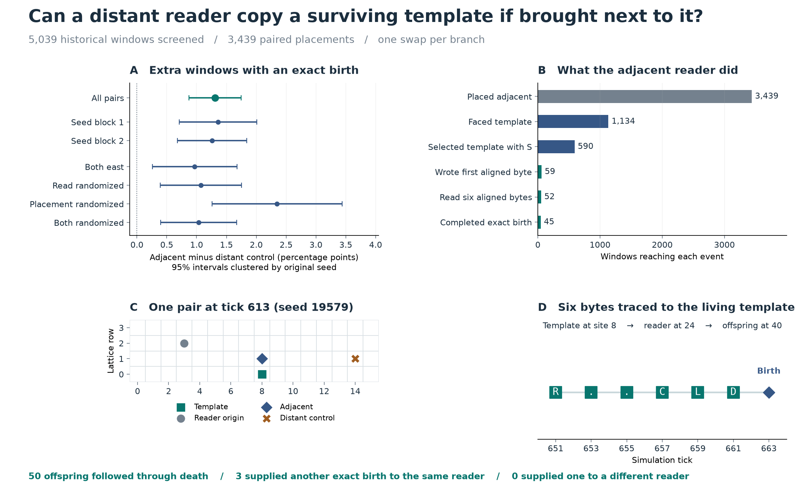

# Can a distant reader copy a surviving template if brought next to it?

One relocation gave 45 of 3,439 matched digital templates an exact birth after the individual that had produced them died. The same reader moved an equal distance to a nonadjacent site yielded zero such cases anywhere in the field. The 45 successful templates supplied 50 births, all executed by the relocated reader. When those 50 offspring were followed in the same fields, three supplied another exact birth to that reader. Zero supplied one to a different reader. [Paired protocol](protocol.md) · [Offspring follow-up protocol](product-followup.md)



## Paired effect

A case is a living six-byte template in an archived field after its original executor died. All 5,039 screened cases had a distant individual observed executing S (select the neighboring read source) in the untreated window. None had an adjacent S carrier. Each eligible case branches from one pre-instruction state. One branch exchanges the reader with an adjacent site, a second exchanges the same reader with a distant control site, and a third continues from the checkpoint without movement. The two moves match absolute wrapped displacement on each axis, destination bank kind and number of free cardinal neighbors immediately after the swap. Each branch then resumes stationary dynamics. The primary endpoint credits any other individual in the field that copies the six aligned bytes from this specific living template without substitution and produces an offspring. [Case selection and replay inputs](../handoff-window-01/README.md) · [Checkpoints, destinations and matching variables](results/screen.tsv)

| Cohort | Screened | Paired | Successful adjacent cases | Successful distant cases | Difference in percentage points (95% interval) |
| --- | ---: | ---: | ---: | ---: | ---: |
| All | 5,039 | 3,439 | 45 | 0 | 1.31 (0.87 to 1.74) |
| Seeds 19521–20544 | 2,518 | 1,695 | 23 | 0 | 1.36 (0.71 to 2.01) |
| Seeds 20545–21568 | 2,521 | 1,744 | 22 | 0 | 1.26 (0.68 to 1.84) |
| Both newborn directions east | 1,018 | 724 | 7 | 0 | 0.97 (0.26 to 1.68) |
| Read direction randomized | 1,483 | 1,024 | 11 | 0 | 1.07 (0.39 to 1.76) |
| Placement direction randomized | 1,064 | 724 | 17 | 0 | 2.35 (1.26 to 3.44) |
| Both directions randomized | 1,474 | 967 | 10 | 0 | 1.03 (0.40 to 1.67) |

There were 45 adjacent-only successes, zero distant-only successes and 3,394 pairs with neither. The ordinary continuation also had zero successes. The analysis weights each matched template once and clusters by original seed across templates and arms. The 3,439 pairs came from 1,314 of the 2,048 seeds, with successes in 37 distinct seeds. Intervals use a normal approximation to the seed-cluster sandwich variance of the paired mean. The move tests the effect of deliberately providing a historically active reader with local access in the eligible windows. Matching leaves differences in local layout, later competition and address-dependent mutation draws. A single targeted exchange does not estimate a rate of passive diffusion. [Paired differences, discordant counts and intervals](results/contrasts.tsv)

Matching succeeded for 68.2% of screened cases. In 1,084 windows every qualifying reader held an allocation whenever it was available before its next untreated S. For another 18 there was an available reader but no permissible adjacent destination. In 319 windows a control destination with matching displacement and bank kind was unavailable. In 179 the remaining pairs differed in free-neighbor count. Both destinations were occupied in 3,379 matches and free in 60. Displaced bytes were identical in 2,172 pairs. All living focal windows were fully observed. In 148 pairs the field cutoff shortened the additional follow-up allowed for pending divisions. [All screening outcomes](results/screening.tsv)

## Where copying stopped

Among the 3,439 readers placed adjacent, 1,134 ever faced the focal template, 590 actually selected it with S, and 141 held an allocation while their read pointer addressed it. There were 59 cases with an aligned first write, 52 with all six aligned reads from the living individual, and 45 with an intact product reaching division. The counts describe whether an event occurred at least once per window. In 2,089 cases the reader encountered a full neighborhood during a reservation attempt. An initial lack of space could resolve while the template was still alive. [All stages by arm and seed block](results/summary.tsv)

| At adjacent placement | Cases | Cases with a first write | Cases with an exact birth |
| --- | ---: | ---: | ---: |
| Facing away, no free neighbor | 2,139 | 3 | 0 |
| Facing away, at least one free neighbor | 259 | 2 | 2 |
| Facing template, no free neighbor | 938 | 41 | 34 |
| Facing template, at least one free neighbor | 103 | 13 | 9 |

Of 1,041 readers initially facing the template, 43 completed an exact birth, compared with two of the 2,398 initially facing away. Initial direction and free space describe naturally occurring subgroups within the contact branch. The trial manipulated reader position. [Opening state strata](results/initial-state.tsv)

The 59 cases generated 69 first-write allocations. Fifty produced an exact birth. Five divided after reading six aligned bytes with a substitution, and five divided using a mixture of sources. Five failed division after one write. Four executors died before division, three after six aligned unchanged writes and one after switching source identity. In seed 19579, the reader placed beside site 8 at tick 613 initially had zero free neighbors. It encountered a full neighborhood 35 times, then read R..CLD at ticks 651, 653, 655, 657, 659 and 661. It produced a copy at site 40 on tick 663, when the donor died. [All 69 allocations and per-byte traces](results/attempts.tsv)

## Could the 50 copies serve as templates again?

All 50 offspring were observed from birth through their own age death. Six supplied at least one qualifying first write to another individual, five supplied six aligned bytes, and three supplied an exact birth. One supplied two, for four further exact births. Every one of the seven initiated allocations was held by the same individual that had produced the offspring. Across all 50 offspring, including each interval after that reader died, no different executor initiated a first aligned write. The field cutoff shortened the additional post-death observation time in three cases. All initiated allocations in this follow-up terminated. [All 50 offspring and field endpoints](results/reuse.tsv) · [Seven allocation histories](results/reuse-attempts.tsv)

This establishes a second material transfer in three cases. It also identifies the continuing dependency in those transfers. The placed reader handled both divisions. An open question is how often a subsequent template can recruit another reader under unassisted local motion.

## Field outcomes and replay

All 8,192 untreated fields were reproducing at tick 2048, with zero stagnant or extinct. All 10,317 primary branch endpoints were reproducing under the same last-80-tick definition. Mean living abundance of the focal byte string at the paired endpoints was 21.24 in adjacent branches, 21.12 in distant branches and 21.07 in ordinary branches. The adjacent-minus-distant difference was 0.122 copies per pair (seed-cluster 95% interval 0.015 to 0.229). These counts include every carrier of the same sequence, including unrelated individuals. Byte-traced births and end-of-follow-up sequence abundance answer different questions. [All untreated fields and hashes](results/fields.tsv) · [All branches, population ledgers and hashes](results/branches.tsv)

The placement rules were frozen at commit `7cf037a` using enrollment from `847e6bf`. The supplementary observation rule was frozen at `6e7ad6e` after scoring the primary endpoint. Each ordinary field uses the preceding study's 16 × 4 torus, 80-tick maximum age, first-free allocation, neighbor read, local instruction fetch, retained bytes, 20,000 ppm copy substitution and ancestor R..CLD at site 36. All untreated field hashes and population ledgers match the archive. Every ordinary branch matches the uninterrupted run at its own endpoint. A mutation-free fixture places identical templates at two sites and checks attribution after the swap. Two builds at different optimization levels and opposite traversal orders reproduced all ten result tables byte for byte. [Source and result checksums](revision.sha256)

From the repository root, use C++20, Make, patch and Python 3.10 or newer. Plotting also uses Matplotlib and NumPy.

```sh
study=kernel/runs/contact-placement-01
out=kernel/build/contact-placement
make -C kernel all test
make -C "$study" all test
python3 -B "$study/run.py" "$out/trial" "$out/results"
python3 -B "$study/analyze.py" "$out/results"
diff -qr "$out/results" "$study/results"
python3 -B "$study/plot.py" "$out/results" "$out/contact-placement.png"

replay=kernel/build/contact-placement-replay
make -C "$study" BUILD=../../build/contact-placement-replay CXXFLAGS='-O3 -Wall -Wextra -Werror' all test
python3 -B "$study/run.py" "$replay/trial" "$replay/results" --reverse
python3 -B "$study/analyze.py" "$replay/results"
diff -qr "$out/results" "$replay/results"
shasum -a 256 -c "$study/revision.sha256"
```

Per-byte traces encode tick, source site, source birth tick, bank kind, read offset, input byte and output byte, in destination-offset order. In the primary attempt ledger, selected denotes the relocated reader (or the same reader left in place). In the offspring attempt ledger it denotes the individual that produced that offspring. The overlap column counts openings in which the chosen reader and template were both alive. Room includes a held allocation or a free neighbor at that opening. A birth counts only after division commits.
