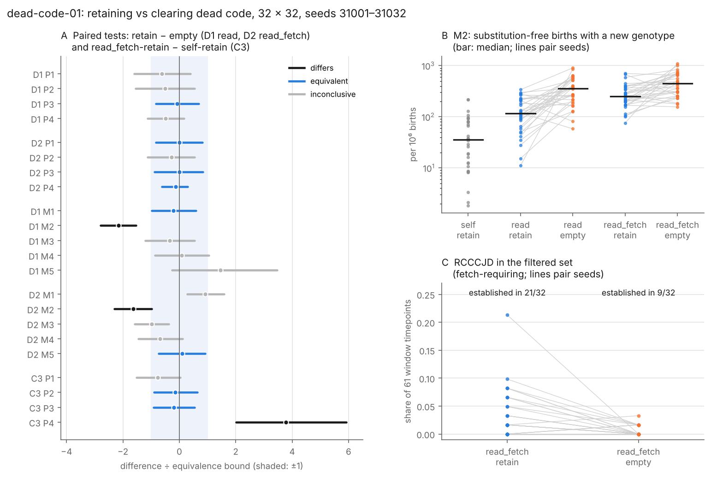

# Does retaining dead code change evolutionary dynamics?

Retaining the bytes of the dead, rather than clearing them, changed no preregistered primary endpoint in matched 32 × 32 worlds. Both claims are inconclusive under the frozen rules. In the read_fetch arm (D2), three of the four endpoints were equivalent, and P2 was inconclusive. In the read arm (D1), only P3 was equivalent. Of the mechanism endpoints, only M2 differed. Retain had fewer substitution-free births with a new genotype in both arms. By the brief's rule, M2 is the H-raw endpoint, and a difference in this direction counts against H-raw. No mechanism endpoint differed in the H-buffer direction. The pattern is therefore "neither" in both arms. *Post hoc*, in the replays checked so far, the empty worlds' excess was offspring copied from zeroed reservation offsets, made entirely of zero bytes. The access study's C3 replicated on new seeds: read_fetch-retain raised Bedau's mean new activity (P4) over self-retain, beyond the neutral expectation. Descriptively, the fetch-requiring `RCCCJD` passed the persistence filter in 21 of 32 read_fetch-retain worlds and in 9 of 32 read_fetch-empty worlds. No genotype required residue directly. All 160 worlds survived the 4,194,304-tick horizon. [Frozen protocol](protocol.md) · [Research brief](../../../docs/research/dead-code-rq.md) · [Generated analysis summary](results/analysis/summary.md)



## Claims under the preregistered rules

Each comparison is retain minus empty within an access arm, on 32 seed pairs. The empty cell is the reference for Glass's Δ and for the equivalence bound.

| Claim | Comparison | Outcome | Endpoints that differ | Equivalent | Inconclusive |
| --- | --- | --- | --- | --- | --- |
| D1 | read-retain vs read-empty | inconclusive | none | P3 | P1, P2, P4 |
| D2 | read_fetch-retain vs read_fetch-empty | inconclusive | none | P1, P3, P4 | P2 |

A comparison differs on an endpoint when two conditions hold. Its exact two-sided Wilcoxon signed-rank p, Holm-corrected over the 8 tests, is below 0.05. The median paired difference has the same sign in seed blocks A (31001–31016) and B (31017–31032). An endpoint is equivalent when the 90% bootstrap interval of the mean paired difference lies within ±0.5 SD of the reference cell. A claim answers "no detectable effect at this scale" only if all four endpoints are equivalent. [All tests](results/analysis/tests.tsv) · [Claim outcomes](results/analysis/claims.tsv)

| Claim | Endpoint | Median paired difference (A / B) | Holm p | 90% interval of mean difference | Equivalence bound | Outcome |
| --- | --- | --- | ---: | --- | ---: | --- |
| D1 | P1 total novelty | −6.5 (−11 / −1.5) | 1 | −9.7 to 2.4 | ±6.1 | inconclusive |
| D1 | P2 mean change | +0.02 (−0.04 / +0.03) | 1 | −0.14 to 0.05 | ±0.09 | inconclusive |
| D1 | P3 mean ecology | −0.004 (−0.007 / +0.008) | 1 | −0.039 to 0.032 | ±0.047 | equivalent |
| D1 | P4 mean new activity | −409 (−669 / −114) | 1 | −1,276 to 183 | ±1,126 | inconclusive |
| D2 | P1 | +1 (+7 / −6) | 1 | −7.1 to 7.1 | ±8.6 | equivalent |
| D2 | P2 | −0.11 (−0.11 / −0.11) | 1 | −0.14 to 0.07 | ±0.12 | inconclusive |
| D2 | P3 | −0.03 (+0.05 / −0.05) | 1 | −0.044 to 0.041 | ±0.050 | equivalent |
| D2 | P4 | +113 (+122 / +110) | 1 | −1,494 to 720 | ±2,380 | equivalent |

No endpoint differed, so the neutral expectation was not compared. The D2-minus-D1 effect per seed, a descriptive contrast, had uncorrected p ≥ 0.39 on every primary endpoint. [Contrasts](results/analysis/contrasts.tsv)

## Mechanism endpoints and patterns

The mechanism family has 10 tests (M1–M5 in D1 and D2), Holm-corrected together, under the same rules. [Mechanism tests](results/analysis/mechanisms.tsv) · [Patterns](results/analysis/patterns.tsv)

| Claim | Endpoint | Median paired difference (A / B) | Holm p | 90% interval of mean difference | Equivalence bound | Outcome |
| --- | --- | --- | ---: | --- | ---: | --- |
| D1 | M1 rescue | −0.0009 (−0.0081 / +0.0019) | 1 | −0.0042 to 0.0025 | ±0.0042 | equivalent |
| D1 | M2 substitution-free new genotypes, per 10⁶ births | **−173 (−66 / −319)** | **1.3 × 10⁻⁵** | −303 to −168 | ±109 | **differs** |
| D1 | M3 realized load | −0.0002 (−0.0003 / −0.0001) | 1 | −0.0004 to 0.0002 | ±0.0003 | inconclusive |
| D1 | M4 neutrality | +0.003 (−0.007 / +0.009) | 1 | −0.012 to 0.014 | ±0.014 | inconclusive |
| D1 | M5 persistence | +0.02 (+0.07 / −0.02) | 1 | −0.02 to 0.31 | ±0.09 | inconclusive |
| D2 | M1 | +0.0033 (+0.0014 / +0.0053) | 0.44 | 0.0012 to 0.0072 | ±0.0045 | inconclusive |
| D2 | M2 | **−134 (−112 / −154)** | **4.4 × 10⁻⁴** | −287 to −122 | ±125 | **differs** |
| D2 | M3 | −0.0003 (−0.0003 / −0.0003) | 0.11 | −0.0005 to −0.0001 | ±0.0003 | inconclusive |
| D2 | M4 | −0.013 (−0.004 / −0.028) | 0.54 | −0.024 to 0.002 | ±0.017 | inconclusive |
| D2 | M5 | +0.05 (+0.08 / +0.04) | 1 | −0.11 to 0.14 | ±0.15 | equivalent |

Glass's Δ for M2 was −1.08 in D1 and −0.81 in D2. Under the pattern rule, M2 lower counts against H-raw, and no endpoint differed in the H-buffer direction, so both arms are classified "neither". D2's M1 (higher under retain) and M3 (lower) point in the H-buffer direction, but neither passed Holm correction (uncorrected p 0.062 and 0.013).

**What the M2 difference consists of (post hoc, in progress).** In the ledger, residue bytes reached substitution-free births mostly through the copier's own reservation: 94% of them in read-retain were copied from its unwritten offsets. Those offsets hold the bank's previous occupant under retain and zeros under empty (`R` resizes a bank and keeps its visible prefix; code inspection). A copy from them under retain therefore reproduces a dead individual's bytes, and when most bytes come from that individual it is the material parent. Under empty it writes zero bytes, which no living genotype carries. To check this, [zero_births.cpp](zero_births.cpp) replayed seed 31002 in both arms without the observer and counted births whose product held a zero byte. Its birth totals equal the study's.

| World | Births | With a zero byte | All six bytes zero | M2 numerator (substitution-free new genotypes) |
| --- | ---: | ---: | ---: | ---: |
| read-retain-31002 | 43,661,921 | 0 | 0 | 2,146 |
| read-empty-31002 | 43,709,311 | 22,041 | 15,643 | 16,431 |
| read_fetch-retain-31002 | 43,672,090 | 0 | 0 | 17,705 |
| read_fetch-empty-31002 | 43,676,083 | 25,913 | 14,469 | 19,351 |

An all-zero product carries no substitution, since substitution writes only the 12 instruction bytes. It differs from its parent's genotype, since a zero byte executes as a no-op and an individual made of zeros never reserves or divides. Each all-zero birth therefore counts in M2 (code inspection). In both pairs, the empty world's all-zero offspring outnumber the M2 difference. Without them, the empty world would have had at most 788 and 4,882 substitution-free births with a new genotype, fewer than the retain world's 2,146 and 17,705. A replay of all 64 empty worlds is running. [Replay output](results/posthoc/zero-births/)

## Replication of C3

read_fetch-retain against self-retain repeats the access study's C3 on new seeds, Holm-corrected over its own 4 tests. It does not enter D1 or D2. [Replication tests](results/analysis/replication.tsv)

| Endpoint | Median paired difference (A / B) | Holm p | 90% interval of mean difference | Equivalence bound | Outcome |
| --- | --- | ---: | --- | ---: | --- |
| P1 | −10.5 (−3 / −16.5) | 0.24 | −13.1 to 0.3 | ±8.7 | inconclusive |
| P2 | −0.13 (−0.04 / −0.20) | 1 | −0.13 to 0.09 | ±0.14 | equivalent |
| P3 | −0.03 (+0.06 / −0.07) | 1 | −0.053 to 0.031 | ±0.057 | equivalent |
| P4 | **+1,478 (+1,390 / +1,478)** | **1.1 × 10⁻⁴** | 1,318 to 3,863 | ±653 | **differs** |

C3 is supported. Glass's Δ for P4 was 1.89. The run-minus-shadow difference had an uncorrected exact Wilcoxon p of 2.8 × 10⁻⁵ with the same sign, so P4 is *beyond the neutral expectation*. The access study found +1,833 on seeds 30001–30032.

## Cell values

Medians over 32 worlds per cell. [Per-world endpoints](results/analysis/endpoints.tsv) · [Cell summary](results/analysis/cells.tsv)

| Cell | P1 run / shadow | P2 run / shadow | P3 run / shadow | P4 run / shadow | M1 | M2 | M3 | M4 | M5 |
| --- | --- | --- | --- | --- | ---: | ---: | ---: | ---: | ---: |
| self-retain | 52.5 / 88 | 1.14 / 1.44 | 0.25 / 0.40 | 10,183 / 415 | 0.245 | 36 | 0.2857 | 0.306 | 1.11 |
| read-retain | 45 / 88 | 1.11 / 1.44 | 0.21 / 0.39 | 10,448 / 414 | 0.243 | 115 | 0.2854 | 0.310 | 1.13 |
| read-empty | 50 / 89 | 1.11 / 1.46 | 0.20 / 0.40 | 10,638 / 414 | 0.246 | 357 | 0.2857 | 0.308 | 1.09 |
| read_fetch-retain | 39.5 / 87 | 1.08 / 1.43 | 0.23 / 0.37 | 11,674 / 416 | 0.280 | 249 | 0.2849 | 0.337 | 1.16 |
| read_fetch-empty | 40 / 86 | 1.11 / 1.41 | 0.19 / 0.35 | 11,503 / 414 | 0.275 | 446 | 0.2851 | 0.364 | 1.07 |

As in the access study, runs had fewer filtered genotypes, less change and lower ecology entropy than their neutral shadows in every cell. About a quarter of substitution-bearing newborns gave birth (M1), and 28.5% of all deaths came without a birth (M3). A filtered genotype stayed in F(A) for about one timepoint per run on average (M5). The median window maximum of complexity was 5 in every cell.

## Dependent strategies and RCCCJD

Each genotype in a filtered set was classified by the access study's four permission forks and the residue-cleared fork, at the birth of its first filtered carrier. Classes are descriptive (M6). [Classes per cell](results/analysis/strategies.tsv) · [Per-world episodes](results/analysis/strategy_worlds.tsv)

| Class | self-retain | read-retain | read-empty | read_fetch-retain | read_fetch-empty |
| --- | --- | --- | --- | --- | --- |
| independent | 32/32 | 32/32 | 32/32 | 32/32, with 2 losses | 32/32 |
| fetch-requiring | 0/32 | 0/32 | 0/32 | **21/32** (95% CI 47–81%) | **10/32** (16–50%) |
| residue-requiring | 0/32 | 0/32 | 0/32 | 2/32, both indirect | 0/32 |
| read-requiring, both-requiring, either-sufficient, other | 0/32 | 0/32 | 0/32 | 0/32 | 0/32 |
| template-only | 0/32 | 0/32 | 1/32 | 0/32 | 0/32 |

In the material genealogy, the fetch-requiring genotype was `RCCCJD` in every read_fetch-retain world and in 9 of the 10 read_fetch-empty worlds; the tenth was `RCCJLD`. `+JCLD+` was also fetch-requiring once under retain. Paired by seed, RCCCJD was established under both rules in 5 seeds, under retain only in 16 and under empty only in 4. Its episodes were 33 under retain and 9 under empty, and every episode ended in a loss. It was in the filtered set at 3.4% of window timepoints under retain and 0.5% under empty, averaged over worlds; the most in one world was 13 of 61 timepoints, against 2. The access study, run under retain, found 17 of 32 and 3.1%. These counts are descriptive and were not tested.

**Residue-requiring genotypes.** Two genotypes lost all their births in the residue-cleared fork: `.RCCLD` (world 31010, level 6,144) and `SRCLDJ` (31011, level 4,096). Each had one recorded birth and was independent in the permission forks, so both are indirect: clearing the residue changed something around them, not their own access. Overall, the residue-cleared fork changed the births of 14 of 1,381 material carriers assayed in read_fetch-retain worlds, in both directions, and of none of 1,496 in read-retain worlds. No genotype was residue-requiring directly. The template-only case was `RCCLDL` in read-empty world 31022, whose carrier made no birth.

**How RCCCJD reproduced (ledger, optional analysis 1).** The ledger counts every RCCCJD division attempt. Per world, RCCCJD births averaged 516,329 under retain and 168,452 under empty.

| Share | read_fetch-retain | read_fetch-empty |
| --- | ---: | ---: |
| RCCCJD births with a fetch from the carrier's own reservation | 51% | 54% |
| RCCCJD births with a residue fetch | 4.0% | 0 |
| Fetched instructions from living neighbors | 46% | 45% |
| from the carrier's own reservation, written offsets | 50% | 53% |
| from other reservations, written / unwritten offsets | 1.6% / 2.0% | 1.7% / 0.05% |
| from free banks | 0.7% | 0 |

About half of RCCCJD births therefore executed the carrier's own offspring: after `RCC`, its `J` jumped into its reservation and ran the bytes just written there. The brief named this self-execution candidate from code inspection. Failed RCCCJD divisions averaged 31,010 per world under retain and 15,994 under empty. Of these, 14,562 and 5,076 combined a substitution with a fetch from the carrier's own reservation. Residue reached 4% of RCCCJD births under retain. The census at establishment shows how little of it was in reach. Carriers' bearing neighbors were living (88% under retain, 85% under empty) or reserved (12%, 14%); free banks holding bytes were 0.8% under retain. The whole lattice held about 17 such banks at those times. Each carrier had 2.4–2.5 RCCCJD carriers among its four neighbors. [RCCCJD episodes](results/analysis/rcccjd_worlds.tsv) · [Census at establishments and losses](results/analysis/rcccjd_events.tsv) · [Ledger per world](results/analysis/ledger_worlds.tsv)

Retain raised RCCCJD's births and establishment, but the ledger does not show residue as their main source. Free banks are rare and quickly re-reserved, and most residue sits inside reservations. These data do not identify why RCCCJD fared better under retain.

## Neutrality and the residue-cleared environment

M4 sampled a median of 9–10.5 genotypes per world. In read_fetch-retain worlds, viability in the residue-cleared environment was slightly lower than in the ordinary one: median M4 minus M4-cleared +0.0017, uncorrected p = 0.006 (descriptive). In read-retain worlds the difference was zero in every world. M4 itself was not higher under retain in either arm: D1 was inconclusive, and in D2 the median difference was −0.013 (inconclusive). Code inspection predicted no change in self and empty cells, and the frozen code aborts there. No world aborted.

## Effective error rate (optional analysis 2)

Substitutions alone predict a variation share of 1 − 0.98⁶ = 11.42% of births. The median cell values were 11.40–11.45%. In read_fetch-retain, the substitution-bearing share of births was 11.37%, slightly below that floor; in the other cells it was 11.41–11.42%. Births averaged 0.1194 substituted copies in read_fetch-retain and 0.1199–0.1200 elsewhere, against 6 × 0.02 = 0.12. Under retain, a substitution was therefore slightly more often lost before birth when fetch was allowed. The 64 × 64 access check had shown a larger shortfall in read_fetch worlds (10.5–10.7%). [Cell summary](results/analysis/cells.tsv)

## Sensitivity analyses (descriptive)

Each variant repeats D1 and D2 with Holm correction within the variant: filters t = 256 and 2,048, executor parentage, informative-site components, and P4 with thresholds pooled over all 160 worlds (a* = 2,234, a₁ = 178,036). No variant found a difference. Under pooled thresholds, P4 was equivalent in both claims, so both answer "no detectable effect at this scale" on P4 alone. [All variant tests](results/analysis/sensitivity.tsv) · [Variant claim outcomes](results/analysis/sensitivity_claims.tsv)

**Boundedness (descriptive).** Cell-mean cumulative novelty was best fitted by a straight line in all five cells over the window. Per world, it was linear in 14–18 worlds per cell and mostly saturating otherwise. The genotype space is finite, so this is not evidence of unbounded growth. [Fits](results/analysis/boundedness.tsv)

## Demography and reach

All 160 worlds survived to H, none was demographically stagnant, and all reached the 61 window timepoints. Two read_fetch-empty worlds (31001 and 31012) were evolutionarily stagnant: no new genotype passed the filter at any level from 12,288 to 16,384. The population averaged 842–846 of 1,024 sites. Each world had about 43.7 million births, and the mean generation interval was 41.2–42.4 ticks. Mean depth at H was 92,600–94,200 generations in the run and 51,100–52,400 in the shadow. Every assayed carrier reproduced its recorded births in the ordinary fork (median 84–112 per world by cell).

## Scale check (descriptive)

**Running.** Seeds 31101–31108 in the four read and read_fetch cells on a 64 × 64 torus for 2²¹ ticks. Progress is in [results/scale/progress.log](results/scale/progress.log).

## Validation

Seeds 29921–29924 ran in the five primary cells and self-empty for 65,536 ticks, with the mutation-free self-retain world for 2²⁰ ticks. Together with the classifier and residue controls, they passed all 192 checks.

- Observed and bare hashes matched, and a perturbed shadow key left the run hash unchanged.
- All 102 assayed carriers reproduced their births.
- Self-retain and self-empty had identical event digests and tables on every seed, except the census counts of free banks holding bytes.
- Empty cells drew no byte or fetch from a free bank, held no residue, and kept no bytes in any free bank.
- The residue-cleared fork changed no births where no residue is visible, and none in the visible cells at this length.
- The residue control classified as fetch-requiring and residue-requiring.

[Checks](results/validation/checks.tsv)

## Run record

- **Code and protocol.** Frozen in `97a49cb` after validation, before any study seed ran. [revision.sha256](revision.sha256) lists the digests that `run.py` checks before each set. Each world's `log.txt` records the command, the repository revision when the driver started, the final hash, wall time and peak memory. The revisions are `97a49cb` (primary batches 1–7), `28af44f` (8–14) and `9ec04b5` (15–20); the frozen files were unchanged throughout. The kernel adds the analysis hooks `World::clear_residue` and `World::set_reclamation` (`2c28805`) to those of the access study.
- **Batches.** Worlds ran in batches of eight, four at a time, and each batch was committed and pushed. To stay under a two-hour limit on background commands, the driver ran in three parts with `--stop-after 5400`; each part ended between batches and the next resumed at the following batch. No world was rerun. Primary worlds took 383–440 s each and 171–178 MB of memory.
- **Post hoc material.** The overview figure, [overview.py](overview.py), was drawn after the results from committed analysis files only. The zero-byte replay, [zero_births.cpp](zero_births.cpp), and the RCCCJD and ledger summaries above were computed after the frozen analysis and are labelled where used.

```sh
make -C kernel/runs/dead-code-01
python3 kernel/runs/dead-code-01/run.py validate
python3 kernel/runs/dead-code-01/run.py primary --stop-after 5400
python3 kernel/runs/dead-code-01/run.py scale --stop-after 4200
python3 kernel/runs/dead-code-01/analyze.py primary
python3 kernel/runs/dead-code-01/analyze.py scale
python3 kernel/runs/dead-code-01/overview.py
```

## What this does not show

- **Scope.** One ancestor, one mutation rate, six-byte genomes and one confirmatory lattice size. Age is the only cause of death, so residue is an unselected sample of the population 80 ticks earlier. A selective reaper, as in Tierra, could leave different residue.
- **Little residue in reach.** At about 82% occupancy, freed banks are soon reserved again. Most residue therefore sits in reservations, where the reserving individual usually overwrites it. Retain and empty differ less here than they would in a sparser world.
- **Inconclusive is not absent.** Most primary endpoints in D1 and P2 in D2 were inconclusive rather than equivalent, so effects of the size of the equivalence bounds are not excluded there.
- **M2 and H-raw.** The rule counts the M2 difference against H-raw. In the replays checked so far, the difference is all-zero offspring made under empty, not fewer new combinations under retain. The test therefore says more about what an empty reservation supplies than about residue as raw material.
- **RCCCJD.** Its higher establishment under retain is descriptive and has no identified cause. The residue-cleared fork found no direct dependence on residue, and the ledger attributes about half of its fetched instructions to its own offspring.
