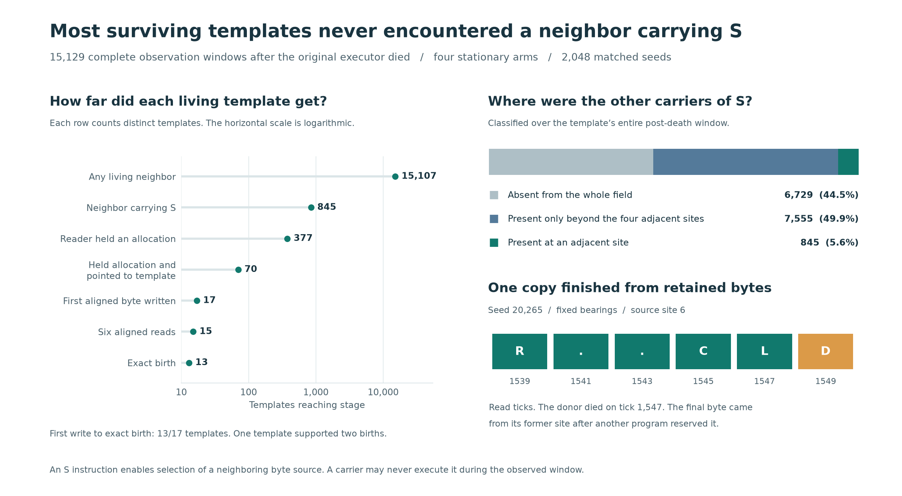

# Who could copy a surviving template after its original executor died?

Of 15,129 fully followed templates, 15,107 had a living neighbor after their original executor died. Only 845 (5.6%) ever had a neighbor carrying S, the instruction that can select another site as a byte source. Thirteen templates supplied a completed exact birth to a new executor after the original executor died. One supplied two births, giving 14 completed transfers. The largest absolute drop in the observed sequence was between having a living neighbor and having one with S. [Primary protocol](protocol.md) · [Per-template stages](results/case-stages.tsv) · [Cohort totals](results/summary.tsv)



## From proximity to a completed copy

The denominator includes every enrolled newborn in the four stationary arms with its entire lifetime observed through age death. Its original executor produced it from another living individual's six aligned, unchanged bytes and had a different genome from the product. Each stage counts a template once if any eligible individual reached that stage during follow-up. To qualify as a new executor, a neighbor can have any genome and must have a different individual identity from both the original executor and the focal template. [Source enrollment and factor definitions](../bearing-handoff-01/README.md)

| Stage reached by the focal template | Both east | Read randomized | Placement randomized | Both randomized | Pooled | Share of previous stage |
| --- | ---: | ---: | ---: | ---: | ---: | ---: |
| Complete observation window | 3,031 | 4,529 | 3,102 | 4,467 | 15,129 | — |
| At least one other living neighbor | 3,029 | 4,523 | 3,097 | 4,458 | 15,107 | 99.9% |
| Neighbor carrying S | 179 | 242 | 190 | 234 | 845 | 5.6% |
| S-bearing neighbor held an allocation | 90 | 104 | 82 | 101 | 377 | 44.6% |
| Neighbor held an allocation and its read pointer addressed the template | 13 | 18 | 18 | 21 | 70 | 18.6% |
| First aligned byte written after the original executor's death | 5 | 5 | 4 | 3 | 17 | 24.3% |
| Six aligned reads from this living template in the same allocation | 4 | 4 | 4 | 3 | 15 | 88.2% |
| Intact product reached division by the cutoff | 4 | 4 | 2 | 3 | 13 | 86.7% |

Complete observation windows ranged from 14 to 80 instruction openings, with a median of 33. Windows contain 598,749 focal-ticks and 58,964 focal–neighbor identity pairs, of which 983 involved a neighbor carrying S. In the first seed block 419 of 7,624 templates had such a neighbor; in the second block 426 of 7,505 did. Exact handoffs occurred for eight and five templates respectively. The pooled counts describe four configurations run on the same 2,048 seeds. Repeated templates within a world and matched arms share background conditions.

Facing, available room and pointer state describe different opportunities. For 276 templates, an adjacent carrier ever faced the template. For 202 it faced the template while holding an allocation or having at least one free neighbor in the same opening. For 130, an adjacent program executed S directed at that template. Reservation while facing failed at least once from a full neighborhood for 174 templates, and from competition for 89. Failures and later successes can overlap. A change of bearing, or a reservation that resets the source pointer, can separate a geometric opportunity from a successful write. These counts identify where observed transfers stopped; they do not estimate the causal effect of providing room. [Every neighbor's identity, overlap and actions](results/neighbors.tsv.gz)

## Were other potential readers present elsewhere?

A supplementary scan compared all living individuals at the same instruction openings. It excluded the focal individual itself. Of the 15,129 complete windows, **6,729 (44.5%)** had no other carrier of S anywhere on the field. In **7,555 (49.9%)** other carriers were present at least once, always outside the four adjacent sites. In the remaining **845 (5.6%)** at least one other carrier became adjacent. These categories partition the windows. An S anywhere in a genome establishes eligibility for the screen; for 5,039 of the 7,555 distant-only cases, a remote individual also actually executed S during the window. Among the 845 local cases, 458 had a neighbor execute S in some direction. The location comparison was specified after observing the primary neighborhood counts. It measures the joint availability of a living individual, the instruction and contact under the existing dynamics. [Supplementary protocol](availability-protocol.md) · [Window-by-window field counts](results/availability.tsv)

## What happened after the first byte?

Seventeen fully followed templates accounted for 18 qualifying allocations. Fourteen allocations completed intact births. Two completed their products after later reads came from the focal individual's former site as free or reserved storage. In the remaining two allocations the same living donor supplied all six aligned reads, but the executor died before division. One of those allocations also incurred a substitution. These distinctions can matter even when two resulting byte strings look identical.

In the fixed-bearing arm of seed 20265, a new executor read the first five bytes of R..CLD from the living individual at site 6. The fifth read occurred at tick 1547, on the donor's death tick. At tick 1549 the executor read D from the same site, which was now reserved. The exact sequence appeared at division on tick 1551. The trace attributes five bytes to the living donor and one to retained storage. [All initiated allocations and per-byte provenance](results/attempts.tsv)

The 633 newborns with incomplete observation are reported separately. For 268 the original executor had not yet died before the last observable opening. Among the truncated cases there was one eligible first write, two observed aligned reads in that allocation and zero completed exact handoffs. All 8,192 field runs were reproducing at tick 2048, with zero stagnant and zero extinct. [Windows including censoring](results/windows.tsv) · [All field outcomes and final hashes](results/fields.tsv)

## Replay and verification

Primary protocol commit `f721640` precedes the neighborhood census. Supplementary protocol commit `2b1b99f` precedes the whole-field availability scan. Both use reference `50cf4b1`, the same local VM patches as the split-bearing study, seeds 19521–20544 and 20545–21568, and its four stationary configurations. The field is a 16 × 4 torus with local instruction fetch, neighbor reads, retained bytes, first-free placement, maximum age 80 and 20,000 ppm copy substitution. The observer uses public committed states and VM events. Each arm applies its previously defined newborn bearing assignments.

- Follow candidate instruction openings strictly after the original executor's committed death up to and including the focal template's death tick, or the field cutoff. A candidate neighbor that occupies its site at the opening may itself die during that tick. Current bearing and selected source address are recorded separately. Positive first writes must use destination offset zero and read offset zero from the focal identity in this window.
- Follow a started allocation until birth, failed division, actor death or cutoff. The trace for each successful write is encoded in destination-offset order as `tick/site/source_birth/bank_kind/read_offset/input_byte/output_byte`. Kinds o, r and f denote occupied, reserved and free storage. An inactive source has birth tick −1. Inputs and outputs are unsigned decimal byte values. The archive includes attempts whose sources changed. The exact endpoint requires six aligned, unchanged reads from the one living focal and a completed birth.
- Seed, population ledger and hash match all 8,192 fields in the preceding experiment. The exact post-death links, including identities, products, all six read ticks and source sites, match its independent birth-to-birth reconstruction. The supplementary build preserved every original raw census row. Two separately optimized builds with opposite traversal orders reproduced all seven final result tables byte for byte. [Source and result checksums](revision.sha256)

Run from the repository root with C++20, Make, patch and Python 3.10 or newer. The figure uses Matplotlib.

```sh
study=kernel/runs/handoff-window-01
out=kernel/build/handoff-window
replay=kernel/build/handoff-window-replay
make -C kernel all test
make -C "$study" all test
python3 -B "$study/run.py" "$out/observe" "$out/final"
python3 -B "$study/analyze.py" "$out/final"
make -C "$study" BUILD=../../build/handoff-window-replay CXXFLAGS='-O3 -Wall -Wextra -Werror' all test
python3 -B "$study/run.py" "$replay/observe" "$replay/final" --reverse
python3 -B "$study/analyze.py" "$replay/final"
diff -qr "$out/final" "$replay/final"
diff -qr "$study/results" "$out/final"
python3 -B "$study/plot.py" "$out/final" "$out/handoff-window.png"
shasum -a 256 -c "$study/revision.sha256"
```
