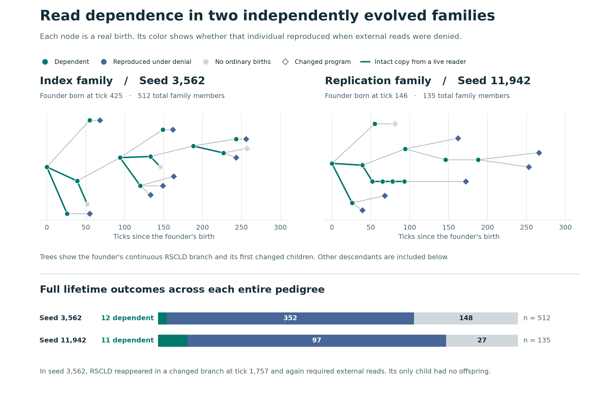

# External-read dependence recurred in an independent natural world

One of 8,192 prospectively enrolled worlds produced five consecutive exact transfers from living readers. Under a matched permission test, two independently evolved families each sustained an uninterrupted run of six individuals that required external reads to reproduce. Every confirmed dependent individual in these two pedigrees had the same five-byte program, RSCLD. [Frozen protocol](protocol.md) · [Every replication seed](natural/seeds.tsv) · [Every focal individual](pedigrees/individuals.tsv)



## Independent natural replication

Seeds 11329–19520 produced 10,600,887 births by tick 2048. Every world was reproducing in its final 80 ticks, with zero stagnant and zero extinct worlds. There were 17,379 exact reader newborns and 18,828 births by exact readers. In 11 worlds, 16 births copied five unchanged bytes from a single living external reader. One daughter in seed 19082 was alive at the cutoff. Lifetime follow-up for a focal could extend beyond tick 2048, while enrollment and incidence used the original cutoff. The broader behavioral screen produced eight positive events in two worlds, seeds 11942 and 13058. [Denominators](natural/summary.tsv) · [All transfers](natural/links.tsv) · [Behavioral pairs](natural/pairs.tsv)

The primary outcome occurred in seed 11942. The line began at tick 146 and reached consecutive reader daughters at ticks 185, 198, 211, 224 and 239. The four overlapping two-transfer windows all passed the lifetime denial tests for both reproducing CPUs. Each daughter in those windows was west of her mother. At the first qualifying copy by the four daughters, the maternal donor had 39, 65, 65 and 63 ticks remaining until death respectively. In the index family both qualifying daughters read their own mother with 39 ticks remaining. These observations characterize the positive cases under this field geometry. The former placement experiment tested daughter location separately. [Confirmed windows](natural/chains.tsv) · [Donor identities and timing](pedigrees/chain-context.tsv) · [Previous placement comparison](../placement-01/README.md)

The previous cohort had one primary-positive world among 8,192. The combined descriptive count is two independent worlds among 16,384 under this configuration and horizon. The six two-transfer windows across cohorts belong to just those two families.

## Whole-pedigree lifetime forks

Each focal began in its own untreated birth state. A dependent individual produced offspring with ordinary reads and zero offspring under external-read denial, with at least one blocked copy. An ordinary nonreproducer provides no test of the need for external reads in reproduction. [Family totals](pedigrees/summary.tsv) · [Matched outcomes and parent identities](pedigrees/individuals.tsv)

| Seed | Family members enrolled | Dependent | Reproduced under denial | No ordinary births | Longest continuous dependent run | Longest consecutive exact live-reader transfers |
| --- | ---: | ---: | ---: | ---: | --- | ---: |
| 3562 | 512 | 12 | 352 | 148 | 6 individuals, 5 parent-child edges | 2 |
| 11942 | 135 | 11 | 97 | 27 | 6 individuals, 5 parent-child edges | 5 |

The seed-3562 pedigree contained 44 genomes and still had 11 members alive at tick 2048. All 11 completed their follow-up in ordinary and denied branches. After the contiguous reader family died at tick 749, RSCLD reappeared in a changed branch at tick 1757. It reproduced once with ordinary access and zero times under denial. Its sole child had a changed genome and never reproduced. Seed 11942 contained 13 genomes. Its continuous reader branch died at tick 415 and the last maternal descendant died at tick 883. The surrounding world had 49 living individuals at tick 2048. [Seed 3562 forks](pedigrees/forks-3562-17-425/scores.tsv) · [Seed 11942 forks](pedigrees/forks-11942-51-146/scores.tsv)

Among children with a changed genome born to a dependent parent, 14 reproduced under denial and three had no ordinary offspring. Zero changed parent-child edges connected two confirmed dependent individuals. Dependence therefore recurred after restoration of the original sequence in the index case. Inherited dependence across a change of sequence remains unobserved in these two pedigrees.

## Living-source intervention

Deduplicating overlapping windows gives four confirmed reproducing CPUs in seed 3562 and five in seed 11942. Denying every external copy eliminated reproduction in all nine. Denying only copies from occupied external banks eliminated all the original qualifying transfers, yet each of the nine CPUs still reproduced. The ordinary branches yielded 18 births in total and the occupied-source denial branches yielded 12.

The successful fallback copies used identifiable residual bytes. Six products read all five bytes from reserved banks. The other six read the first byte from a free bank and the next four from a reserved bank. The source column records opening bank status for each copied byte using `o` for occupied, `r` for reserved, `f` for free and `s` for self. These paired comparisons establish that external bytes were necessary for reproduction in those birth environments. Access to a living supplier was necessary for the specified live transfer, and unoccupied sources sufficed for other births. [Paired chain contexts](pedigrees/chain-context.tsv) · [Index products](pedigrees/forks-3562-17-425/products.tsv) · [Replication products](pedigrees/forks-11942-51-146/products.tsv)

## Replay

Protocol commit `7f02342` precedes the new cohort. Field and founder configuration follow placement-01 at baseline `b68d0c4`. This study extends the historical lifetime observer to verify arbitrary enrolled focal programs, record copy-source kinds and apply the occupied-source mask. The kernel is the original reference implementation. Each field's census, exact reader count and final state hash were checked against a separate simulation. Ordinary in-window focal offspring were matched to the untreated pedigree by parent, birth tick, site, input bytes and product. All natural and pedigree tables, including temporary opening ledgers, matched byte for byte across forward and reversed traversals in separate optimized builds. The fixed seed scan closed at 19520. [Source and output hashes](revision.sha256)

Run both traversals from the repository root with C++20, Make, patch and Python 3.10 or newer. The script compares its results with the archived tables. The figure uses Python and Matplotlib.

```sh
sh kernel/runs/inheritance-01/replay.sh forward
sh kernel/runs/inheritance-01/replay.sh reverse
diff -qr kernel/build/inheritance/pedigrees kernel/build/inheritance-replay/pedigrees
shasum -a 256 -c kernel/runs/inheritance-01/revision.sha256
python3 -B kernel/runs/inheritance-01/plot.py kernel/build/inheritance/pedigrees \
    kernel/build/inheritance/natural kernel/build/inheritance/pedigrees.png
```
