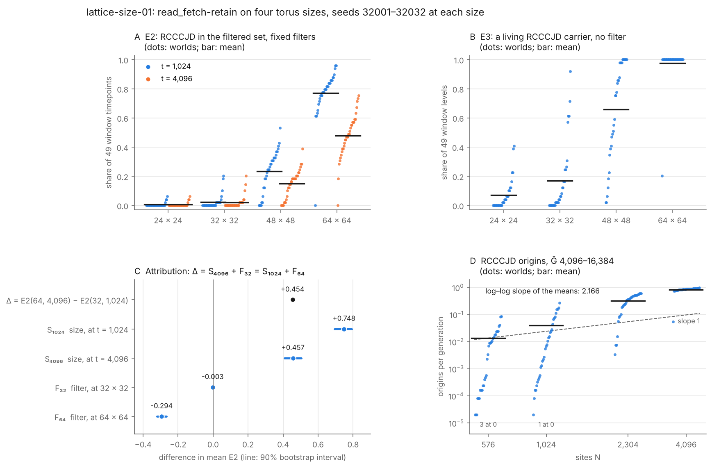

# Does lattice size alone change whether RCCCJD persists?

Lattice size alone changed whether the fetch-requiring genotype `RCCCJD` was established and persisted in the read_fetch-retain cell. All five preregistered primary endpoints differed with size. Spearman ρ was 0.69–0.85 and was positive in both seed blocks. The attribution rule gives **size, not filter length**. The longer filter used in the earlier 64 × 64 checks had lowered, not raised, the measured persistence. The rise also exceeds the filter's neutral scaling.

`RCCCJD` passed the t = 1,024 filter in 4 of 32 worlds at 24 × 24 and 31 of 32 at 64 × 64. A living carrier was present at a median of 2% of window levels at 24 × 24 and at every level in 31 of 32 worlds at 64 × 64. Most of the rise came between 48 × 48 and 64 × 64. None of the three descriptive patterns (supply-like, smooth, pattern-like) met its criterion.

All 128 worlds survived the 4,194,304-tick horizon and reached every window level.

[Frozen protocol](protocol.md) · [Research brief](../../../docs/research/lattice-size-rq.md) · [Generated analysis summary](results/analysis/summary.md)



## Primary endpoints under the preregistered rules

Each size has 32 worlds, seeds 32001–32032. The window is Ḡ 4,096–16,384, 49 timepoints.

- **E1** is establishment: `RCCCJD` is in the filtered set F(A) at one or more window timepoints.
- **E2** is the fraction of window timepoints at which it is in F(A).
- **E3** is the fraction of window levels with at least one living carrier, with no filter.

[Tests](results/analysis/tests.tsv) · [Per-size intervals](results/analysis/size-intervals.tsv)

| Endpoint | 24 × 24 | 32 × 32 | 48 × 48 | 64 × 64 | ρ (A / B) | Holm p | Outcome |
| --- | --- | --- | --- | --- | --- | ---: | --- |
| E1, t = 1,024 | 4/32 (0.04–0.29) | 12/32 (0.21–0.56) | 28/32 (0.71–0.96) | 31/32 (0.84–1.00) | 0.69 (0.68 / 0.71) | 5.0 × 10⁻⁵ | **differs** |
| E1, t = 4,096 | 4/32 (0.04–0.29) | 11/32 (0.19–0.53) | 28/32 (0.71–0.96) | 31/32 (0.84–1.00) | 0.69 (0.68 / 0.73) | 5.0 × 10⁻⁵ | **differs** |
| E2, t = 1,024 | 0 (0–0); mean 0.005 | 0 (0–0.02); 0.023 | 0.26 (0.18–0.31); 0.233 | 0.80 (0.77–0.84); 0.771 | 0.85 (0.88 / 0.83) | 5.0 × 10⁻⁵ | **differs** |
| E2, t = 4,096 | 0 (0–0); 0.005 | 0 (0–0.01); 0.020 | 0.17 (0.12–0.18); 0.149 | 0.48 (0.43–0.55); 0.477 | 0.84 (0.87 / 0.82) | 5.0 × 10⁻⁵ | **differs** |
| E3, no filter | 0.02 (0–0.06); 0.070 | 0.05 (0.02–0.14); 0.170 | 0.77 (0.50–0.93); 0.657 | 1 (1–1); 0.975 | 0.83 (0.84 / 0.84) | 5.0 × 10⁻⁵ | **differs** |

How to read the table:

- E1 cells give the count with a 95% Clopper–Pearson interval.
- E2 and E3 cells give the median with a 95% bootstrap interval, then the mean.
- The per-size intervals were computed after the run by [supplement.py](supplement.py) (see the run record).
- Every two-sided permutation p was 1/100,001, the smallest that 100,000 permutations can give, so the true p values may be smaller.
- Kruskal–Wallis p was below 10⁻¹³ for every endpoint. It decides nothing.
- A size endpoint differs when its Holm-corrected p is below 0.05 and ρ has the same sign in seed blocks A (32001–32016) and B (32017–32032).

No size was too short of its window: the lowest Ḡ at H was 91,842, against 20,480 needed. [Reach](results/analysis/reach.tsv)

## Attribution: size or filter length

The earlier contrast was Δ = E2(64 × 64, t = 4,096) − E2(32 × 32, t = 1,024). It changed size and filter length together. Δ splits into a size part S at a fixed filter and a filter part F at a fixed size, in two ways. Each part has a 90% bootstrap interval. [Attribution](results/analysis/attribution.tsv)

| Part | Value | 90% interval |
| --- | ---: | --- |
| Δ | +0.454 | — |
| S₁₀₂₄, size at t = 1,024 | +0.748 | +0.693 to +0.793 |
| S₄₀₉₆, size at t = 4,096 | +0.457 | +0.408 to +0.503 |
| F₃₂, filter at 32 × 32 | −0.003 | −0.005 to −0.001 |
| F₆₄, filter at 64 × 64 | −0.294 | −0.320 to −0.267 |

E2 and E3 differ with Δ's sign at both primary filters, and neither filter part lies on Δ's side of zero. By rule 5 the outcome is **size, not filter length**.

Code inspection predicted F_L ≤ 0, and both F_L intervals are below zero. Holding the filter at t = 1,024, the size part is +0.75, larger than Δ.

**Neutral scaling (rule 6).** On the t = N diagonal, where the filter grows with N, ρ was 0.67 for E1 and 0.83 for E2, both with p = 1.0 × 10⁻⁵, uncorrected. Both are labelled *beyond the filter's neutral scaling*. [Neutral scaling](results/analysis/neutral-scaling.tsv)

## Outcome patterns (descriptive)

Each label is used only if its preregistered criterion holds. None did. [Patterns](results/analysis/patterns.tsv)

| Pattern | Criterion | Observed | Holds |
| --- | --- | --- | --- |
| Supply-like (A1a) | Log–log slope of origins per generation on N has a 95% interval containing 1, and ρ(L, longest filter-free episode) has one containing 0 | Slope 2.17 (1.94–2.49); ρ 0.82 (0.77–0.86) | no |
| Smooth (A1b) | ρ(L, longest episode) interval above 0, and at both primary filters no adjacent step carries more than half of the rise in mean E2 from 24 to 64 | ρ interval above 0; the 48 → 64 step carries 70% of the rise at both filters | no |
| Pattern-like (A2) | ρ(L, median ξ) interval contains 0, median ξ at 64 × 64 below 16, and at 24 × 24 more than half of filter-free global losses follow a level with one cluster | ρ 0.77 (0.69–0.83); median ξ 3; 9 of 43 losses | no |

The patterns fail in these ways:

- **Supply-like.** Origins per generation grew faster than N, and episodes lengthened with size.
- **Smooth.** The episode criterion held, but the rise was concentrated in the last step.
- **Pattern-like.** ξ grew with L, and most small-world losses followed a level with several clusters. Levels are 256 generations apart, so clusters may have collapsed between levels.

## Secondary endpoints (descriptive)

Means over worlds unless marked as medians. Carrier and cluster statistics are taken over window levels. [Secondary endpoints](results/analysis/secondary.tsv) · [Size × filter](results/analysis/cross.tsv)

| Endpoint | 24 × 24 | 32 × 32 | 48 × 48 | 64 × 64 |
| --- | ---: | ---: | ---: | ---: |
| Longest filter-free episode, generations (median) | 256 | 512 | 6,784 | 12,544 |
| Filter-free global losses, total over 32 worlds | 43 | 55 | 51 | 3 |
| … of which after a level with one cluster | 9 | 9 | 9 | 2 |
| Cluster drops while carriers remained (median) | 0 | 0 | 18 | 24.5 |
| Living carriers per level | 3.9 | 17.6 | 237 | 1,049 |
| Share of the living | 0.008 | 0.021 | 0.125 | 0.309 |
| Clusters when present (median) | 3 | 7 | 22 | 47 |
| Largest cluster's share of carriers (median) | 0.73 | 0.58 | 0.48 | 0.52 |
| Correlation length ξ (median) | 1 | 2 | 2 | 3 |
| Join ratio: carrier pairs relative to random placement | 36.5 | 24.0 | 30.4 | 5.9 |
| Origins per generation | 0.014 | 0.040 | 0.324 | 0.837 |
| Origins per 10⁶ births | 52 | 87 | 316 | 465 |
| `RCCCJD` births fetching from a living neighbor | 0.462 | 0.457 | 0.453 | 0.452 |
| … from their own written reservation | 0.494 | 0.500 | 0.505 | 0.507 |

Notes on the table:

- **Episode length.** At 64 × 64 the longest episode usually spanned the whole window, 12,544 generations.
- **ξ.** It was never censored at L/2.
- **Origins.** Every origin is a birth of `RCCCJD` from a parent of another genotype. Origins per birth rose about ninefold from 24 × 24 to 64 × 64. The substitution rate is fixed, so this suggests that parents one substitution away from `RCCCJD` made up more of the births in larger worlds. The study did not record parent genotypes beyond the first origin.
- **Fetch sources.** The fetch-source shares of `RCCCJD` births barely moved with size. The remaining 3–5% came from other reservations and free banks.

**Extended window (agreed item 13).** Validation found an extra cost of 1.4% at most, so the extended grid was adopted. It covers Ḡ 17,408–65,536 at t = N, 48 levels, and every world reached it.

| Endpoint | 24 × 24 | 32 × 32 | 48 × 48 | 64 × 64 |
| --- | ---: | ---: | ---: | ---: |
| Worlds with RCCCJD in F(A) at any level | 0 | 7 | 30 | 32 |
| Mean share of levels in F(A) | 0 | 0.006 | 0.169 | 0.517 |
| Mean share of levels with a living carrier | 0.015 | 0.050 | 0.588 | 0.995 |
| Worlds with a carrier at every level | 0 | 0 | 3 | 29 |

The brief added this window to show whether presence at 64 × 64 lasts or ends in a later loss. It lasted: a carrier was alive at every level through Ḡ 65,536 in 29 of 32 worlds.

**Strategy classes (rule 8).** At t = N, the fetch-requiring class was established in 5, 12, 28 and 31 of 32 worlds at 24, 32, 48 and 64. These counts equal `RCCCJD`'s own t = N counts. No read-requiring, both-requiring or either-sufficient genotype was established at any size. Every assayed `RCCCJD` carrier was fetch-requiring. It was assayed in 9, 23, 32 and 32 worlds; in the rest it never passed a filter. [Classes](results/analysis/classes.tsv)

**Continuity endpoints.** The table below gives P1–P4 for continuity with the earlier studies. P1–P3 use t = N, so they change filter length together with size and do not isolate size.

| | 24 × 24 | 32 × 32 | 48 × 48 | 64 × 64 |
| --- | ---: | ---: | ---: | ---: |
| P1 total novelty | 42.9 | 33.3 | 13.4 | 3.7 |
| P2 mean change | 1.17 | 1.09 | 0.76 | 0.38 |
| P3 mean ecology | 0.236 | 0.204 | 0.176 | 0.118 |
| P4 mean new activity | 7,135 | 12,840 | 26,695 | 27,393 |
| P4, neutral shadow | 417 | 416 | 423 | 439 |

**The one 64 × 64 exception.** In world 64-32030, `RCCCJD` had a carrier at 10 of 49 window levels and never passed a filter there. It was lost twice in the window. In the extended window it was in F(A) at 52% of levels.

## Relation to the earlier studies

In dead-code-01, `RCCCJD` passed the 32 × 32 filter in 21 of 32 read_fetch-retain worlds. Here it passed in 12 of 32 at 32 × 32. The two counts are not directly comparable:

- dead-code-01's window began at Ḡ 1,024, and this one begins at 4,096;
- the seeds differ.

The earlier 64 × 64 checks had found the genotype established at 64 × 64 while it was transient at 32 × 32. Those checks used a longer filter and sparser timepoints. With every setting but size fixed, the difference remains, and it is larger at a fixed filter.

## Validation

Validation ran on seeds 29941–29944 before any study seed. All 132 checks passed. [Checks](results/validation/checks.tsv)

- **Controls.** Fixed-program classifier controls, five spatial fixtures and the origin rule gave their expected values.
- **Identity.** In all 16 short worlds:
  - the observer kept the run hash;
  - a shadow perturbation changed only the shadow;
  - spatial carriers equalled the census count.
- **Regression.** dead-code-01's `read_fetch-retain-31001` was rerun with this observer at its old settings. It reproduced byte for byte, with six tables plus its end hash, event digest, births, deaths, Ḡ and P4.
- **Origin replay.** Its first `RCCCJD` origin, at tick 3,730, replayed with the bare kernel.
- **Mutation-free world.** It showed no origins and one genotype.
- **Extended window.** It added rows only and kept the run hash. It cost +0.4% (24 × 24) and +1.4% (32 × 32), so it was adopted.

## Run record

- **Code and protocol.**
  - Implemented in `1517d55`; validated in `e044ab8`; frozen in `ee7cef0`, before any study seed ran. [revision.sha256](revision.sha256) lists the digests that `run.py` checks at the start of every primary call.
  - Each world's `log.txt` records the command, the repository revision when the driver call started, the end hash, wall time and peak memory.
  - The revisions are `ee7cef0` (batches 1–2), `b98a52a` (3–4), `22db6a7` (5–6), `f593ada` (7–8), `2b8fc61` (9), `87ada1d` (10–11), `a5383d8` (12–13), `40f2840` (14–15) and `fec427a` (16). They differ only in committed results; the frozen files were unchanged throughout.
  - The kernel is unchanged from dead-code-01.
- **Batches.**
  - Worlds ran in 16 batches of eight, four at a time. Each batch was committed and pushed to the working branch and to `main`.
  - To stay under a two-hour limit on background commands, the driver ran in nine calls with `--deadline 6900`. Each call ended between batches.
  - The first five calls used `--first-batch 3600`. In the fifth, that guess allowed only one batch, so the last four calls used `--first-batch 2600`, near the observed batch length of 2,125–2,480 s. These options affect scheduling only.
  - No world failed or was rerun. [Progress log](results/primary/progress.log)
- **Cost.** Worlds took 194–225 s at 24 × 24, 360–417 s at 32 × 32, 937–1,117 s at 48 × 48 and 2,126–2,471 s at 64 × 64. Peak memory was at most 191 MB. The total was 35.5 CPU-hours, against an estimate of about 50.
- **Post hoc material.** Two files were added after the run; both read committed analysis files only:
  - [supplement.py](supplement.py) computes the per-size 95% intervals that rule 1 asks for and the frozen `analyze.py` omits;
  - [overview.py](overview.py) draws the figure.

```sh
make -C kernel/runs/lattice-size-01
python3 kernel/runs/lattice-size-01/run.py validate
python3 kernel/runs/lattice-size-01/run.py primary --deadline 6900 --first-batch 2600   # repeat until progress.log says "primary complete"
python3 kernel/runs/lattice-size-01/analyze.py primary
python3 kernel/runs/lattice-size-01/supplement.py
python3 kernel/runs/lattice-size-01/overview.py
```

## What this does not show

- **Why size matters.** Size changes the number of sites and the side length together. The study shows that size matters, not whether through population number or spatial length. A strip with the same N but a shorter side, or a mixing manipulation, would separate them.
- **Supply versus persistence.** Origins per birth rose with size. More frequent re-creation of `RCCCJD` and longer survival of its carriers are not separated here.
- **Other cells and settings.** Only the read_fetch-retain cell, one substitution rate, age limit 80 and one founder were run. The result says nothing about the read or self arms, or about clearing dead code.
- **Larger sizes.** No size above 64 × 64 was run. E3 is near its ceiling at 64 × 64, but E2 is not.
