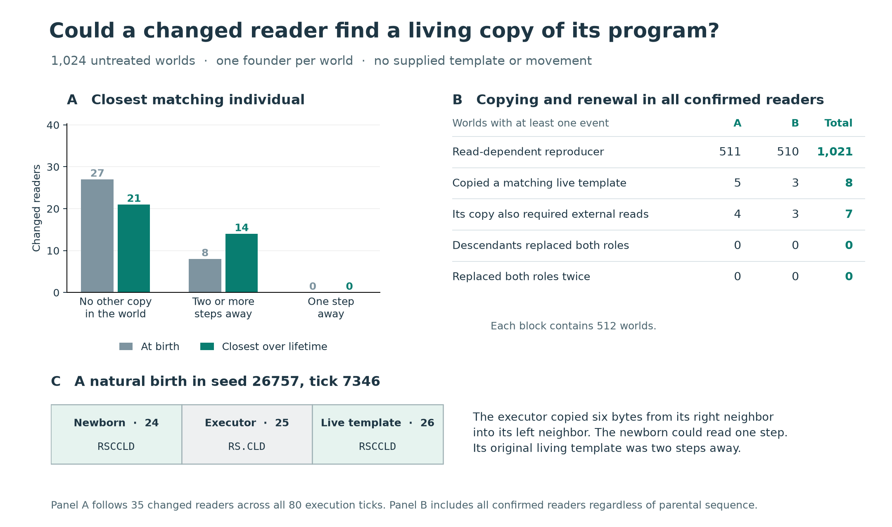

# Can untreated fields renew a changed reader and its living template?

Thirty of 1,024 untreated worlds produced 35 read-dependent individuals whose sequence differed from that of their confirmed executor. During all 80 executable ticks of each individual's life, none had a living neighbor carrying its exact sequence. A wider screen found seven worlds in which a reader copied a living match and its child also required external reads. In none did the family subsequently supply both a confirmed executor and a confirmed living template for another copy after both initial individuals died. [Frozen protocol](protocol.md) · [Counts by block, reader and world](results/summary.tsv)



## Where the natural pedigrees stopped

| Untreated worlds meeting each criterion | Block A / 512 | Block B / 512 | Total / 1,024 |
| --- | ---: | ---: | ---: |
| Confirmed read-dependent individual | 511 | 510 | 1,021 |
| Confirmed changed individual from a confirmed executor | 13 | 17 | 30 |
| Changed individual ever had a matching living neighbor | 0 | 0 | 0 |
| Any confirmed individual made an intact copy from a matching living neighbor | 5 | 3 | 8 |
| At least one such copy also passed its own lifetime permission test | 4 | 3 | 7 |
| Descendants replaced both original participants once | 0 | 0 | 0 |
| Descendants replaced both participants twice in succession | 0 | 0 | 0 |

The two blocks yielded 14 and 21 changed readers. Together they produced 59 offspring. Eighteen of the 35 readers made 22 of those births by copying six aligned bytes from another living individual. Each of those living templates carried a different sequence from the reader. For each of the 35 enrolled readers, both it and its own birth executor reproduced using external material and lost all offspring under individual read denial. A change relative to the executor can also restore an older sequence. [Each changed reader and its opportunities](results/changed.tsv) · [Birth material and lifetime assays](results/nodes.tsv.gz)

Across all 11,750 confirmed readers enrolled by tick 8192, eight readers in eight worlds made at least one intact copy from a matching living individual. Seven produced a confirmed child in this way. With 324 ticks of follow-up per focal, all seven copying families reached zero replacements. A start has depth zero. Replacing both roles once gives depth one. The family constraint requires the next executor and donor to be two later-born, confirmed descendants of the prior executor through same-sequence paths. At least one must descend from the previous copy, including that copy itself. All six new reads must occur after both previous participants died. Relationships use executed divisions or intact living-source donations. This measures family renewal over a fixed time and omits transfers to unrelated individuals and paths through passive intermediates. [All seven starting births and descendants' maximum depths](results/starts.tsv) · [Per-world endpoints](results/endpoints.tsv)

## Were matching individuals absent or beyond reach?

The prespecified measure was contact at birth and at every eligible execution opening. After finding zero contacts, we added a **supplementary** census of distances to other live individuals in the same fields at the same openings. A separate scan of all 64 sites agreed with the four-neighbor observer on every contact decision.

| Closest other living individual with identical bytes | At birth | Closest over 80 execution ticks |
| --- | ---: | ---: |
| No other matching individual anywhere in the field | 27 | 21 |
| Two lattice steps away | 8 | 13 |
| Five lattice steps away | 0 | 1 |
| Direct neighbor | 0 | 0 |

Thus 21 readers lacked a second live copy throughout their executable lives. Fourteen coexisted with a match at some point. None had direct access to it. These counts describe availability; they do not predict the effect of moving an individual. [Per-reader distance and contact census](results/contacts.tsv)

There is a geometric reason the **original living donor** can be out of reach immediately after division. On this stationary square grid, an executor reads its external donor at one cardinal neighbor and reserves a distinct cardinal neighbor for the offspring. Those two sites are always exactly two lattice steps apart. We checked all 768 ordered choices of executor site and two distinct directions on the 16 × 4 torus. Other living copies might still be adjacent, including the executor when it has the matching sequence. In seed 26757, site 25 copied six unchanged RSCCLD bytes from living site 26, producing a changed reader at site 24 on tick 7346. The original donor was still alive. The newborn was two steps from it and could read only one step. [Reference rules](../../src/vm.cpp) · [Natural birth traces](results/nodes.tsv.gz)

The previous delivery experiment gives a measured positive case for the same endpoint. In the together branch of seed 20349, the classifier identified the first child (76), then the copy (121) executed by descendant 83 with living descendant 76 as its template. All six reads occurred after the deaths of the natural focal and its supplied partner. The ordinary and apart branches scored zero. In the untreated prospective fields the number of observed renewals was 0/1,024. If the worlds are treated as independent seed samples, the one-sided exact 95% upper bound is 0.292% per world for this finite observation and definition. The 35 changed individuals include relatives and are not independent sampling units. [Recorded positive and control branches](../partner-placement-01/README.md)

A next structural comparison could hold read degree fixed and vary whether the original template can remain adjacent to the newborn. Use unsupplemented populations, measure formation of a second living copy separately from access to it, and retain the same renewal endpoint.

## Field accounting and replay

All fields originated from one independently replicating R..CLD founder at site 36. The preregistration was committed as `c1d80a7` before running new seeds. Each block used the same 16 × 4 torus, stationary sites, first-free placement, retained bytes, age limit 80, external data reads, local instruction fetch and 20,000 ppm copy substitution. Everyone born by tick 8192 was eligible to start a family. Follow-up extended to tick 8516, with another 81 ticks for complete ordinary and denied lifetime tests of the last descendants. Through tick 8516 the reference VM recorded 5,493,369 births. There were 1,023 worlds reproducing in the final 80 ticks, zero stagnant and one extinct. Seed 27319 had four births and five deaths including the founder. [Complete field ledger, cutoffs and hashes](results/world.tsv)

The driver reuses the committed trait-lineage field observer and lifetime assay. The source checks execution identity and event order, matches ordinary-fork births with natural products and checks field hashes at tick 2048, follow-up close and the final assay tick. The historical family, a synthetic two-replacement pedigree and rejection controls validate the classifier. Executions at different optimization levels and opposite traversal orders produced identical tables, including the distance census. Inputs, source and results are recorded in the [checksum manifest](revision.sha256).

From the repository root, use C++20, Make, Python 3.10 or newer and Matplotlib for the figure.

```sh
study=kernel/runs/natural-renewal-01
out=kernel/build/natural-renewal
rev=kernel/build/natural-renewal-replay
make -C kernel all test
make -C "$study" all test
python3 -B "$study/run.py" "$out/field" "$out/results"
python3 -B "$study/analyze.py" "$out/results"
diff -qr "$study/results" "$out/results"
make -C "$study" BUILD=../../build/natural-renewal-replay CXXFLAGS='-O3 -Wall -Wextra -Werror' all test
python3 -B "$study/run.py" "$rev/field" "$rev/results" --reverse
python3 -B "$study/analyze.py" "$rev/results"
diff -qr "$out/results" "$rev/results"
python3 -B "$study/plot.py" "$out/results" "$out/natural-renewal.png"
shasum -a 256 -c "$study/revision.sha256"
```

In the contact and distance tables, -1 denotes no observation. For timing, the birth observation is the state immediately after committed birth, at the opening of the next tick. Sparse node records include screened individuals and relevant lineage links, together with the six ordered reads for each recorded birth. Each read identifies the tick, site, source birth tick, bank kind, offset and individual ID. Enrolled roots and prospective denominators are determined by the explicit cutoff. The archived control and synthetic fixtures are excluded from those denominators.
