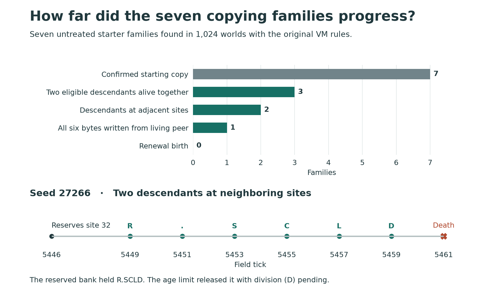

# Where the seven natural copying families stopped

A natural family reached the last instruction before division. In seed 27266, two descendants were alive at neighboring sites after both original participants had died. One wrote all six bytes of the other's program into a reservation. At the next opportunity to divide its lifetime expired. The original prospective study correctly counted zero renewed families. This retrospective replay distinguishes a complete write from a birth. [Prospective cohort, including its extinct world](../README.md) · [Frozen definition of renewal](../protocol.md)



## Same rules and pedigrees

The audit includes every confirmed starting copy in the untreated cohort, one in each of seven worlds. The archived starting executor, living source and child identify each case. The child and executor were both confirmed by individual read-denial tests. We used the archived links through division and intact living donors to find later-born, confirmed descendants with the same program. Both potential replacements must descend from the original executor and at least one must descend from the starting child (including that child). We checked both directions of each pair, beginning strictly after both original deaths and retaining the original 324-tick window. Sites are stationary. An executor can work during its 80 executable ticks. Its neighbor's bytes are also readable at the opening of the neighbor's death tick. [Original classifier](../pedigree.py) · [Per-family counts](results/families.tsv)

| Furthest stage or observed interruption | Seeds | Families |
| --- | --- | ---: |
| Only one eligible later descendant | 26720, 26788, 26947, 27428 | 4 |
| Two eligible relatives overlapped at distance two | 27323 | 1 |
| Adjacent relatives, neither faced the other during overlap | 26893 | 1 |
| Six aligned, unchanged bytes from a living relative, then executor death before division | 27266 | 1 |

The seven starting children themselves executed ten births. Two offspring retained the starting child's sequence and passed their lifetime read-dependence tests. Both drew on reserved bytes, one also drawing on free memory. The other eight offspring inherited different bytes, and all ten births matched their actual input bytes without substitution. One additional family had an eligible relative on a separate branch. The largest observed loss in these seven selected cases precedes the question of where to put two descendants. [All ten births and source kinds](results/products.tsv)

## The two adjacent pairs

In seed 26893, the relatives at sites 19 and 35 were north–south neighbors. Neither faced the other on any executable opening in the shared window. Individual 920 made five writes from site 20 while its relative was present. Individual 934 spent all 42 observed executable openings attempting to reserve space. [Both directions of every overlapping pair](results/pairs.tsv)

In seed 27266 the last original participant died at tick 5429. Individual 3336 was born at site 17 on tick 5430. Its executor, individual 3310, was at site 16. Between ticks 5431 and 5445, 3310 spent 15 attempts waiting for a reservation. It reserved site 32 at tick 5446 and selected its living relative to the east at tick 5448. At ticks 5449, 5451, 5453, 5455, 5457 and 5459 it read offsets zero through five from that relative and wrote `R.SCLD` unchanged. Its loop advanced to division at 5460. At 5461 its opening PC addressed `D` with six offsets written. The VM applied age death before instruction fetch and released site 32 as free memory containing the six bytes. There was no CPU birth in that bank on that tick. The two descendants had already supplied the execution and material for this write. A hypothetical child's reproductive dependence is unknown. [Tick-by-tick opening states, copy events and released bytes](results/ticks.tsv)

## Next comparison

A prospective run can keep the founder, neighborhood, instruction set, age limit, mutation, enrollment and confirmation rules fixed. Freeze a fresh seed budget and report world counts for formation of two eligible relatives, overlap, adjacency, reads from each other, a complete aligned unchanged write from one living relative, committed division, and permission-confirmed offspring. Trace an unfinished reservation through release even if the family produced no birth. Keep the original family-renewal endpoint and the historical positive control from seed 20349. This would establish how often each loss occurs in independent fields. A timing or placement intervention would address a separate causal question. Seven selected cases provide limited evidence about their relative frequency across worlds.

## Replay

From the repository root, use C++20 and Python 3.10 or newer. Only plotting needs Matplotlib. Each replay verifies the original world's three full-state hashes. All four tables matched between forward traversal at `-O2` and reverse traversal at `-O3`. The reference tests and historical positive and negative renewal controls passed.

```sh
d=kernel/runs/natural-renewal-01/starter-audit
b=kernel/build/natural-renewal
make -C kernel all test
make -C kernel/runs/natural-renewal-01 all test
c++ -std=c++20 -O2 -Wall -Wextra -Werror -Ikernel/src kernel/src/vm.cpp "$d/replay.cpp" -o "$b/starter-replay"
python3 -B "$d/audit.py" "$b/starter-replay" "$b/starter-audit"
diff -qr "$d/results" "$b/starter-audit"
c++ -std=c++20 -O3 -Wall -Wextra -Werror -Ikernel/src kernel/src/vm.cpp "$d/replay.cpp" -o "$b/starter-replay-o3"
python3 -B "$d/audit.py" "$b/starter-replay-o3" "$b/starter-audit-reverse" --reverse
diff -qr "$d/results" "$b/starter-audit-reverse"
python3 -B "$d/plot.py"
```

In the tick table, input and output are byte values in decimal and bank contents use hex. Allocation columns after a tick refer to the bank held at its opening. An extra death-boundary row is included when the executor dies immediately after the overlap and the peer is still present at that opening. It is excluded from executable window counts. In the product table, source kinds `o`, `r` and `f` denote occupied external, reserved and free banks.
