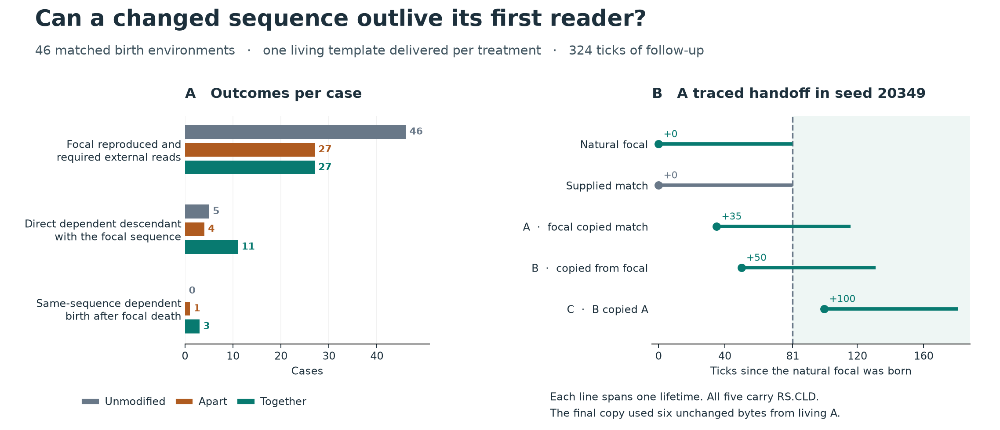

# Can a changed sequence outlive its first reader?

In 46 matched birth environments, placing a living copy of a changed reader's program beside the newborn produced a later read-dependent descendant with the same sequence in three cases. Placing the same matching individual far away and its nonmatching counterpart nearby produced one case. One environment succeeded in both arrangements. The two together-only outcomes came from different seeds in the original pilot block. This establishes a route past the original carrier's death under a single delivery. The observed pedigrees still ended well within the 324-tick window. [Frozen protocol](protocol.md) · [Paired outcomes by block and original seed](results/paired.tsv)



## Matched locations in natural fields

The four historical blocks supplied 75 naturally born changed readers from 55 seeds. Each differed from its immediate executor, and both had previously required external reads to reproduce. We replayed every original birth hash and focal lifetime result. Forty-six cases from 35 seeds had room for delivery. In the other 29, one or more residents would have needed moving and there was insufficient free parking space. All 75 ordinary branches remained in the ledger. In the eligible cases, 13 required no relocation, 30 required one and three required two. The two treatment arms shared relocations, newborn ages, CPUs and occupied sites. Only the assignment of the two supplied sequences to the near and far sites differed. The ordinary branch added neither individual. [Case selection](results/cases.tsv) · [Sites, relocations and exclusions](results/placement.tsv)

| Cases with an outcome, out of the same 46 | Unmodified | Match apart | Match together |
| --- | ---: | ---: | ---: |
| Original focal reproduced and required external reads | 46 | 27 | 27 |
| Focal copied six unchanged bytes from the supplied living match into a child | — | 0 | 15 |
| Direct confirmed descendant with the focal's sequence | 5 | 4 | 11 |
| Confirmed same-sequence descendant born after focal death | 0 | 1 | 3 |
| Later endpoint reached through an intact focal copy of the supplied match | — | 0 | 2 |

The direct-descendant count admits the focal as either executor of division or living supplier of all six bytes. An intact first copy alone says nothing about the offspring's ability to reproduce. Every individual counted on a confirmed path had at least one birth incorporating external material, made the recorded offspring in ordinary replay, encountered a blocked external copy attempt under its own read denial and made zero offspring under denial. The first natural focal was the only pedigree root. The supplied matching individual and its independent offspring could contribute material or execution to a rooted birth. Their mere presence could never qualify. [Branch populations and focal permission forks](results/branches.tsv) · [Byte provenance and descendant forks](results/nodes.tsv.gz)

| Archive block | Eligible / selected cases | Together only | Apart only | Both | Neither |
| --- | ---: | ---: | ---: | ---: | ---: |
| Six-origin pilot | 25 / 31 | 2 | 0 | 0 | 23 |
| Six-origin replication | 7 / 9 | 0 | 0 | 0 | 7 |
| Long-run A | 5 / 17 | 0 | 0 | 1 | 4 |
| Long-run B | 9 / 18 | 0 | 0 | 0 | 9 |
| Total | 46 / 75 | 2 | 0 | 1 | 43 |

Collapsing repeated cases by original seed gave two together-only, zero apart-only, one shared and 32 negative seeds. No ordinary branch reached the late endpoint, including the 29 ineligible cases. Nineteen of the 46 original focals lost confirmed reproduction in both supplemented arms. This matched comparison isolates which program occupied which site conditional on successful delivery. The ordinary comparison also changes crowding and, in some cases, nearby residents' positions. The two discordant seeds give limited evidence about the frequency advantage outside these selected fields. [All four blocks and untreated controls](results/summary.tsv)

## How the late copies arose

- **Seed 20349, together only.** At tick 1227 the changed RS.CLD reader occupied site 13. It copied the supplied live match at site 14 into offspring A at tick 1262. Another individual copied the original reader into offspring B at tick 1277. The original reader and supplied match died at tick 1308. After both deaths, B read all six unchanged bytes from living A at ticks 1315–1325 and divided at tick 1327. The new individual produced one offspring ordinarily and zero under its own read denial. The two intervening readers also passed their own lifetime tests. This pedigree supplies both a living source and an executor from the next generation.
- **Seed 20382, together only.** The root produced a confirmed R>SCLD intermediate from reserved bytes. This intermediate subsequently copied all six RS.CLD bytes from another living reader and produced a confirmed RS.CLD offspring at tick 1033, 16 ticks after root death. The traced path temporarily changed sequence. It did not pass through a focal-executed intact copy of the supplied match.
- **Seed 25763, both arrangements.** The focal at site 34 was born at tick 3201 carrying R.SCLD. With the matching partner nearby, its two confirmed direct offspring inherited that sequence through intact live copies. With the nonmatching program nearby, the corresponding offspring carried RS.CLD. In both branches an offspring produced a confirmed R.SCLD descendant at tick 3298 by copying six unchanged bytes from a reserved bank. The same later sequence can therefore be reached by different material routes. [Lifetime and byte records for all three witnesses](results/nodes.tsv.gz)

As a supplementary duration check, the latest birth on any confirmed path in the matched cases was at +114 ticks with the partner nearby, +100 apart and +81 unmodified. With an 81-tick lifetime, even the latest confirmed reader had died by +195. All 167 field branches still had births in their final 80 enrollment ticks. Population-level reproduction continued after these particular pedigrees ended. A prospective test in untouched fields could now look for spontaneous renewal of both roles, using the seed-20349 case as a positive control for the ancestry analysis.

## Replay and data

The protocol was committed as `b743565` before running the branches. Each field uses the historical 16 × 4 torus, founder R..CLD, age limit 80, local fetch, external reads, retained bytes, first-free placement and 20,000 ppm copy substitutions. Every branch runs 324 ticks after the original birth plus 81 for the last enrolled offspring's lifetime. A study-local build reuses the native newborn initializer, historical relocation and historical permission assay. The reference VM source remains the replay baseline. Release and reverse-traversal builds at different optimization levels produced identical tables. [Inputs and output checksums](revision.sha256)

From the repository root, use C++20, Make, Python 3.10 or newer, and Matplotlib for the PNG.

```sh
study=kernel/runs/partner-placement-01
out=kernel/build/partner-placement
rev=kernel/build/partner-placement-replay
make -C kernel all test
make -C "$study"
python3 -B "$study/run.py" "$out/field" "$out/results"
python3 -B "$study/analyze.py" "$out/results"
diff -qr "$study/results" "$out/results"
make -C "$study" BUILD=../../build/partner-placement-replay CXXFLAGS='-O3 -Wall -Wextra -Werror'
python3 -B "$study/run.py" "$rev/field" "$rev/results" --reverse
python3 -B "$study/analyze.py" "$rev/results"
diff -qr "$out/results" "$rev/results"
python3 -B "$study/plot.py" "$out/results" "$out/partner-placement.png"
shasum -a 256 -c "$study/revision.sha256"
```

Each case ID contains the seed, focal site and birth tick. Individual IDs are local to a branch. The node table includes each direct successor of the focal and each child linked to a confirmed path by executor or aligned living donor. It records all six input bytes, source tick, site, birth tick, bank kind, read offset and source individual ID. A negative donor means no aligned living supplier. Incomplete pre-delivery provenance uses kind `?`, a placeholder input byte and negative identifiers. Such a prefix precedes the focal's birth and cannot establish a material link to it. Denied and blocked counts of -1 indicate no assay for that successor. Endpoint counts in branches are numbers of births. Summary and paired tables count cases or original seeds with at least one qualifying birth.
