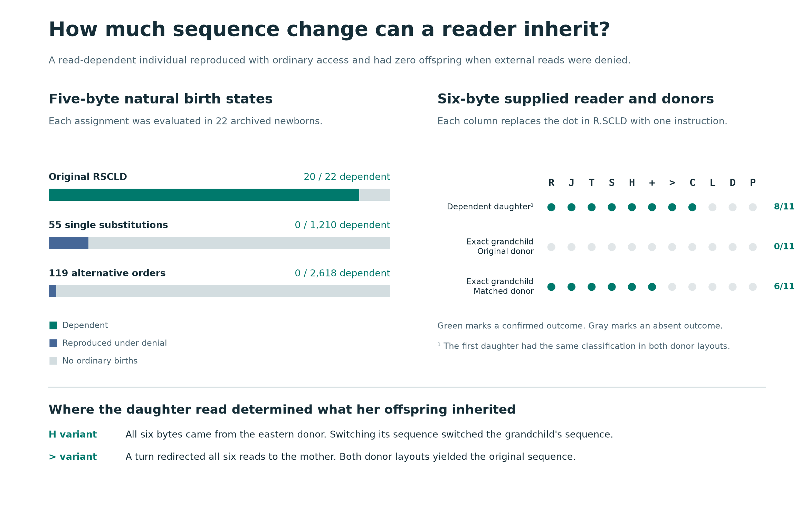

# Program length and donor sequence constrain inherited read dependence

A five-byte reader lost confirmed read dependence under every single substitution in 22 natural birth backgrounds. In a mutation-free comparison with a supplied six-byte reader, **eight of eleven changed programs** still required external reads in the first daughter. **Six of eleven** reached an identical grandchild through the assigned living donor when that donor carried the changed program. The two experiments address different questions. The first edits natural newborns in their recorded worlds. The second measures what fixed programs and a supplied donor layout can express. [Frozen protocol](protocol.md) · [Natural outcomes](results/natural-summary.tsv) · [Six-byte outcomes](results/supplied.tsv)



## Five-byte readers in natural birth states

The two previously confirmed field pedigrees contained 22 exact RSCLD daughters with a dependent parent, 12 in seed 3562 and ten in seed 11942. Each individual contributed the same birth state to every assignment. Separate lifetime forks isolated the focal's external-read permission. Untreated controls matched the archived birth-state hashes, offspring timing, sites, input bytes, product bytes, blocked attempts and classifications. Two control newborns had no ordinary offspring. [Enrolled parent and daughter identities](../inheritance-01/pedigrees/individuals.tsv) · [Individual assignments](results/cases.tsv)

| Assigned sequence | Background × sequence trials | Dependent | Reproduced under denial | No ordinary offspring |
| --- | ---: | ---: | ---: | ---: |
| Unchanged RSCLD | 22 | 20 | 0 | 2 |
| Every single substitution | 1,210 | 0 | 141 | 1,069 |
| Every other order of the same five instructions | 2,618 | 0 | 58 | 2,560 |

Of the 20 dependent controls, ten produced at least one dependent daughter. The 32 tested daughter lifetimes from these controls included 14 dependent daughters. All 14 retained RSCLD. A failure to reproduce with ordinary access leaves dependence unclassified. Trial counts here describe repeated assignments in two seed pedigrees.

### Why the five positions are constrained

Code inspection gives a stronger restriction for a fresh five-byte CPU with external instruction fetch disabled. A birth requires allocation (`R`), successful copies (`C`) and division (`D`). Successful external copying also requires `S` because allocation sets the read source to the executing site. Without `L`, a five-byte program containing those four operations has at most two copies before `D` resets the CPU and releases an incomplete allocation. It cannot fill five destination bytes.

This accounts for all five positions. `L` repeats the previous instruction, so it must immediately follow `C` to obtain five writes. `D` resets execution to the beginning on success and failure, so every required action must be reachable before it. Allocation must precede external source selection, and selection must precede the copying loop. Together these constraints give the order `R S C L D`. The 119-permutation experiment directly checked the alternative orders in both natural backgrounds. This deduction concerns the five-byte newborn state under the reference VM. The reservation takes its size from the parent and the current mutation operator substitutes bytes, so these five-byte lineages keep their length. [VM step, placement and mutation](../../src/vm.cpp) · [Kernel contract](../../../docs/r0-kernel-contract.md)

## Changed daughters in a six-byte field

The supplied founder was `R.SCLD`. The program slot after `R` was executed by every first daughter, including the three substitutions that never reproduced. Founders copied all six bytes from their living eastern donor. In every assignment the first daughter appeared at site 44 on tick 16. Both founder and daughter needed external reads for eight changed slot symbols in each second-donor configuration. Denying either focal's reads gave it zero offspring. Three changed daughters, carrying `L`, `D` or `P` in that slot, had no ordinary offspring.

| Second living donor east of the daughter | Changed dependent first daughters | First daughters producing an exact changed grandchild from that donor |
| --- | ---: | ---: |
| Original founder sequence | 8 / 11 | 0 / 11 |
| Same changed sequence as the daughter | 8 / 11 | 6 / 11 |

With mutation disabled, exact copying from the original second donor necessarily yields its original sequence. As an additional source-independent check, we inspected every ordinary offspring of the first daughter. None reproduced the changed sequence in the original-donor layouts. In the matched layouts the six retained slot symbols were `R J T S H +`, with the first exact grandchild on tick 32 in each. Both unchanged control assignments also gave an exact live-donor grandchild on tick 32. These counts enumerate a slot in one deterministic layout. The different daughter sequence was supplied by the first donor and copied without mutation. [All first-daughter outcomes and products](results/supplied.tsv)

Three source traces explain why receiving the behavior and retaining the new sequence gave different counts.

- With `H` in the slot, the next `S` selected the eastern neighbor. The daughter copied its offsets 0 through 5 on ticks 20 through 30. Switching that donor's slot from `.` to `H` changed the first grandchild from `R.SCLD` to `RHSCLD`.
- With `>`, the daughter turned south before selecting her source. It read all six bytes from its own mother at site 36. The first grandchild was `R.SCLD` in both layouts.
- With `C`, the daughter first wrote its own leading `R` and then read the eastern donor's offsets 0 through 4. The first grandchild in the matched layout was `RRCSCL` on tick 30. The daughter needed external reads, but its six writes assembled a different program. [Byte-level sources and all offspring](results/products.tsv)

## Replay

Protocol commit `91d8916` precedes both panels. The kernel baseline is `b22688a`. The natural runs use the historical 16 × 4 field, age limit 80, first-free placement, retained banks, 20,000 copy substitutions per million and the archived seed. The supplied runs use seed 1, an 8 × 8 torus and zero mutation. The executable adds a same-length, birth-tick assignment method to a build-directory copy of the VM header. It compiles the unmodified reference step implementation.

The archive contains 3,874 assignments, 7,956 lifetime branches and 867 focal birth records. Each lifetime ends at the focal's death and retains the population ledger, final status and hashes. All 7,956 branch worlds had births in their final 80 ticks. Zero were stagnant or extinct at that point. All five result tables matched byte for byte between two optimized builds with opposite cell traversal. [Lifetimes](results/lifetimes.tsv) · [Inputs and artifact hashes](revision.sha256)

Run from the repository root with Make, C++20, patch and Python 3.10 or later. Matplotlib is needed only to draw the figure.

```sh
make -C kernel all test
study=kernel/runs/read-variants-01
make -C "$study" all
python3 -B "$study/study.py" kernel/build/read-variants/variants kernel/build/read-variants/results
make -C "$study" BUILD=../../build/read-variants-replay CXXFLAGS='-O3 -Wall -Wextra -Werror' all
python3 -B "$study/study.py" kernel/build/read-variants-replay/variants kernel/build/read-variants-replay/results --reverse
diff -qr "$study/results" kernel/build/read-variants/results
diff -qr "$study/results" kernel/build/read-variants-replay/results
shasum -a 256 -c "$study/revision.sha256"
python3 -B "$study/plot.py" "$study/results" kernel/build/read-variants/sequence-changes.png
```
