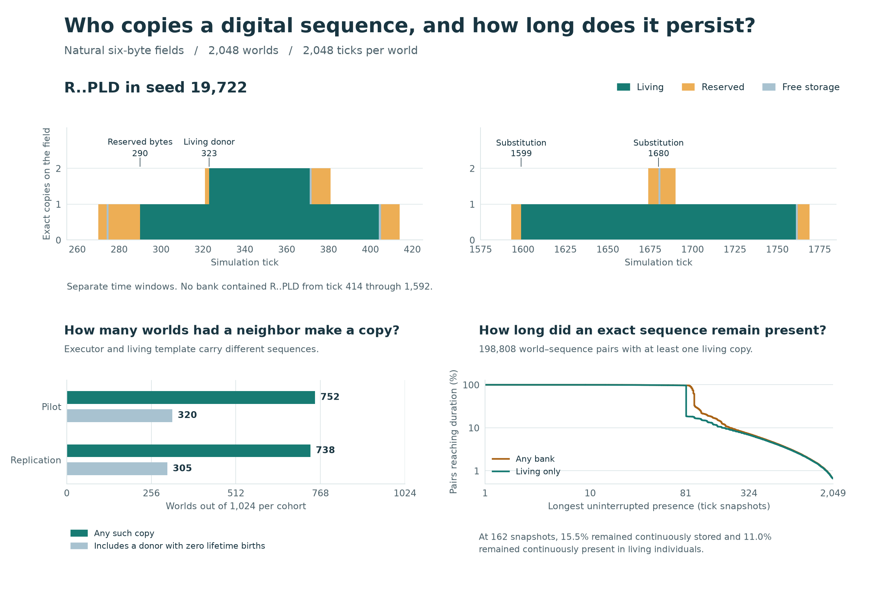

# Who made the copy, and whose sequence persisted?

A program assembled an exact copy of a different living neighbor's six-byte sequence in 1,490 of 2,048 untreated worlds (72.8%). This happened 3,161 times in 2,521,383 births (0.125%) and involved 263 distinct product sequences. For 845 of these births, the entire lifetime of the individual that supplied the template was observed and its own CPU produced zero offspring. A CPU pedigree misses that individual's contribution. [Frozen protocol](protocol.md) · [Cohort totals](results/cohorts.tsv) · [Executors and donors for every living-template birth](results/living-template-births.tsv)



## Transmission through a living template

| Observed outcome | Pilot | Replication | Pooled |
| --- | ---: | ---: | ---: |
| Worlds | 1,024 | 1,024 | 2,048 |
| Births from a single intact living neighbor with a different executor sequence | 1,632 | 1,529 | 3,161 |
| Worlds containing such a birth | 752 | 738 | 1,490 |
| Distinct product sequences | 181 | 160 | 263 |
| Such births with a fully observed donor that produced zero direct offspring | 437 | 408 | 845 |
| Such births with an incompletely observed donor lifetime | 21 | 32 | 53 |
| Longest consecutive living-neighbor path, transfers | 2 | 2 | 2 |
| Longest living-neighbor path, ticks from first carrier birth to last product birth | 160 | 97 | 160 |
| Longest consecutive self-copy path, transfers | 60 | 60 | 60 |
| Longest self-copy path, ticks | 2,048 | 2,048 | 2,048 |

The two cohorts are disjoint. The pooled diversity counts each product sequence once across both. The founder sequence accounted for 1,617 of the 3,161 different-executor births. The other 1,544 births occurred in 946 worlds. The zero-direct-offspring count is a supplementary lifetime audit. Its 845 births involved 750 distinct fully observed donors in 625 worlds. Among the 3,108 primary births with complete donor follow-up, that subset accounted for 27.2%. Direct offspring counts describe what those donors did during the run.

Copy paths connect a product backward to the particular individual supplying all six bytes. Each path uses the same route and product sequence throughout. The path measures include all intact living-neighbor copies, including four births where the executor and donor carried identical sequences. Six world–sequence pairs reached a second consecutive living-neighbor transfer. No third transfer was observed by tick 2,048. Path duration, the existence of an exact sequence somewhere on the field and the lifetime of an individual are three different measurements. [Per-world endpoints](results/seeds.tsv) · [Per-sequence stocks and paths in each world](results/world-sequences.tsv.gz)

## Routes of birth and return

| Route assigned to the birth | All births | Births restoring a previously occupied sequence |
| --- | ---: | ---: |
| Executor copied its own intact sequence | 2,224,716 | 0 |
| Executor copied one intact living neighbor | 3,165 | 4 |
| Executor copied one intact free or reserved bank | 4,112 | 395 |
| Assembly from other unchanged inputs | 1,034 | 124 |
| At least one copied byte underwent substitution | 288,356 | 73,417 |
| **Total** | **2,521,383** | **73,940** |

A return requires a previously observed occupied sequence with zero living copies at the opening of the birth tick. If two products satisfy that condition on the same tick, each birth counts. In 99.3% of returns a copy substitution occurred. In 395 returns the read ledger identifies the entire returning sequence in one inactive bank during all six reads. The four living-template returns are possible because the donor can die between the last read and division. [Route counts by cohort](results/cohorts.tsv)

Across both cohorts, 22,007 distinct strings appeared in storage and 9,182 appeared in living individuals. Across the 198,808 world–sequence pairs ever present in a living individual, 30,825 (15.5%) had an uninterrupted run of at least 162 tick snapshots in some form of storage and 21,929 (11.0%) had one in living individuals. These are longest observed runs for the same set of pairs. An occupant can die on the same tick that an unrelated copy appears elsewhere. Continuous abundance therefore establishes field presence, with source traces needed to establish transmission. Observations end at tick 2,048.

## Two appearances of the same sequence in seed 19722

- The first committed bank containing `R..PLD` was reserved at tick 270. At tick 290, the executor `RS.CLD` at site 21 completed a birth from the intact reserved bytes at site 22. The field then held one living copy.
- The same executor read the living site 22 at ticks 311, 313, 315, 317, 319 and 321. At tick 321 the field held one living and one reserved copy. Division activated the second copy at site 37 on tick 323. The donor at site 22 produced zero direct offspring before its death at tick 371.
- Living abundance reached zero at tick 404. The last stored bytes disappeared at tick 414. All three stocks stayed at zero through tick 1,592.
- A substitution during copying of `R..CLD` produced a reserved `R..PLD` at tick 1,593. It became a living copy at tick 1,599. A second substitution produced another birth at tick 1,680, on the first individual's death tick. Living abundance stayed at one across that handoff despite the two independent origins. The last living copy died at tick 1,761 and the last stored copy disappeared at tick 1,769. [Complete stock change points](results/witness-stocks.tsv) · [Related births and every source read](results/witness-births.tsv)

## Measurement and replay

The protocol was committed at `dc5fd3a` on baseline `95b77dc`. Both [archived six-byte cohorts](../six-origin-01/README.md) start with `R..CLD` at site 36 on a 16 × 4 torus. The VM uses synchronous commits, first-free placement, neighbor reads, local instruction fetch, retained bytes, maximum age 80 and 20,000 copy substitutions per million byte writes. Seeds 19521–20544 and 20545–21568 all remained reproducing at the cutoff. There were zero stagnant or extinct worlds. The observer uses the existing VM events and committed field. The two builds used Apple Clang 21.0.0, forward traversal with `-O2` and reverse traversal with `-O3`.

- Each committed snapshot, including tick zero, counts an exact six-byte string separately in occupied, reserved and free banks. Empty banks are excluded. Zero-padded and partially assembled banks contribute their actual current strings. Stock changes hold until the next change, with implicit zero before the first row. Copy-ticks sum the stock over snapshots 0–2,048 inclusive. A positive uninterrupted run can extend to either observation boundary.
- The birth ledger records the executor's site, birth tick and sequence, product site and sequence, and six reads in destination-offset order. Each read encodes `tick/site/offset/bank-kind/source-birth/reservation-owner/full-source-hex`. Kinds are `o`, `r` and `f`. The input byte is at the recorded source offset and the written byte is at that entry's position in the product. A value of −1 denotes an absent identity or owner.
- Any substitution takes precedence in the five-way classification. Otherwise, an intact copy requires all six reads to use their aligned offsets at one site, with the complete opening bank equal to the final product at every read. A living source also requires the same individual throughout. A residual source can be free or reserved at read time, including an executor's own reservation. Other unchanged-input births count as assembly.
- All 2,048 world outcomes, population ledgers, external-read birth counts and final state hashes match the original archive. Aggregation also checks occupied copy-ticks against the independently summed observed lifetimes of every newborn and the founder. The SHA-256 digests of all 8,192 raw tables match across traversal orders and optimizations. [Per-world detail hashes](results/index.tsv) · [Source and archive hashes](revision.sha256)

Run from the repository root with C++20, Make and Python 3.10 or newer. The plot uses Matplotlib. One seed produces four human-readable TSV files.

```sh
study=kernel/runs/sequence-stock-01
out=kernel/build/sequence-stock
make -C kernel all test
make -C "$study" all
mkdir -p "$out/example"
"$out/census" 19722 "$out/example"
```

The full replay stores compressed raw tables per seed under the build directory. The tracked index hashes the uncompressed bytes. The compressed sequence summary contains 410,506 seed–sequence records and includes final abundance per class, copy-ticks, positive snapshot counts, maxima and route totals.

```sh
python3 -B "$study/replay.py" "$out/census" "$out/index.tsv" --details "$out/details"
make -C "$study" BUILD=../../build/sequence-stock-replay CXXFLAGS='-O3 -Wall -Wextra -Werror' all
python3 -B "$study/replay.py" kernel/build/sequence-stock-replay/census kernel/build/sequence-stock-replay/index.tsv --reverse
cmp "$out/index.tsv" kernel/build/sequence-stock-replay/index.tsv
python3 -B "$study/summarize.py" "$out/details" "$out/index.tsv" "$out/results"
cp "$out/index.tsv" "$out/results/index.tsv"
diff -qr "$out/results" "$study/results"
python3 -B "$study/plot.py" "$out/results" "$out/sequence-stock.png"
shasum -a 256 -c "$study/revision.sha256"
```
