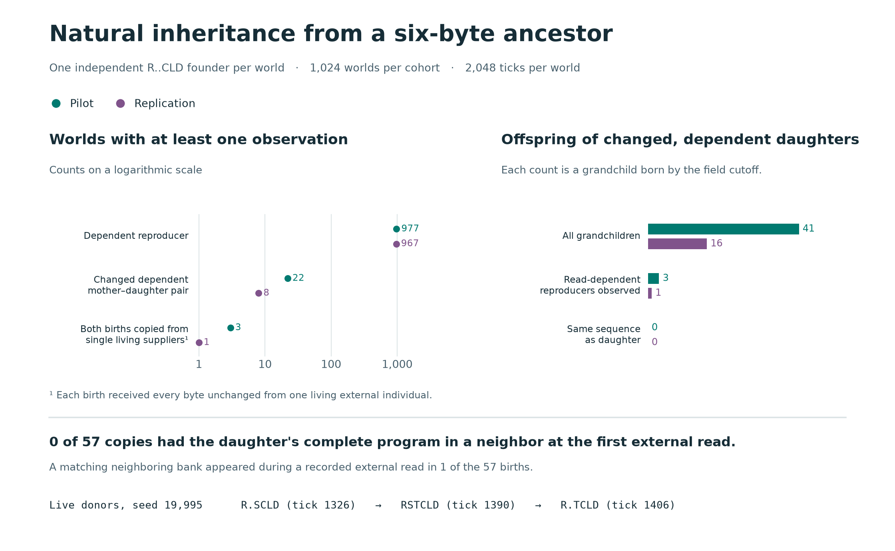

# External-read dependence crossed sequence changes in natural six-byte fields

Starting from one independently reproducing `R..CLD`, 22 of 1,024 pilot worlds produced a changed mother–daughter pair in which both individuals required external reads to reproduce. An independent cohort produced this outcome in 8 of 1,024 worlds. The 40 changed daughters produced 57 grandchildren during their full lifetimes. None had the daughter's exact sequence. Four grandchildren were themselves confirmed dependent reproducers within the field window. [Pilot protocol](protocol.md) · [Independent replication protocol](replication-protocol.md)



## Natural incidence

The primary unit is a world. Each qualifying daughter had a different program from her mother and both generations supplied at least one external byte to the relevant birth. In separate matched lifetime forks, each focal reproduced normally, attempted a blocked external copy under focal denial, and produced zero offspring under denial. The screen admitted every byte sequence and every externally sourced birth through tick 2048. Repeated grandchildren from the same daughter contribute one mother–daughter edge. [Pilot focal tests](pilot/focals.tsv) · [Replication focal tests](replication/focals.tsv)

| Observed by tick 2048 | Pilot, seeds 19521–20544 | Replication, seeds 20545–21568 |
| --- | ---: | ---: |
| Worlds | 1,024 | 1,024 |
| Births | 1,260,961 | 1,260,422 |
| Births incorporating external bytes | 4,553 | 4,285 |
| Confirmed dependent reproducers, distinct worlds | 3,264 in 977 | 3,112 in 967 |
| Changed daughters from dependent mothers using external material | 4,540 | 4,275 |
| Of those daughters, had at least one observed birth | 2,668 | 2,547 |
| Confirmed changed edges, distinct worlds | 31 in 22 | 9 in 8 |
| Confirmed unchanged edges, distinct worlds | 9 in 7 | 8 in 8 |
| Changed edges with an intact single live supplier in each generation, distinct worlds | 3 in 3 | 1 in 1 |
| All offspring of the confirmed changed daughters | 41 | 16 |
| Offspring with the daughter's exact sequence | 0 | 0 |

All 2,048 populations had births in the last 80 ticks, with zero stagnant and zero extinct populations at the cutoff. Among changed externally sourced daughters without an observed external-material birth, 196 in the pilot and 160 in replication were still alive at tick 2048. The finite-window incidence includes no later births. For the 40 confirmed changed daughters, separate whole-lifetime follow-up verified that all 57 offspring were born within the window. [Pilot seed ledger](pilot/seeds.tsv) · [Replication seed ledger](replication/seeds.tsv)

In seed 19995 a mother born at tick 1326 carried `R.SCLD`. It produced a daughter carrying `RSTCLD` at tick 1390. The daughter produced an `R.TCLD` grandchild at tick 1406. Both transfers used six unchanged bytes from a single living neighbor. The mother's three ordinary births and the daughter's two ordinary births each fell to zero under their respective read denials. Across all 40 primary edges, external material could also come from reserved or free banks. The separate live-source endpoint identifies the narrower set of complete, unchanged live transfers. [Pilot byte provenance](pilot/edges.tsv) · [Replication byte provenance](replication/edges.tsv)

## Why the daughter's sequence was lost

In every one of the 57 grandchild births, the input byte string already differed from the daughter's program before copy substitutions. Forty-seven products exactly matched those inputs. Ten included an additional substitution or substitutions. Thus an additional change during copying was unnecessary for the observed loss. Three pilot grandchildren and one replication grandchild later made externally sourced offspring and passed their own denial tests. The remaining grandchildren have no confirmed dependence under the enrollment screen. [Pilot full-lifetime products](pilot/retention.tsv) · [Replication full-lifetime products](replication/retention.tsv)

A post hoc replay measured template availability at all 339 successful external reads for these births. It compared the daughter's six-byte program to the opening bytes in each of her four neighboring banks, including free and reserved banks. At the first external read none of the 57 births had an exact local template. In 56 births there was no exact neighboring template at any external read. The single exception was seed 19918 at tick 1204. The daughter's own northern reservation temporarily matched its program, while the actual copy read from its eastern neighbor. The trace shows which bytes were available and selected. The causal effect of supplying a matching template remains open. [Pilot opening snapshots](pilot/neighborhoods.tsv) · [Replication opening snapshots](replication/neighborhoods.tsv)

The next experiment can fork the 40 daughters' natural birth states, provide one complete matching template for a single reproduction attempt, and follow the resulting grandchildren after ordinary conditions resume. The informative endpoint is whether those grandchildren reproduce dependently and carry the changed sequence into another generation. A paired ordinary replay gives the baseline. This is a proposed intervention.

## Replay

The reference VM baseline is `20832ef`. The pilot protocol was committed in `c3d908e`. The pilot results and replication protocol were committed together in `e16d9b5` before executing the new seeds. Each world starts from an otherwise empty 16 × 4 torus with one six-byte independent ancestor at site 36, first-free allocation, retained bytes, age limit 80, external reads enabled, external fetch disabled and 20,000 random substitutions per million copied bytes. The supplied ancestor adds one inert byte to the five-byte independent ancestor. This experiment measures occurrence under that initial condition. A causal comparison of rates between lengths would need a matched design.

With mutation disabled the founder produced the same three exact offspring at ticks 16, 32 and 49 with and without permission to read externally. Both runs ended its lifetime with the same world hash. An independent census checked every natural world's population ledger and terminal hash. Ordinary focal products were checked against untreated birth ticks, sites, input bytes and output sequences. All result tables matched byte for byte across separately optimized forward and reverse traversals. [Founder controls](pilot/controls.tsv) · [Source and output digests](revision.sha256)

Run from the repository root with C++20, Make, patch and Python 3.10 or newer. The final image uses Matplotlib.

```sh
make -C kernel all test
study=kernel/runs/six-origin-01
for order in forward reverse; do
    suffix=; flag=; opt=-O2
    if [ "$order" = reverse ]; then suffix=-replay; flag=--reverse; opt=-O3; fi
    bin=kernel/build/six-origin$suffix
    make -C "$study" BUILD="../../build/six-origin$suffix" CXXFLAGS="$opt -Wall -Wextra -Werror" all
    for cohort in pilot replication; do
        group=
        if [ "$cohort" = replication ]; then group=--replication; fi
        python3 -B "$study/analyze.py" "$bin" "$bin/$cohort" $flag $group
        python3 -B "$study/neighbors.py" "$bin/reference" "$bin/$cohort" $flag
        diff -qr "$study/$cohort" "$bin/$cohort" || exit 1
    done
done
shasum -a 256 -c "$study/revision.sha256"
python3 -B "$study/plot.py" "$study" kernel/build/six-origin/field-inheritance.png
```
