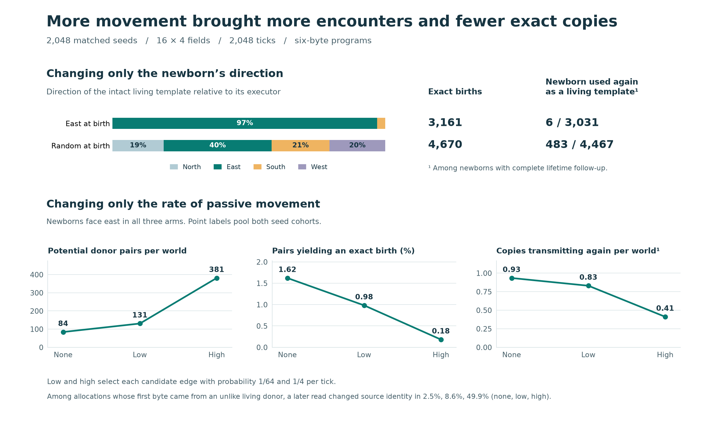

# Birth orientation, transport and intact template copying

In 2,048 matched worlds, randomizing only newborn bearing raised births copied intact from a different living neighbor from 3,161 to 4,670. Passive exchange increased encounters at both tested rates and reduced those exact births to 2,834 and 1,448. Both seed cohorts showed the same direction for the birth counts. All 8,192 field runs reached tick 2,048 with births in their final 80 ticks. [Frozen protocol](protocol.md) · [Each seed and final state hash](results/seeds.tsv)



## Observations

| Pooled outcome | Stationary, east at birth | Stationary, random at birth | Low transport, east | High transport, east |
| --- | ---: | ---: | ---: | ---: |
| All births | 2,521,383 | 2,511,019 | 2,529,129 | 2,554,618 |
| Potential donor pairs per world | 84.0 | 83.7 | 130.6 | 381.0 |
| Potential donors per observed carrier of S | 4.45 | 4.41 | 7.53 | 22.29 |
| Pairs with at least one actual read | 4,073 | 6,659 | 4,430 | 7,286 |
| Pairs yielding at least one exact birth / all potential pairs | 1.62% | 2.61% | 0.98% | 0.18% |
| Exact births | 3,161 | 4,670 | 2,834 | 1,448 |
| Worlds with an exact birth | 1,490 | 1,730 | 1,461 | 967 |
| Exact births reading an eastern donor | 97.1% | 39.6% | 96.3% | 97.7% |
| Exact newborns with full lifetime follow-up | 3,031 | 4,467 | 2,713 | 1,386 |
| Such newborns making an exact self-copy | 1,908 | 2,901 | 1,694 | 842 |
| Such newborns supplying an exact template to another executor | 6 | 483 | 9 | 1 |
| Such newborns transmitting by either route | 1,912 | 3,059 | 1,699 | 842 |
| Either route as a share of fully observed newborns | 63.1% | 68.5% | 62.6% | 60.8% |
| Incomplete newborn follow-up | 130 | 203 | 121 | 62 |

A potential pair comprises one individual carrying the neighbor-source instruction S and one adjacent, living individual with a different genome. Deduplicate by the two birth identities over their observed lifetimes. The screen includes programs that never execute S. A productive pair supplied one or more births with six aligned, unchanged reads from the same donor. Count its births separately. Newborn self-copy and template-use rows can overlap. Each arm includes 1,024 pilot worlds and 1,024 replication worlds. [All cohort totals, including facing, room and exposure](results/cohorts.tsv) · [Identities and six reads for every enrolled birth](results/products.tsv)

### Birth direction

In the random-birth arm, 875 exact births read north, 1,850 east, 990 south and 955 west. The four initial bearings themselves occurred at very similar frequencies. The successful eastern share fell by 57.4 percentage points compared with the stationary east arm. The exact-birth count rose by 0.737 per world (paired approximate 95% interval 0.640 to 0.833). The pilot and replication blocks rose from 1,632 to 2,299 and from 1,529 to 2,371 births respectively. Initial bearing influences both neighbor selection and the search order for a daughter site. Division still resets the executor to east. This comparison measures their combined consequences.

A supplementary identity audit found that 483 fully followed random-bearing newborns supplied a later exact copy in 412 worlds. In 475 cases their original executor subsequently copied from the newborn itself. In 472 of those cases, the newborn was east of the executor at the first such reuse. This directly observed route can continue to copy the same sequence with just one executing individual. The evidence for reuse alone does not establish reciprocal copying. [Post hoc reuse audit](results/reuse.tsv)

### Passive movement

The measured rates were 0.88 and 14.06 individual steps per 100 opening living-individual ticks. High transport raised potential encounters by 297.0 per world (paired approximate 95% interval 282.4 to 311.5). Exact births fell by 0.160 per world at low transport (interval −0.239 to −0.080) and by 0.836 at high transport (interval −0.911 to −0.762). The corresponding high-transport birth counts were 684 in the pilot block and 764 in replication.

One observation bears on contact stability. Among allocations whose first written byte came from a different living donor, a later successful read used a different individual or an inactive bank in 114/4,582 stationary cases, 383/4,459 low-transport cases and 2,189/4,389 high-transport cases. These are 2.5%, 8.6% and 49.9%. Changes of supplier can also follow death or a program changing its read pointer. This measure does not assign every lost birth to a separation. Space is also needed to reserve a destination. The per-seed table records potential pairs ever seen in the current bearing and those with either a held allocation or a free neighbor at such an encounter.

The absolute number of newborns transmitting again fell with movement. Conditional on full follow-up of an exact newborn, the high-minus-stationary difference was −2.33 percentage points (paired approximate 95% interval −5.51 to +0.85). The clearer change in these fields occurs in obtaining the first intact copy. Intervals use the seed as the paired unit and the normal approximation with a paired delta method for pooled fractions. They are descriptive and unadjusted for multiple comparisons. [Paired contrasts in both cohorts and pooled](results/contrasts.tsv)

## Rules and checks

The study uses reference revision `7392f81` and protocol commit `4985f29`. The 16 × 4 torus, single east-facing `R..CLD` founder at site 36, synchronous scheduling, first-free placement, retained bytes, local instruction fetch, permitted neighbor reads, maximum age 80 and 20,000 ppm copy substitutions match the [six-byte census](../sequence-stock-01/README.md). Mutation draws depend on seed, tick, executor location and write offset. Trajectories can diverge when a position or an instruction changes. The experiment uses the reference VM implementation with a build-local header granting access for the two environmental operations.

- Random bearing applies at committed birth, before a newborn first executes. It can change initial placement choice as well as read direction. Parent resets after division retain the normal VM rule.
- After instruction commit, choose one of four horizontal/vertical even/odd matchings with equal probability. Each includes every site exactly once. Sample its edges with probability 1/64 or 1/4. The low threshold is nested in the high threshold for a given seed, tick and edge. A selected pair exchanges complete banks only if at least one is occupied and neither end is reserved or owns a reservation. An individual keeps its sequence, birth identity, age, program counter, direction and relative source offset. Incoming pointers stay attached to addresses. A free bank's residual bytes go to the vacated site. An ineligible pair stays unchanged. Time advances once for the combined tick. These are lattice exchange probabilities.
- Birth identity is the original birth site and tick, carried through every swap. The observer records each copy against the pre-instruction occupants. A newborn can move after its birth that same tick. Birth and death are the only sources and sinks of individuals. The fixed-program checks cover two live individuals exchanging, retained free bytes, a nonzero birth tick, moving self/neighbor pointers, an outside reader losing its source, matching coverage and pinned reservations. Population balance and identity checks run in the field census as well.
- The stationary east reference reproduces all 2,048 archived final state hashes, population ledgers, external birth counts and every enrolled donor–executor–product record and direction. Both optimization levels and traversal orders reproduce all seed, product, cohort, contrast and reuse tables byte for byte. The reported state hash covers VM state; the arm and seed select the additional deterministic environmental rule. [Source and result checksums](revision.sha256)

## Replay

From the repository root, use C++20, Make, awk and Python 3.10 or newer. The figure uses Matplotlib.

```sh
study=kernel/runs/spatial-transport-01
out=kernel/build/spatial-transport
replay=kernel/build/spatial-transport-replay
make -C kernel all test
make -C "$study" all test
mkdir -p "$out/example"
"$out/field" 19722 high "$out/example"
python3 -B "$study/run.py" "$out/field" "$out/results"
python3 -B "$study/analyze.py" "$out/results"
make -C "$study" BUILD=../../build/spatial-transport-replay CXXFLAGS='-O3 -Wall -Wextra -Werror' all test
python3 -B "$study/run.py" "$replay/field" "$replay/results" --reverse
python3 -B "$study/analyze.py" "$replay/results"
diff -qr "$study/results" "$out/results"
diff -qr "$out/results" "$replay/results"
python3 -B "$study/plot.py" "$out/results" "$out/spatial-transport.png"
shasum -a 256 -c "$study/revision.sha256"
```
