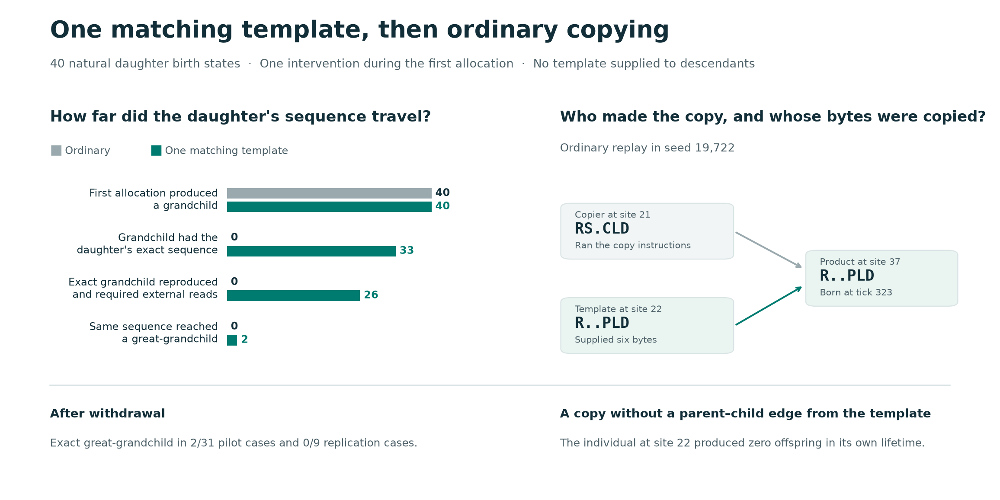

# A single matching template restored exact copies more often than sustained transmission

In 40 paired natural birth states, giving a changed daughter one matching template produced 33 exact grandchildren. Ordinary replay produced zero. After withdrawal, 26 of the 33 exact grandchildren reproduced and required external reads to do so. Two passed the sequence to a great-grandchild, both in the pilot group. A separate analysis found five other cases in which a neighboring executor made a complete copy of the exact grandchild's sequence during its lifetime. [Frozen endpoints](protocol.md) · [Paired case results](results/cases.tsv) · [Copier and template roles](results/roles.tsv)



## Paired intervention

The cases are the 40 changed, read-dependent daughters identified in 30 worlds in the [natural six-byte study](../six-origin-01/README.md). Both arms start at the same archived birth checkpoint. During the first allocation, the treatment makes a virtual six-byte template visible only to the daughter at the first external source address she tries to copy. Her read offsets select the input bytes. The VM applies its ordinary mutation operator and writes to her actual allocation. The underlying bank, its possible executing CPU and every other reader retain ordinary access to the bank's actual contents. Division or death ends the intervention. All subsequent offspring experience the resulting field without a supplied template.

| Outcome per enrolled daughter | Ordinary, all 40 | Matched, pilot 31 | Matched, replication 9 | Matched, all 40 |
| --- | ---: | ---: | ---: | ---: |
| First allocation produced a grandchild | 40 | 31 | 9 | 40 |
| Input string exactly matched the daughter | 0 | 31 | 8 | 39 |
| Grandchild was an exact copy | 0 | 26 | 7 | 33 |
| Exact grandchild reproduced and required external reads | 0 | 22 | 4 | 26 |
| Exact dependent grandchild produced a same-sequence great-grandchild | 0 | 2 | 0 | 2 |

Both cohorts showed restoration of the immediate copy. They differed on the prespecified post-withdrawal endpoint, with two distinct pilot seeds and zero replication cases passing. These denominators describe selected daughters with a known natural transmission history. They do not estimate the incidence of matching templates in untreated worlds. [Cohort scores and paired differences](results/summary.tsv)

Six of the 39 exact input strings acquired a copy substitution. The remaining mismatched input came from a grandchild-producing allocation in seed 21256. The daughter first copied a byte from herself and then read the first five template bytes. Of the 33 exact grandchildren, seven had no ordinary offspring. The other 26 collectively produced 35 offspring. Three input strings equaled the changed sequence and two of those remained exact after copying. [Inputs, products and allocation contents](results/births.tsv)

In the two positive primary cases, seeds 20265 and 20382, the grandchild read all six bytes of `RS.CLD` from its own reserved destination. Those six bytes were already present when the allocation was granted. The great-grandchild was born at tick 1583 or 969, respectively. The external-read denial applied to each grandchild separately eliminated its reproduction. An intact sequence in residual memory therefore supplied an ordinary copy after the pulse was withdrawn in those two runs. [Both successful transfers](results/witnesses.tsv) · [Every focal copy](results/copies.tsv)

## A macromolecule analogy changes which events we count

Treat a local program as a sequence-bearing object. When its CPU runs, its instructions can choose a template and assemble a product. When another CPU reads its bytes, it can serve as a template. The executing individual and the source of the product's sequence can have different identities. The parent–child ledger counts the executor's division. Counting exact copies of a sequence also requires tracing material read from other sites. This is an analogy at the level of template-dependent copying. The measured quantities are byte sequences, addresses, read permissions and simulation ticks.

We added a descriptive template-use audit after scoring the registered endpoint. For each first-allocation grandchild with ordinary permission, it follows births by other CPUs through the grandchild's death tick. A complete template copy requires all six aligned offsets to have been read from that particular living individual and the resulting product to equal its program. The audit records partial uses and copy substitutions as well. Births after the observation window and later copying from residual bytes fall outside this role count. [Observed template uses](results/template-uses.tsv)

In the matched arm, five of the 33 exact grandchildren served as the complete template for a neighbor's exact product. Three came from the pilot group and two from replication. These five cases and the two direct transmissions were disjoint. Thus seven of the 33 restored copies were associated with a further exact birth during their lifetimes by one of the two routes observed here. This secondary count uses a different event definition from the primary endpoint. [Case overlap](results/roles.tsv)

One ordinary replay shows why the distinction matters. In seed 19722, the `R..PLD` individual born at site 22 on tick 290 had zero offspring before its death on tick 371. Its neighbor at site 21 executed the copy, reading the six bytes from site 22 at ticks 311, 313, 315, 317, 319 and 321. A new `R..PLD` appeared at site 37 on tick 323. The template's sequence gained a copy while the template individual had zero direct offspring. [Ordinary and treated lifetimes](results/lifetimes.tsv)

## Replay

The reference revision is `57345eb`. Protocol commit `0cbf5d7` precedes the treatment runs. Both field cohorts retain their original configurations, mutation rate and scheduling. Build-directory patches add a transient argument to the copy operation and mark reads served by the supplied buffer. The focal birth state and pre-read state hashes match across each pair. All 57 ordinary daughter products match the natural archive. Complete lifetimes include 240 field branches, all with recent births at the focal death checkpoint. A separate mutation-free control used an empty external source. Its ordinary branch and its permission-denied treatment went extinct. The allowed treatment produced an exact copy in the first allocation and was reproducing at the checkpoint. All result tables reproduced byte for byte under reverse cell traversal with a separately optimized build. [Source and result hashes](revision.sha256)

Run from the repository root with C++20, Make, patch and Python 3.10 or newer. The figure uses Matplotlib.

```sh
make -C kernel all test
study=kernel/runs/template-pulse-01
make -C "$study" all
python3 -B "$study/study.py" kernel/build/template-pulse/pulse kernel/build/template-pulse/results
make -C "$study" BUILD=../../build/template-pulse-replay CXXFLAGS='-O3 -Wall -Wextra -Werror' all
python3 -B "$study/study.py" kernel/build/template-pulse-replay/pulse kernel/build/template-pulse-replay/results --reverse
diff -qr "$study/results" kernel/build/template-pulse/results
diff -qr "$study/results" kernel/build/template-pulse-replay/results
shasum -a 256 -c "$study/revision.sha256"
python3 -B "$study/plot.py" "$study/results" kernel/build/template-pulse/template-pulse.png
```
