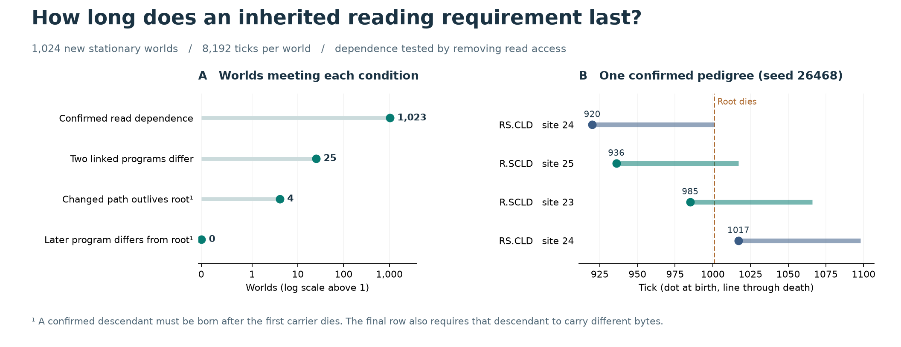

# Did a changed replication trait continue after its first carrier died?

In 4 of 1,024 new stationary worlds, an uninterrupted pedigree of individuals requiring external reads crossed a change of program and produced a confirmed descendant after its first carrier died. The independent blocks contributed one and three worlds. In all four, every qualifying descendant born after that death carried the **original** program again. The behavior continued through the intervening change. The alternative sequence was transient under this birth-based endpoint. [Frozen protocol](protocol.md) · [Per-world outcomes](results/endpoints.tsv) · [First-stage research report](../../../docs/research/neighbor-dependence-results.md)



## From individual behavior to an inherited path

Every field began from an independent R..CLD founder. Over 8,192 ticks the 1,024 worlds produced 5,282,748 births. Individuals born within enrollment could complete their full 81-tick lifetimes. All 11,718 individuals screened because they produced offspring using an externally read byte reproduced in their ordinary replay, encountered an external copy attempt under focal-only read denial, and produced zero offspring under denial. This is an environment-specific change in reproduction under an intervention. The result concerns the external-material screen and allows reads from living neighbors and inactive banks. [All natural field endpoints](results/world.tsv) · [Focal assays and birth provenance, compressed TSV](results/nodes.tsv.gz)

| Worlds with at least one observed outcome | Seeds 25665–26176 | Seeds 26177–26688 | Total / 1,024 |
| --- | ---: | ---: | ---: |
| External-read-dependent reproducer | 511 | 512 | 1,023 |
| Confirmed pedigree containing a change of program | 12 | 13 | 25 |
| Confirmed descendant born after the root's death, any sequence | 2 | 4 | 6 |
| Both a change along the path and a confirmed birth after root death | 1 | 3 | 4 |
| A qualifying later birth still carrying different bytes from the root | 0 | 0 | 0 |
| At least three distinct programs on a qualifying path | 0 | 0 | 0 |

The primary incidence was 0.39% (descriptive 95% Wilson interval 0.15% to 1.00% under independent seed sampling). All four roots also passed the sensitivity restriction giving them at least 162 ticks before the enrollment cutoff. Requiring the later carrier itself to differ from the root was a **supplementary** comparison added after inspection of the primary cases. Some changed carriers born earlier remained alive after the root's death. All 1,024 worlds were still reproducing in the last 80 ticks at enrollment close, with zero stagnant and zero extinct. [Both seed blocks and full denominators](results/summary.tsv)

A confirmed path links an actual CPU executor or an aligned living supplier to its offspring, with independent permission tests for every individual along the path. A root is the first confirmed carrier in a connected direction of descent with no incoming confirmed parent. Among 11,659 roots, 11,613 reached no second confirmed individual. Thirty-nine reached a maximum of two individuals, five reached three, one reached four, and one reached eight. The longest path, in seed 26604, spanned 210 ticks from first to last birth. Its eight individuals all carried RJSCLD. Across all paths at most two distinct programs occurred. Among the 11,659 terminal confirmed individuals, observed outgoing links led to 7,175 successors with no offspring, 9,268 that reproduced without an observed external-material birth, and 64 born after the enrollment cutoff. These are terminal-individual-to-successor links. [All component roots, durations, depths and primary witnesses](results/roots.tsv)

In seed 26468, RS.CLD arose at site 24 at tick 920. An R.SCLD daughter appeared at tick 936. A second R.SCLD was born at tick 985 with the original individual executing division and the tick-936 daughter supplying the six bytes. The original carrier died at tick 1001. At tick 1017 the tick-985 individual produced an RS.CLD offspring at site 24. That offspring also required external reads. Its site and sequence matched the root, while its birth identity and traced parentage establish a later generation. The other primary cases occurred in seeds 25709, 26336 and 26545. All four primary witness paths include a birth with a copy substitution. In each case the change between confirmed programs followed an executor edge whose inputs differed from the executor's own program. The study does not establish serial adaptive improvement.

## Reproduction by an executor, transmission of bytes, and reappearance

Across the new fields there were 35 changed and 24 unchanged executor-only links between confirmed individuals. Nine additional direct links in seven worlds carried the aligned living supplier's sequence to another confirmed individual. All nine were unchanged. When any number of unconfirmed intermediate carriers was allowed along aligned material paths, there were zero further links between confirmed individuals through such a gap. The fully traced material route counts copying from self as well as from another living individual. Mixed-source and residual-byte births retain executor identities and raw source records. [All material links between confirmed individuals](results/material-pairs.tsv)

Newly generated instances of an old program were much more frequent. In 994 worlds, a substitution produced a previously confirmed sequence while no living copy occupied the field at the opening of that birth tick, and the new carrier also passed the permission test. Of 5,916 such returns, 5,313 in 992 worlds had no earlier confirmed carrier of those bytes among their executor or whole-living-template ancestors. This search includes nondependent intermediates and allows a newly born child to count only earlier birth ticks as previous occurrences. In the other 603 cases an earlier confirmed carrier was an ancestor through at least one of these routes. Residual bytes, mixed inputs and deeper shared ancestry limit any claim of independent origin. [Every observed sequence return and ancestry check](results/returns.tsv)

## Replay

The phase-one synthesis and protocol were frozen at commit `c1fa1ac` against `9609fa5`. Both seed blocks used the stationary 16 × 4 torus, local fetch, neighbor read, age limit 80, retained memory, first-free placement and 20,000 ppm copy substitutions. Every ordinary replay was checked against natural offspring identities, product bytes and count over the focal's entire lifetime. The denied branch starts with the same field at birth and changes only the focal's external-read permission. Descendants born after tick 8192 have no lifetime assay and their observed reproductive counts can be truncated. The material trace for a birth records six entries in destination order, each containing read tick, source site, source birth tick, bank kind, read offset and per-world source individual ID. The inputs and product columns give the bytes in the same order.

The mutation-free founder produced three identical offspring with both permissions. Historical seed 19995 reproduces the earlier field ledger and hash, every archived focal assay and its confirmed edges. It is labeled in the raw tables and excluded from all new-seed summaries. The untreated field hash was independently replayed at ticks 2048, 8192 and 8273 in every new seed. Two builds with different optimization levels and opposite traversal orders reproduced all seven tables byte for byte. [Checksums](revision.sha256) · [Historical positive control](../six-origin-01/README.md)

From the repository root, use C++20, Make and Python 3.10 or newer. The PNG uses Matplotlib.

```sh
study=kernel/runs/trait-lineage-01
out=kernel/build/trait-lineage
replay=kernel/build/trait-lineage-replay
make -C kernel all test
make -C "$study" all test
python3 -B "$study/run.py" "$out/field" "$out/results"
python3 -B "$study/analyze.py" "$out/results"
diff -qr "$study/results" "$out/results"

make -C "$study" BUILD=../../build/trait-lineage-replay CXXFLAGS='-O3 -Wall -Wextra -Werror' all test
python3 -B "$study/run.py" "$replay/field" "$replay/results" --reverse
python3 -B "$study/analyze.py" "$replay/results"
diff -qr "$out/results" "$replay/results"
python3 -B "$study/plot.py" "$out/results" "$out/trait-lineage.png"
shasum -a 256 -c "$study/revision.sha256"
```
