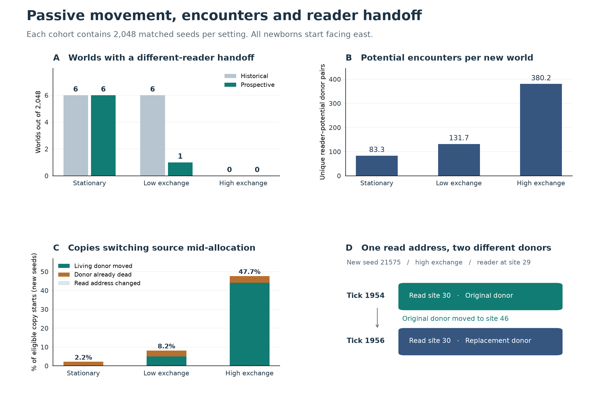

# Does passive movement help a new reader take over?

Among 2,048 new matched seeds, a different individual copied a newly produced template in six stationary worlds, one low-exchange world and zero high-exchange worlds. High exchange increased potential reader–donor encounters from 83.3 to 380.2 per world. In that arm, 2,079 of 4,362 allocations that began copying a living, genetically different donor switched source on a later successful read. In 1,920 of these switches the reader used the same address while its original donor was still alive elsewhere. [Primary protocol](protocol.md) · [Switch attribution protocol](switch-audit.md)



## Handoff in natural fields

The first birth qualifies when an executor copies six aligned, unchanged bytes from one different living individual whose sequence differs from its own. The newborn can then serve as a template. Handoff requires another executor, distinct from both the newborn and its maker, to produce a further exact birth from that living newborn. The two executors can have identical genomes. They must have different birth identities. The primary denominator includes all worlds, even those without a first qualifying birth. Each seed runs under stationary, low and high exchange with the same initial conditions. [Every field, including hashes and population outcomes](results/fields.tsv) · [Field-level endpoints](results/endpoints.tsv)

| Cohort and arm | First qualifying births | Newborns followed through death | Worlds with a handoff / 2,048 | Newborns handed off after maker death | Newborns reused by their maker |
| --- | ---: | ---: | ---: | ---: | ---: |
| Historical stationary | 3,161 | 3,031 | 6 | 4 | 0 |
| Historical low | 2,834 | 2,713 | 6 | 4 | 3 |
| Historical high | 1,448 | 1,386 | 0 | 0 | 1 |
| Prospective stationary | 3,193 | 3,061 | 6 | 3 | 0 |
| Prospective low | 3,021 | 2,920 | 1 | 0 | 0 |
| Prospective high | 1,538 | 1,476 | 0 | 0 | 1 |

In each cohort, every positive world had one distinct newborn handed off at least once. A newborn could supply several births. Among the new seeds, the six stationary cases supplied nine births to different executors. The low-exchange case supplied one. It was a six-zero-byte template in seed 22528. A second executor read it on ticks 165 through 175 and produced an exact copy at tick 177, the original maker's death tick. Its template function follows from the byte trace. The program contains no reserve, copy or divide instruction. [All onward births, read sites and read ticks](results/links.tsv) · [All initial products](results/products.tsv)

For new seeds, high exchange lost six positive worlds and gained zero relative to stationary. The paired difference was −2.93 handoff worlds per 1,000 (approximate 95% interval −5.27 to −0.59, exact two-sided paired p = 0.03125). Low exchange lost five and gained zero with one shared positive world (−2.44 per 1,000, exact p = 0.0625). Historically, low exchange gained six and lost six. Across both cohorts, its difference was −1.22 per 1,000 (approximate interval −3.19 to +0.75). These sparse, unadjusted comparisons provide limited precision for the low setting. High exchange had zero observed handoff worlds in each cohort. [Paired contrasts including discordance counts](results/contrasts.tsv)

The conditional handoff frequencies in the new fields were 1.96, 0.34 and 0.00 per 1,000 fully observed newborns for stationary, low and high exchange. Restricting eligibility to births by tick 1886 leaves a full additional lifespan after donor death for an executor to finish. This gives five, one and zero new handoff worlds (high versus stationary exact p = 0.0625). None of the 608 newborns with an incomplete lifetime across both cohorts supplied an observed handoff. All 12,288 fields reached tick 2048 with births in their last 80 ticks, zero stagnant and zero extinct. [All denominators, follow-up windows and statuses](results/cohorts.tsv)

## What happened between byte reads?

A potential encounter counts a unique pair of an individual carrying S and an adjacent living individual with a different genome. Either can move and meet the other again. The encounter count deduplicates that pair for its lifetime. The switch analysis begins later, with an allocation whose first successful write used a byte from a genetically different living donor. It records the first subsequent successful write from a different identity or an inactive bank. A single allocation contributes at most one switch.

| New-seed copy allocations | Stationary | Low | High |
| --- | ---: | ---: | ---: |
| Qualifying starts | 4,611 | 4,661 | 4,362 |
| Any observed source switch | 101 (2.2%) | 380 (8.2%) | 2,079 (47.7%) |
| Same address, original donor alive elsewhere | 0 | 234 | 1,920 |
| Same address, original donor already dead | 101 | 145 | 159 |
| Read address changed | 0 | 1 | 0 |

In the high arm, 92.4% of observed switches and 44.0% of qualifying starts had a direct signature of displacement. In new seed 21575, the reader at site 29 used the donor occupying site 30 at tick 1954. Its next successful read at tick 1956 still addressed site 30. The original donor was alive at site 46, and a different living individual occupied site 30. A source change after donor death can also include an earlier move. Failed reads and departures reversed before the next successful write are outside the measurement. The audit spans all qualifying allocations and cannot assign individual missing handoffs to a specific displacement. [Every switch with both read addresses and donor location](results/switches.tsv) · [Switch counts in both cohorts](results/switch-summary.tsv)

With the previous targeted placement experiment, these observations distinguish two spatial effects. Placing a reader next to a template made some otherwise absent transfers possible. Continuing rapid exchange also moved living templates away from an address partway through copying. In this VM, bringing two programs together and keeping the same template readable for six writes are separate requirements. A direct follow-up would vary the timing of movement while controlling the number of exchange opportunities. [Paired reader placements](../contact-placement-01/README.md)

## Replay and verification

The primary protocol was committed at `caf654c` against `cde5beb`. Historical seeds are 19521–21568 and prospective seeds 21569–23616. The switch audit was frozen at `b38d0ea` after the primary comparisons. Both builds use the reference VM and the existing transport operator. The study-local observer patch records every exact external birth and first source switch and extends the accepted seed range. It retains the existing substrate settings, local fetch, neighbor read, first-free placement, 80-tick maximum age, 20,000 ppm copy substitution and east-facing R..CLD founder at site 36. After each tick the low and high arms select eligible matching edges at probabilities 1/64 and 16/64. Ownership of an allocation pins the executor during its copy. Incoming read pointers continue to address lattice sites. [Transport transitions and fixed-program controls](../spatial-transport-01/README.md)

All 6,144 historical field ledgers, final hashes and first qualifying birth records match the transport archive. All historical stationary onward links match the independent bearing study, including the six read ticks and sites. The observer tracks opening occupants by original birth site and tick, which travel through every exchange. Both optimization levels and opposite traversal orders reproduce all eight result tables byte for byte. The switch audit preserved the original six primary tables. [Source and result checksums](revision.sha256)

From the repository root, use C++20, Make, patch, awk and Python 3.10 or newer. The figure uses NumPy and Matplotlib.

```sh
study=kernel/runs/transport-handoff-01
out=kernel/build/transport-handoff
replay=kernel/build/transport-handoff-replay
make -C kernel all test
make -C "$study" all test
python3 -B "$study/run.py" "$out/field" "$out/results"
python3 -B "$study/analyze.py" "$out/results"
diff -qr "$study/results" "$out/results"

make -C "$study" BUILD=../../build/transport-handoff-replay CXXFLAGS='-O3 -Wall -Wextra -Werror' all test
python3 -B "$study/run.py" "$replay/field" "$replay/results" --reverse
python3 -B "$study/analyze.py" "$replay/results"
diff -qr "$out/results" "$replay/results"
python3 -B "$study/plot.py" "$out/results" "$out/transport-handoff.png"
shasum -a 256 -c "$study/revision.sha256"
```
