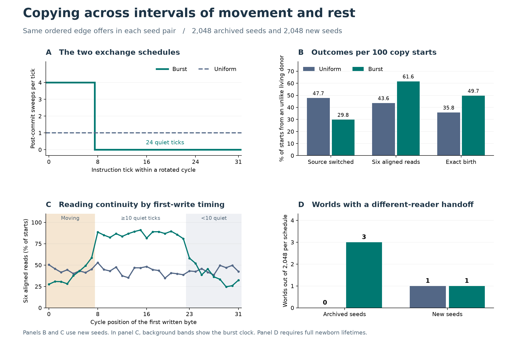

# Does a quiet interval help a digital template reach the next reader?

Giving the same exchange opportunities in bursts raised six-byte reading continuity from 43.6% to 61.6% in 2,048 new matched seeds. The burst worlds produced 2,246 intact copies from unlike living donors, compared with 1,515 under regular movement. Each schedule had one world in which a different individual went on to copy a fully observed newborn. The increase in initial copying was reproducible across cohorts. The change in reader handoff remains unresolved. [Frozen protocol](protocol.md) · [Paired contrasts](results/contrasts.tsv)



## What changed in the digital field

The uniform arm uses the previous high exchange rule. One instruction tick commits, then one sweep offers local exchanges across a sampled set of disjoint edges. The burst arm consumes the identical ordered sequence of sweeps for each seed. In a 32-tick cycle, it performs four sweeps after each of eight ticks followed by 24 ticks of rest. The cycle is rotated by a seed-specific offset. Every block of 32 instruction ticks receives the same 32 sweep draws in the same order in both arms. Multiple sweeps after one tick can move a mobile individual several times before it executes another instruction.

Both schedules offered exactly 33,550,942 edges over the new cohort. A bank holding a reservation, a reserved bank or two free banks can prevent a swap. This depends on the state when the offer arrives. The schedules therefore produced different numbers of actual movements. The pooled counts below include every new world. Encounter counts deduplicate a carrier of the neighbor-source instruction and a genetically different potential donor by birth identity over their lifetimes. [Per-seed budgets, realized swaps and edge digests](results/budgets.tsv) · [Full field ledgers and hashes](results/fields.tsv)

| New cohort | Uniform | Burst |
| --- | ---: | ---: |
| Offered edges | 33,550,942 | 33,550,942 |
| Accepted swaps | 14,537,611 | 14,863,396 |
| Individual steps | 28,524,377 | 29,110,846 |
| Potential encounters per world | 383.4 | 352.2 |
| Allocations starting from an unlike living donor | 4,237 | 4,523 |
| Source switched on a later successful read | 2,021 (47.7%) | 1,346 (29.8%) |
| Six aligned reads from the original living donor | 1,846 (43.6%) | 2,786 (61.6%) |
| Intact birth from the original living donor | 1,515 (35.8%) | 2,246 (49.7%) |

The last three percentages use all qualifying first writes in their own arm. Six aligned reads permit copy substitutions and can precede an unsuccessful division. An intact birth requires six unchanged bytes in the same allocation followed by committed division. The paired burst-minus-uniform difference for six aligned reads was +18.03 percentage points (approximate 95% interval +15.81 to +20.25). Source switching fell by 17.94 points (15.90 to 19.98). The gain in intact births was 0.357 per world (0.293 to 0.421). The corresponding archived-cohort differences were +18.45 points, −19.21 points and +0.288 births per world. The intervals use paired seed-level contributions to each arm's pooled estimate. [All cohort denominators](results/cohorts.tsv) · [Actual source-switch events](results/switches.tsv)

## Timing of the first byte

In a two-tick copy loop, the sixth write occurs ten ticks after the first. When the first byte was written with at least ten sweep-free post-commit ticks ahead, 1,877 of 2,172 burst starts (86.4%) read all six aligned bytes from one living template. The same phase positions in uniformly moving fields gave 854 of 1,989 (42.9%). Burst starts during the eight moving ticks completed six aligned reads in 411 of 1,074 allocations (38.3%). Starts in the final nine quiet ticks did so in 498 of 1,277 (39.0%). The assigned schedule is a controlled comparison. The time when an individual begins copying emerges during each run, so these within-schedule rates describe the timing of successful starts. [Per-world first-write phases](results/phases.tsv) · [Per-phase outcomes](results/phase-summary.tsv)

## Did a different reader take over?

The second transfer must begin from the living newborn and end in another exact birth. Its executor must differ in identity from both that newborn and its original maker. The primary analysis follows newborns born by tick 1967 through their entire age-limited lifetime. Each arm includes every seed, even worlds producing zero qualifying newborns. [All traced products](results/products.tsv) · [All onward links](results/links.tsv)

| Seed cohort and schedule | Fully followed newborns | Reused by original maker | Worlds with a different-reader handoff | Worlds with a handoff starting after maker death |
| --- | ---: | ---: | ---: | ---: |
| Archived uniform | 1,476 | 1 | 0 | 0 |
| Archived burst | 2,050 | 5 | 3 | 1 |
| New uniform | 1,455 | 2 | 1 | 1 |
| New burst | 2,173 | 9 | 1 | 1 |

The positive new worlds had different seeds. The uniform case occurred in seed 25246 and the burst case in seed 25572. Both supplied R..CLD after their makers died. The paired new-cohort difference was 0.00 per 1,000 worlds (one gained and one lost, exact two-sided p = 1). The historical comparison had three gains and zero losses (p = 0.25). Across 4,096 matched seeds there were four burst-only and one uniform-only handoff worlds, a difference of +0.73 per 1,000 (approximate 95% interval −0.34 to +1.80, exact p = 0.375). The archived zero for uniform has a one-sided exact 95% upper bound of 1.46 per 1,000 under independent seed sampling. Handoff under uniform high exchange was observed in the new sample. [All per-world endpoints](results/endpoints.tsv)

Requiring birth by tick 1886 reserves an additional full lifespan after donor death for division to finish. All five primary handoff worlds retained their classifications. Late-born templates were counted separately. In new burst seed 24697, a template born at tick 1990 supplied six bytes at ticks 2010–2020 to a different executor and division committed at tick 2022. The birth is confirmed. The tick-2048 cutoff preceded the template's age death, so it appears in the incomplete-window ledger. Across both cohorts the uniform and burst arms had 122 and 151 incomplete newborn lifetimes respectively. This was the sole handoff among them. All 8,192 fields were reproducing at tick 2048, with zero stagnant and zero extinct.

## Reproduction and checks

The rules and seed ranges were frozen at commit `177140f`, against `6d3912e`. Seeds 21569–23616 reproduce the previous uniform high-exchange fields. Seeds 23617–25664 form the new cohort. Every field runs for 2,048 instruction ticks on the 16 × 4 torus from one east-facing R..CLD at site 36. The observer uses neighbor reads, local fetch, first-free placement, retained bytes, maximum age 80 and 20,000 ppm copy substitution. No extra instruction, mutation or aging step runs between sweeps. Incoming pointers remain attached to addresses. The reference kernel supplies the VM and the existing exchange primitive enforces mobility restrictions. [Earlier transport and handoff study](../transport-handoff-01/README.md)

The canonical digest folds each sweep's matching identity and sampled edge mask in sweep order, before occupancy is taken into account. All 4,096 pairs match on digest, offered count, sweep count and phase offset. A mutation-free parked-program control compares the uniform state and moving identities against the original transport routine every tick, and compares both schedules after each 32-tick block. The archived uniform field, birth, switch and handoff ledgers match the earlier experiment. The two separately optimized builds reproduce all ten result tables under opposite traversal orders. [Source and result checksums](revision.sha256)

From the repository root, use C++20, Make, awk, patch and Python 3.10 or newer. The PNG also uses Matplotlib and NumPy.

```sh
study=kernel/runs/transport-timing-01
out=kernel/build/transport-timing
replay=kernel/build/transport-timing-replay
make -C kernel all test
make -C "$study" all test
python3 -B "$study/simulate.py" "$out/field" "$out/results"
python3 -B "$study/summarize.py" "$out/results"
diff -qr "$study/results" "$out/results"

make -C "$study" BUILD=../../build/transport-timing-replay CXXFLAGS='-O3 -Wall -Wextra -Werror' all test
python3 -B "$study/simulate.py" "$replay/field" "$replay/results" --reverse
python3 -B "$study/summarize.py" "$replay/results"
diff -qr "$out/results" "$replay/results"
python3 -B "$study/plot.py" "$out/results" "$out/transport-timing.png"
shasum -a 256 -c "$study/revision.sha256"
```
